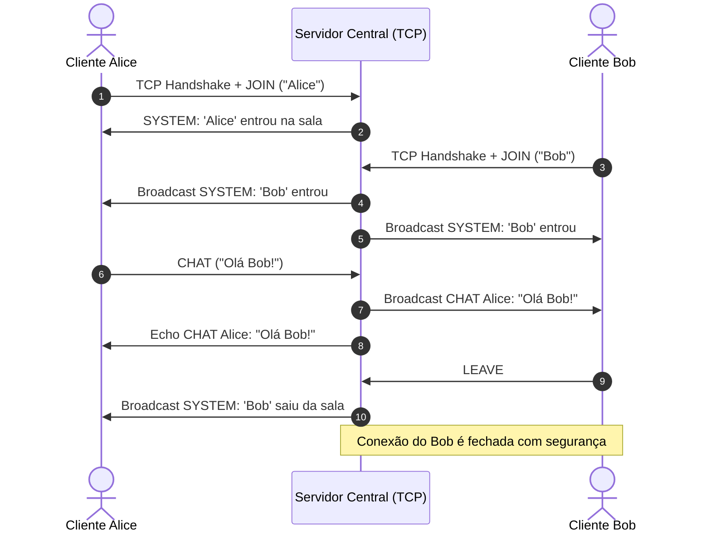

# 💬 Exemplo 01: Chat Room Multiusuário em Tempo Real

> Demonstração prática do padrão **Cliente-Servidor sobre TCP Sockets**, gerenciando conexões simultâneas, difusão de mensagens (*broadcast*) e isolamento de falhas de desconexão.

---

## 🎯 1. Cenário do Dia a Dia

Imagine um sistema de suporte ao cliente ou um canal de mensagens corporativo (como Slack ou Discord). Múltiplos operadores e clientes precisam conversar simultaneamente. Quando uma pessoa envia uma mensagem, o servidor deve retransmiti-la imediatamente a todos os demais participantes da sala sem travar nem expor a conexão de um participante aos outros.

---

## 💡 2. Justificativa Arquitetural

Por que a arquitetura Cliente-Servidor é a escolha correta aqui?
- **Ponto Central de Coordenação**: Sem um servidor, os clientes precisariam de uma malha ponto-a-ponto (*P2P mesh*), o que geraria complexidade absurda com firewalls (NAT traversal) e sincronização de estado.
- **Autoridade e Segurança**: O servidor valida quem pode entrar, formata os eventos do sistema e garante que mensagens malformadas não atinjam outros usuários.
- **Desacoplamento entre Clientes**: O cliente da Alice não sabe o IP ou porta do Bob; ambos só conhecem o endereço do servidor.

---

## 📊 3. Diagrama de Sequência (Mermaid)



---

## 📁 4. Estrutura dos Arquivos

```text
01-chat-room-socket/
├── README.md       # Esta documentação
├── protocol.py     # Contrato de dados e protocolo de enquadramento (JSON + \n)
├── server.py       # Servidor multithreaded com broadcast seguro
├── client.py       # Cliente TCP com recepção assíncrona via callback
└── main.py         # Orquestrador executável da demonstração
```

---

## 🧼 5. Princípios de Clean Code & SOLID Aplicados

- **Protocolo de Enquadramento (`protocol.py`)**: Sockets TCP entregam um fluxo contínuo de bytes (*stream*), não mensagens discretas. O uso de `\n` como delimitador e uma classe imutável `@dataclass(frozen=True)` com serialização/desserialização isola as regras do protocolo da lógica de rede.
- **Single Responsibility Principle (SRP)**:
  - `protocol.py`: Responsável apenas pelo formato e validação dos dados.
  - `server.py`: Responsável por aceitar conexões e despachar pacotes.
  - `client.py`: Responsável por gerenciar a conexão do usuário e disparar callbacks.
- **Fail-Safe & Resource Cleanup**: Toda conexão fecha sockets no bloco `finally`, prevenindo vazamento de descritores de arquivo (*file descriptors leak*).

---

## ⚖️ 6. Trade-offs

| Vantagem | Custo / Limitação |
|---|---|
| Latência ultrabaixa com TCP persistente | Custo de manter uma thread por conexão (`Thread-per-client`). Em produção para milhares de conexões, um loop assíncrono com `asyncio` ou `epoll` é preferível. |
| Simplicidade de implementação e leitura | Se o servidor cair, todos os chats são desconectados imediatamente (ponto único de falha). |

---

## 🚀 7. Como Executar

```bash
# A partir desta pasta:
python3 main.py
```
