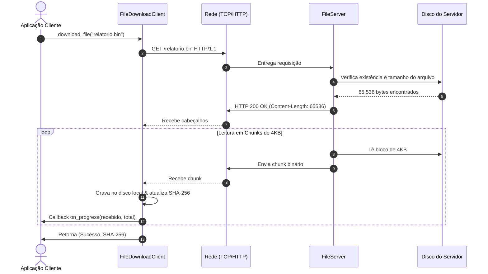

# 📦 Exemplo 02: Download e Transferência de Arquivos em Streaming

> Demonstração prática da transferência de arquivos binários entre Cliente e Servidor via **HTTP Streaming em Chunks**, mitigando esgotamento de memória RAM (*Out of Memory*) e garantindo integridade via hashing SHA-256.

---

## 🎯 1. Cenário do Dia a Dia

Em qualquer plataforma web ou corporativa (como Google Drive, Dropbox, ou um sistema que exporta relatórios financeiros pesados), transferir um arquivo de 500 MB ou 10 GB carregando-o por inteiro na memória RAM de uma só vez derrubaria o servidor. 

A solução clássica de arquitetura cliente-servidor é o **streaming em blocos fixos (chunks)**: o servidor lê pequenos pedaços do disco e despacha imediatamente para a placa de rede; o cliente lê esses pedaços, atualiza o progresso visual do usuário e grava incrementalmente no disco local.

---

## 💡 2. Justificativa Arquitetural

- **Uso Estável de Memória (O(1) Memory Footprint)**: Não importa se o arquivo tem 10 KB ou 10 GB, a aplicação mantém um buffer fixo em memória (ex: 4 KB ou 64 KB).
- **Feedback de Progresso em Tempo Real**: Conhecendo o cabeçalho `Content-Length` prévio, o cliente consegue calcular a porcentagem exata transferida em tempo real.
- **Proteção contra Directory Traversal**: O servidor valida a normalização dos caminhos (`os.path.abspath`), impedindo que clientes maliciosos solicitem `/../../etc/passwd`.

---

## 📊 3. Diagrama de Sequência (Mermaid)



---

## 📁 4. Estrutura dos Arquivos

```text
02-rest-file-downloader/
├── README.md       # Esta documentação
├── protocol.py     # Parser e serializador de cabeçalhos HTTP mínimos
├── server.py       # Servidor HTTP com streaming e proteção de traversal
├── client.py       # Cliente de download com buffer, progresso e checksum
└── main.py         # Orquestrador com arquivo temporário e validação de hash
```

---

## 🧼 5. Princípios de Clean Code & SOLID Aplicados

- **Single Responsibility Principle (SRP)**:
  - `protocol.py`: Responsável exclusivamente pela especificação dos cabeçalhos HTTP.
  - `server.py`: Responsável por sanitizar o caminho do arquivo e gerenciar o streaming de envio.
  - `client.py`: Responsável por consumir a stream, notificar progresso e calcular o hash de integridade.
- **Interface Segregation**: O cliente recebe um callback opcional `on_progress: Callable[[int, int], None]`, permitindo ligar barras de progresso CLI ou GUI sem acoplamento a bibliotecas gráficas.
- **Defensive Programming**: Verificação explícita de `normalized_path.startswith(normalized_root)` para segurança contra ataques de travessia de diretório.

---

## ⚖️ 6. Trade-offs

| Vantagem | Custo / Limitação |
|---|---|
| Consumo constante de memória RAM | Maior quantidade de chamadas de sistema I/O (*syscalls* de `recv` e `send`). |
| Validação de integridade ponta a ponta | Necessidade de computar o hash durante a gravação local. |

---

## 🚀 7. Como Executar

```bash
# A partir desta pasta:
python3 main.py
```
