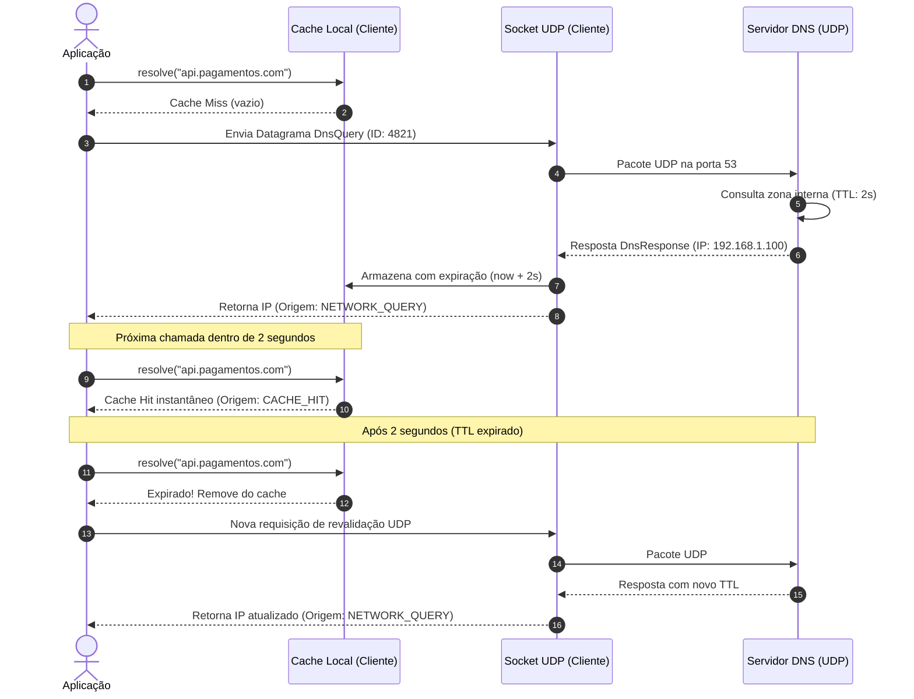

# 🌐 Exemplo 03: Resolução de Nomes com UDP e Cache por TTL

> Demonstração prática do padrão **Cliente-Servidor sobre UDP (User Datagram Protocol)**, evidenciando a ausência de estado de conexão e o uso de **Cache com Time-To-Live (TTL)** no cliente para mitigar tráfego de rede.

---

## 🎯 1. Cenário do Dia a Dia

Sempre que sua aplicação faz uma chamada para `https://api.stripe.com` ou acessa um banco em nuvem, o sistema operacional e a biblioteca HTTP precisam traduzir esse nome textual para um endereço IP numérico (`192.0.2.1`).

Se o cliente fizesse uma conexão TCP completa com um servidor DNS para cada consulta, a latência de handshake seria intolerável. Por isso, a internet utiliza **UDP**: o cliente "dispara" um datagrama atômico e o servidor responde diretamente. Para evitar sobrecarregar os servidores DNS, o cliente guarda a resposta em um **cache local** até que o TTL expire.

---

## 💡 2. Justificativa Arquitetural

- **Datagramas UDP vs Streams TCP**: UDP não possui handshake de 3 vias (*three-way handshake*) nem encerramento de conexão. Para consultas pequenas de pergunta-e-resposta única, o custo de rede é mínimo.
- **Cache Local no Cliente (Client-Side Caching)**: Reduz a latência de centenas de milissegundos para 0ms após a primeira consulta e protege o servidor contra tempestades de requisições (*request storms*).
- **Time-To-Live (TTL)**: Permite que os administradores do servidor alterem o IP de um serviço sem que os clientes fiquem eternamente presos ao IP antigo.

---

## 📊 3. Diagrama de Sequência (Mermaid)



---

## 📁 4. Estrutura dos Arquivos

```text
03-dns-name-resolver/
├── README.md       # Esta documentação
├── protocol.py     # Definição de DnsQuery e DnsResponse serializados em JSON
├── server.py       # Servidor UDP autoritativo com tabela de registros de zona
├── client.py       # Cliente UDP com cache em memória e invalidação por TTL
└── main.py         # Orquestrador com demonstração de cache hit e expiração
```

---

## 🧼 5. Princípios de Clean Code & SOLID Aplicados

- **Protocol & Imutabilidade**: Estruturas de dados `DnsQuery` e `DnsResponse` são `@dataclass(frozen=True)`, impedindo alterações indevidas de payload durante o ciclo de envio.
- **Single Responsibility Principle (SRP)**:
  - `CacheEntry`: Cuida apenas da verificação de validade temporal (`is_expired`).
  - `DnsClient`: Coordena a estratégia entre consulta em cache e fallback de rede.
  - `DnsServer`: Isola o recebimento de datagramas e resolução de zonas.
- **Idempotência e IDs de Correlação**: Toda requisição carrega um `query_id` numérico, garantindo que o cliente associe com segurança a resposta recebida à pergunta enviada, prevenindo pacotes duplicados ou fora de ordem comuns em UDP.

---

## ⚖️ 6. Trade-offs

| Vantagem | Custo / Limitação |
|---|---|
| Latência ultrabaixa sem custos de conexão prévia | Pacotes UDP podem ser perdidos silenciosamente pela rede sem retransmissão automática do SO (necessário timeout no cliente). |
| Alta capacidade de escala do servidor | Mensagens UDP devem ser pequenas (geralmente menores que 512 bytes) para evitar fragmentação de pacotes IP. |

---

## 🚀 7. Como Executar

```bash
# A partir desta pasta:
python3 main.py
```
