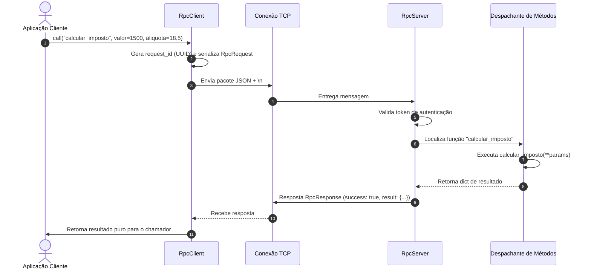

# ⚡ Exemplo 04: Chamada de Procedimento Remoto (Mini JSON-RPC)

> Demonstração prática do padrão **RPC (Remote Procedure Call)** sobre Cliente-Servidor TCP, permitindo que a aplicação cliente execute funções na máquina servidora com transparência sintática, autorização por token e tratamento seguro de exceções remotas.

---

## 🎯 1. Cenário do Dia a Dia

Em arquiteturas orientadas a serviços, nós distribuídos precisam coordenar ações (por exemplo, um serviço de Checkout invocando um motor de cálculo de impostos ou análise fiscal em outro nó de infraestrutura).

Ao invés de modelar rotas REST com verbos HTTP para cada cálculo, padrões RPC (como gRPC ou JSON-RPC) permitem que o cliente envie o nome do método (`calcular_imposto`) e os parâmetros em formato serializado, recebendo o resultado de volta como se estivesse executando uma função local.

---

## 💡 2. Justificativa Arquitetural

- **Transparência e Ergonomia**: O cliente oculta os detalhes de sockets e serialização através do método `client.call("nome_metodo", **kwargs)`.
- **Despachante Dinâmico (*Dispatcher Pattern*)**: O servidor registra funções Python de forma desacoplada (`server.register_method(...)`) sem precisar de um bloco gigantesco de `if/else`.
- **Encapsulamento de Exceções**: Se o método no servidor lançar uma divisão por zero ou erro de banco, o servidor não quebra; ele empacota a mensagem de erro no payload JSON e o cliente converte isso em uma `RemoteProcedureError` local.

---

## 📊 3. Diagrama de Sequência (Mermaid)



---

## 📁 4. Estrutura dos Arquivos

```text
04-remote-shell-exec-rpc/
├── README.md       # Esta documentação
├── protocol.py     # Contrato RpcRequest e RpcResponse
├── server.py       # Servidor com registro de métodos e execução segura
├── client.py       # Cliente com encapsulamento de exceções remotas
└── main.py         # Demonstração executável de casos de sucesso e erros
```

---

## 🧼 5. Princípios de Clean Code & SOLID Aplicados

- **Open/Closed Principle (OCP)**: Novos procedimentos podem ser adicionados ao servidor via `server.register_method(...)` sem modificar o código do loop de rede ou do despachante.
- **Fail-Safe & Tratamento de Erros de Primeira Classe**: Exceções levantadas dentro do procedimento remoto são interceptadas com `try/except Exception`, capturando o nome da classe do erro e a mensagem, garantindo que o processo do servidor continue estável para outras conexões.
- **Dependency Inversion**: O cliente interage com a interface abstrata de chamada de método, sem se importar com a forma física como os dados são empacotados.

---

## ⚖️ 6. Trade-offs

| Vantagem | Custo / Limitação |
|---|---|
| Comunicação direta focada em ações e cálculos | Forte acoplamento ao contrato de parâmetros das funções remotas. |
| Altíssimo desempenho em relação a requisições HTTP REST genéricas | Dificuldade de caching em camadas intermediárias de rede (CDNs). |

---

## 🚀 7. Como Executar

```bash
# A partir desta pasta:
python3 main.py
```
