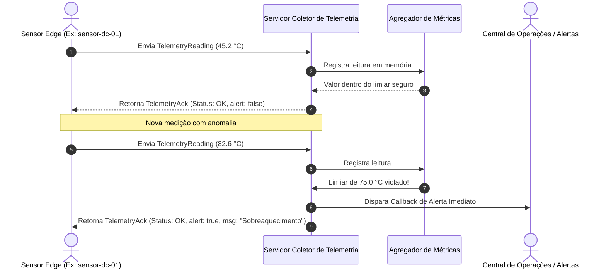

# 🌡️ Exemplo 05: Coletor de Telemetria de Sensores IoT

> Demonstração prática do padrão **Cliente-Servidor para Coleta de Telemetria (Push Model)**, onde nós de borda (*Edge Nodes*) com restrição de processamento enviam métricas periódicas para um servidor central encarregado de agregação estatística e detecção de anomalias.

---

## 🎯 1. Cenário do Dia a Dia

Em fábricas conectadas (Indústria 4.0), data centers e frotas de veículos, dezenas ou centenas de sensores (temperatura de racks, pressão de caldeiras, rotação de turbinas) precisam reportar seu status para uma central de operações.

O sensor em si possui hardware modesto (microcontrolador ou Raspberry Pi) e não possui capacidade para armazenar histórico nem rodar algoritmos estatísticos complexos. Ele apenas lê o sinal físico e despacha (*push*) a medição para o servidor central através de sockets de rede.

---

## 💡 2. Justificativa Arquitetural

- **Assimetria de Recursos**: O cliente precisa ser o mais enxuto possível (apenas medição e envio); o servidor central concentra poder computacional, armazenamento histórico e lógica de disparo de alertas.
- **Topologia Hub-and-Spoke**: Facilita a adição de novos sensores sem qualquer alteração na infraestrutura dos sensores existentes.
- **Feedback de ACK Imediato**: O servidor confirma a recepção e já pode alertar o próprio dispositivo se a medição ultrapassou parâmetros seguros (ex: permitindo que o sensor ative uma válvula de alívio emergencial).

---

## 📊 3. Diagrama de Sequência (Mermaid)



---

## 📁 4. Estrutura dos Arquivos

```text
05-sensor-telemetry-collector/
├── README.md       # Esta documentação
├── protocol.py     # Contratos imutáveis de TelemetryReading e TelemetryAck
├── server.py       # Coletor central com detecção de limiares e agregação
├── client.py       # Cliente sensor IoT com envio e interpretação de ACK
└── main.py         # Demonstração executável com simulação multissensor
```

---

## 🧼 5. Princípios de Clean Code & SOLID Aplicados

- **Single Responsibility Principle (SRP)**: O sensor só se preocupa em traduzir seu valor numérico em payload e despachar. O servidor central é quem orquestra regras de negócio sobre médias e anomalias.
- **Thread-Safety com Locks**: No servidor, o acesso ao dicionário compartilhado de medições é protegido por `threading.Lock()`, garantindo que múltiplos sensores enviando simultaneamente não causem condições de corrida (*race conditions*).
- **Callback Inversion**: O servidor recebe um callback desacoplado `on_alert` via injeção de dependência, permitindo acoplar sistemas de notificação como PagerDuty, Slack ou SMS sem poluir a lógica de rede.

---

## ⚖️ 6. Trade-offs

| Vantagem | Custo / Limitação |
|---|---|
| Clientes simples e de baixo consumo de energia | O servidor central precisa suportar alta concorrência de escritas (*write-heavy workload*). |
| Centralização total de métricas e regras de segurança | Se o servidor ficar offline, o sensor precisa de estratégia de fila local (*store-and-forward*) para não perder dados. |

---

## 🚀 7. Como Executar

```bash
# A partir desta pasta:
python3 main.py
```
