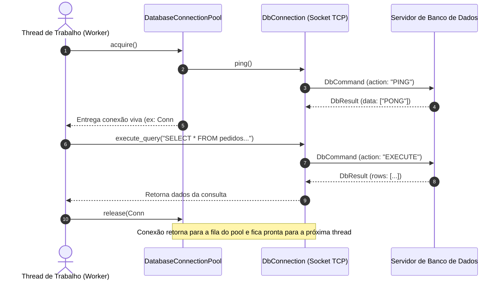

# 🗄️ Exemplo 06: Driver de Banco de Dados com Connection Pooling e Heartbeat

> Demonstração prática do padrão **Client-Side Connection Pool** sobre Cliente-Servidor TCP, ilustrando a reutilização thread-safe de conexões pré-estabelecidas, mitigação de sobrecarga de handshake de rede e validação ativa por *Heartbeat (Ping)*.

---

## 🎯 1. Cenário do Dia a Dia

Em servidores web ou APIs de alto tráfego (como FastAPI, Django, Spring ou Express), centenas de requisições por segundo precisam consultar o banco de dados relacional (PostgreSQL, MySQL).

Se a aplicação abrisse um socket TCP novo, realizasse o handshake de 3 vias e a autenticação a cada requisição, a latência dispararia e as portas efêmeras do sistema operacional se esgotariam (*TCP TIME_WAIT exhaustion*). 

A solução padrão da indústria é manter uma piscina de conexões vivas (**Connection Pool**) no cliente.

---

## 💡 2. Justificativa Arquitetural

- **Reutilização de Recursos Caros**: Abertura de sockets TCP e autenticação de sessões no banco são operações de alto custo computacional e de I/O.
- **Controle de Concorrência e Backpressure**: Ao fixar o tamanho do pool (ex: 3 conexões), o cliente impõe um limite natural de carga ao servidor de banco, evitando que 10.000 requisições simultâneas derrubem a máquina do banco de dados.
- **Resiliência via Heartbeat/Ping**: Antes de entregar a conexão alugada para a thread de trabalho, o pool dispara um comando leve de `PING`. Se a conexão caiu por timeout de firewall, ela é descartada e recriada imediatamente de forma transparente.

---

## 📊 3. Diagrama de Sequência (Mermaid)



---

## 📁 4. Estrutura dos Arquivos

```text
06-database-client-pool/
├── README.md       # Esta documentação
├── protocol.py     # Contratos DbCommand e DbResult (PING, EXECUTE, CLOSE)
├── server.py       # Servidor simulado com sessões persistentes
├── client.py       # Conexão unitária (DbConnection) com socket persistente
├── pool.py         # Gerenciador de Connection Pool thread-safe
└── main.py         # Demonstração executável com ThreadPoolExecutor
```

---

## 🧼 5. Princípios de Clean Code & SOLID Aplicados

- **Single Responsibility Principle (SRP)**:
  - `DbConnection`: Gerencia o socket TCP de uma única conexão física.
  - `DatabaseConnectionPool`: Gerencia a fila de aluguel e reciclagem de conexões.
  - `DatabaseServer`: Gerencia o recebimento de queries e resposta aos comandos.
- **Garantia de Liberação com Bloco `try/finally`**: No código cliente, a chamada `pool.release(conn)` é executada obrigatoriamente dentro do `finally`, garantindo que conexões nunca vazem mesmo se a query falhar.
- **Encapsulamento de Concorrência**: O uso de `queue.Queue` da biblioteca padrão do Python garante atomicidade no aluguel e devolução de conexões entre threads sem risco de duas threads compartilharem o mesmo socket simultaneamente.

---

## ⚖️ 6. Trade-offs

| Vantagem | Custo / Limitação |
|---|---|
| Latência quase zero para início de consultas (conexões pré-aquecidas) | Memória alocada continuamente no servidor para manter os sockets abertos (*idle connections*). |
| Protege o servidor de banco de saturação acidental | Threads de aplicação podem sofrer timeout se o pool for menor que a demanda sob picos extremos. |

---

## 🚀 7. Como Executar

```bash
# A partir desta pasta:
python3 main.py
```
