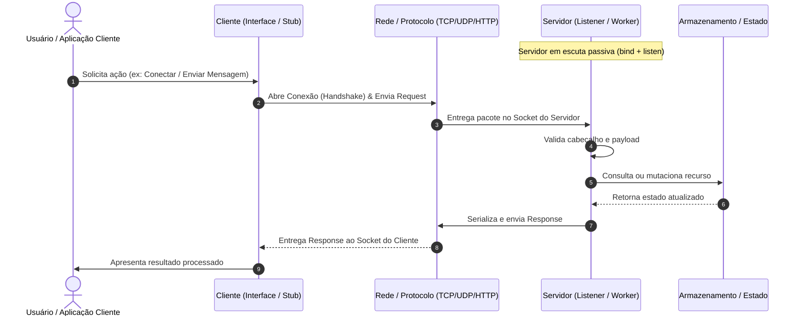

# 📡 Arquitetura Cliente-Servidor (Client-Server Architecture)

> O padrão arquitetural fundamental da computação distribuída em rede: separação clara entre fornecedores de recursos ou serviços (**Servidores**) e solicitantes de serviços (**Clientes**).

---

## 📖 1. O que é e Origem Histórica

A arquitetura **Cliente-Servidor (Client-Server)** surgiu entre o final dos anos 1970 e início dos anos 1980 (com pioneirismo no Xerox PARC e a padronização dos sockets BSD no Unix). Ela nasceu como uma evolução para romper com o modelo de *Mainframes centralizados* (onde terminais "burros" apenas exibiam dados processados em um único computador gigante).

No modelo Cliente-Servidor:
- O **Servidor** é um provedor de serviços com escuta passiva (*listening*), que gerencia recursos compartilhados (dados, capacidade de processamento, arquivos, autenticação).
- O **Cliente** é o agente ativo que inicia o contato através de uma rede, enviando uma solicitação (*request*) e aguardando uma resposta (*response*).
- O meio de comunicação é regido por um **protocolo de comunicação bem definido** (ex: TCP/IP, UDP, HTTP, WebSockets, gRPC).

---

## 📊 2. Diagrama Conceitual da Arquitetura (Mermaid)

---

## 🔒 3. Regras Invariantes (O que NUNCA fazer)

1. **O Servidor NUNCA deve depender do Cliente para existir**: O servidor deve ser autônomo, tolerante a quedas repentinas de clientes e manter sua integridade mesmo se 100% dos clientes desconectarem.
2. **O Cliente NUNCA deve ter acesso direto ao estado/armazenamento do Servidor**: Toda manipulação de recursos deve passar pela camada de protocolo e validação do servidor. O cliente só conhece a interface pública do protocolo.
3. **Protocolo Explícito e Tipado**: Clientes e servidores devem concordar estritamente sobre a estrutura da mensagem (tamanho de cabeçalho, serialização JSON/Binário, delimitadores de linha).
4. **Isolamento de Conexões**: Uma falha ou exceção não tratada na conexão de um cliente específico nunca pode derrubar o processo do servidor ou afetar outros clientes conectados.

---

## ⚖️ 4. Vantagens e Trade-offs Reais

### Vantagens
- **Centralização de Regras e Dados**: Políticas de segurança, integridade de dados e auditoria ficam centralizadas no servidor.
- **Heterogeneidade de Plataformas**: Um servidor em Python pode atender simultaneamente clientes em Flutter (mobile), React (web), CLI em Go ou sensores em C++.
- **Evolução Independente**: O cliente pode atualizar sua interface visual sem alterar a lógica de dados do servidor, desde que o protocolo seja preservado.

### Desvantagens e Trade-offs
- **Ponto Único de Falha (SPOF)**: Se o servidor cair, todos os clientes perdem o serviço, a menos que haja estratégias de redundância e balanceamento de carga.
- **Gargalo de Rede e Concorrência**: O servidor precisa gerenciar concorrência (threads, processos ou event-loop assíncrono com `asyncio`) para lidar com múltiplos clientes sem esgotar memória ou descritores de arquivos (*file descriptors*).
- **Latência de Comunicação**: Toda operação requer serialização, tráfego de rede e deserialização, adicionando latência em relação a operações em memória local.

---

## 🚦 5. Quando Usar vs Quando NÃO Usar

### Quando Usar
- Ferramentas CLI que conversam com daemons em background (ex: cliente Docker comunicando com `dockerd`).
- Aplicações de comunicação em tempo real (chat, mensagens P2P mediadas por servidor, jogos multiplayer).
- Coleta de telemetria distribuída (sensores IoT reportando para um gateway central).
- Serviços de arquivos, caches ou servidores de autenticação centralizada.

### Quando NÃO Usar
- Aplicações desktop/mobile puramente locais sem necessidade de sincronização ou dados compartilhados (utilize arquitetura em camadas local ou MVC).
- Algoritmos de computação pura de alto desempenho em um único nó (a sobrecarga de sockets adiciona latência inútil).

---

## 📁 6. Índice dos Exemplos Práticos

Cada pasta interna traz um exemplo real do dia a dia, auto-contido, com código limpo em Python 3 e documentação detalhada:

| Pasta | Cenário do Dia a Dia | Protocolo / Foco Técnico | Lição Arquitetural |
|---|---|---|---|
| [`01-chat-room-socket/`](./01-chat-room-socket/) | **Chat Multiusuário em Tempo Real** | TCP Socket com Threads e Broadcast | Como gerenciar múltiplos clientes concorrentes e tratar desconexões graciosamente. |
| [`02-rest-file-downloader/`](./02-rest-file-downloader/) | **Download/Upload de Arquivos com Chunking** | HTTP/TCP Streaming com Buffer | Transferência eficiente de dados binários em blocos sem esgotar a memória RAM. |
| [`03-dns-name-resolver/`](./03-dns-name-resolver/) | **Servidor de Resolução de Nomes com Cache** | UDP Datagrams com TTL e Invalidation | Baixa latência sem conexão prévia (UDP) e estratégia de cache local resiliente no cliente. |
| [`04-remote-shell-exec-rpc/`](./04-remote-shell-exec-rpc/) | **Execução Remota de Tarefas (Mini RPC)** | JSON-RPC sobre TCP com Tokens | Serialização de comandos, tratamento de erros no servidor e contrato de interface remota. |
| [`05-sensor-telemetry-collector/`](./05-sensor-telemetry-collector/) | **Coletor de Métricas de Sensores IoT** | Push de Telemetria com Agregação | Padrão onde múltiplos nós simples enviam dados periódicos para um nó central agregador. |
| [`06-database-client-pool/`](./06-database-client-pool/) | **Driver de Conexão com Connection Pool** | Keep-Alive, Pool de Sockets e Heartbeat | Padrão resiliente do lado do cliente para reuso de conexões e detecção de nós inativos. |

---

  Navegue pelas pastas acima para explorar a implementação de cada cenário.

