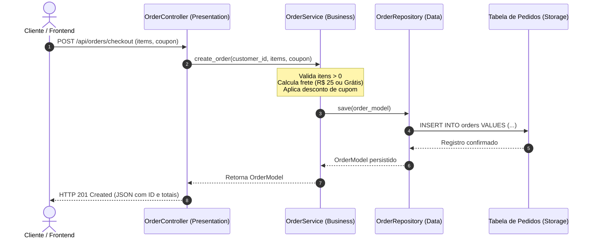

# 🛒 Exemplo 01: Gestão de Pedidos E-commerce (Arquitetura em Camadas)

> Implementação clássica da **Arquitetura em Camadas (3-Tier)** para um fluxo de Checkout e Pagamento de Pedidos, demonstrando a separação estrita de responsabilidades entre **Presentation**, **Business** e **Data**.

---

## 🎯 1. Cenário do Dia a Dia

Em uma loja virtual, quando um cliente finaliza uma compra:
1. A camada de apresentação recebe os dados brutos da requisição HTTP.
2. A camada de negócio calcula subtotais, valida se o carrinho não está vazio, confere regras de frete (ex: frete grátis para compras acima de R$ 200) e aplica cupons promocionais.
3. A camada de dados salva o pedido no banco relacional com status inicial `PENDING_PAYMENT`.

---

## 💡 2. Justificativa Arquitetural

- **Por que Camadas aqui?**
  - O fluxo é linear e predominantemente centrado em regras sequenciais sobre entidades persistidas.
  - O Controller HTTP não sabe como calcular frete nem cupons; se a empresa decidir criar uma interface CLI ou um consumidor de mensageria para criar pedidos, a camada `OrderService` será 100% reaproveitada sem alterações.
  - O repositório não valida regras de negócio; apenas persiste e recupera os dados.

---

## 📊 3. Diagrama de Sequência em Camadas (Mermaid)



---

## 📁 4. Estrutura dos Arquivos

```text
01-ecommerce-order-management/
├── README.md               # Esta documentação
├── main.py                 # Ponto de entrada e injeção das camadas
├── presentation/
│   └── controller.py       # Manipulação de requisições, status codes e formatação
├── business/
│   ├── service.py          # Regras de negócio, frete, cupons e validações
│   └── exceptions.py       # Exceções de domínio ricas
└── data/
    ├── models.py           # Modelos de dados relacionais
    └── repository.py       # Acesso e persistência em tabela
```

---

## 🧼 5. Princípios de Clean Code & SOLID Aplicados

- **Single Responsibility Principle (SRP)**: Cada camada cuida estritamente do seu papel. O Controller formata status code; o Service aplica regras; o Repository persiste.
- **Exceções de Domínio Ricas**: Ao invés de retornar strings de erro ou números mágicos, o serviço lança `InvalidOrderException` ou `CouponExpiredException`. O Controller faz o mapeamento para HTTP 400.
- **Inversão de Dependência Básica**: O serviço recebe o repositório em seu construtor (`dependency injection`), facilitando substituição por implementações de teste.

---

## ⚖️ 6. Trade-offs

| Vantagem | Custo / Limitação |
|---|---|
| Simplicidade absoluta de navegação e leitura do código | Mudanças no modelo de dados (`OrderModel`) refletem diretamente no Service. |
| Altíssima velocidade de entrega para CRUDs corporativos | Risco de *Architecture Sinkhole* caso existam consultas sem nenhuma regra de negócio. |

---

## 🚀 7. Como Executar

```bash
# A partir desta pasta:
python3 main.py
```
