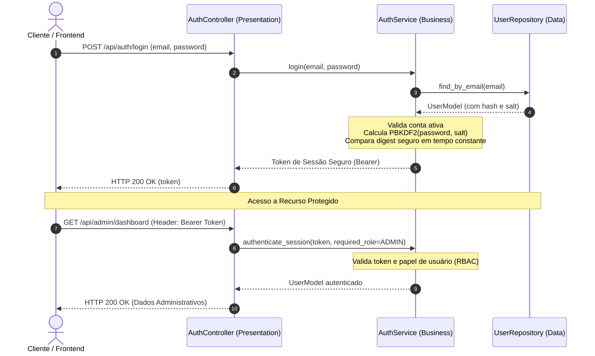

# 🔐 Exemplo 02: Autenticação de Usuários, Perfis e RBAC

> Implementação da **Arquitetura em Camadas** para segurança de acesso, cobrindo registro com salting PBKDF2, emissão de tokens de sessão e controle de acesso baseado em papéis (**RBAC**).

---

## 🎯 1. Cenário do Dia a Dia

Todo sistema corporativo (SaaS, ERP, CRM) precisa autenticar quem está acessando e restringir o que cada usuário pode fazer:
- Usuários comuns (`CUSTOMER`) têm acesso apenas às suas próprias contas.
- Administradores (`ADMIN`) podem visualizar painéis de auditoria e métricas globais.

A arquitetura em camadas permite que a lógica de criptografia e validação de tokens fique blindada no `AuthService`, enquanto o `AuthController` apenas repassa credenciais e filtra campos sensíveis da resposta HTTP.

---

## 💡 2. Justificativa Arquitetural

- **Não Vazamento de Dados Críticos (DTO Projection)**: O modelo de dados (`UserModel`) armazena `password_hash` e `salt`. A camada de Apresentação (`AuthController`) projeta um DTO seguro que remove esses campos antes de responder ao cliente.
- **Isolamento de Criptografia**: Se a empresa decidir migrar de PBKDF2 para Argon2 ou bcrypt, apenas a função interna do `AuthService` é alterada, sem impactar o `AuthController` ou o banco.

---

## 📊 3. Diagrama de Sequência em Camadas (Mermaid)



---

## 📁 4. Estrutura dos Arquivos

```text
02-user-auth-and-profiles/
├── README.md               # Esta documentação
├── main.py                 # Demonstração executável de login e bloqueio RBAC
├── presentation/
│   └── controller.py       # Endpoints de cadastro, login e rota protegida
├── business/
│   ├── service.py          # Hashing PBKDF2, geração de sessão e RBAC
│   └── exceptions.py       # Exceções de credenciais e autorização
└── data/
    ├── models.py           # Modelos de usuário e enum de Roles
    └── repository.py       # Repositório de busca e persistência
```

---

## 🧼 5. Princípios de Clean Code & SOLID Aplicados

- **Information Hiding**: Hashes e salts nunca ultrapassam a fronteira da camada de apresentação.
- **Timing Attack Prevention**: Uso de `secrets.compare_digest` para comparação de senhas em tempo constante, prevenindo vazamentos de tempo de execução.
- **Single Responsibility Principle**: O repositório apenas armazena e consulta usuários; ele não sabe nada sobre hashes criptográficos ou verificação de papéis.

---

## ⚖️ 6. Trade-offs

| Vantagem | Custo / Limitação |
|---|---|
| Controle centralizado de autenticação e perfis | Sessões em memória funcionam para um único nó; para cluster distribuído necessitaria de Redis ou JWT assinado. |
| Fácil integração com frameworks como FastAPI ou Django | Acoplamento moderado entre a entidade de usuário e a camada de serviço. |

---

## 🚀 7. Como Executar

```bash
# A partir desta pasta:
python3 main.py
```
