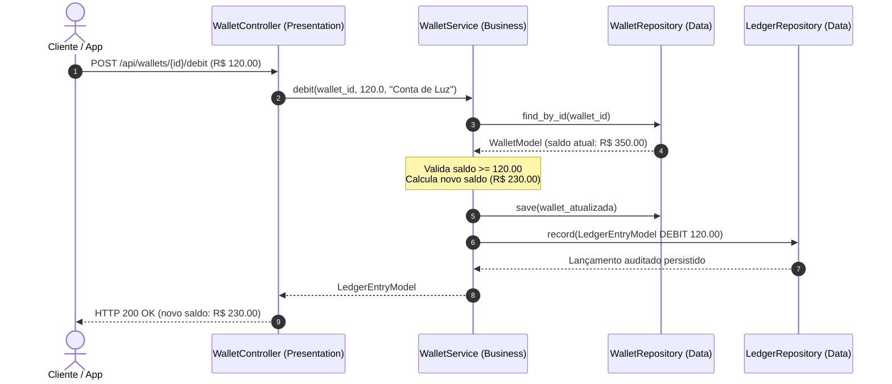

# 💳 Exemplo 03: Carteira Digital e Livro-Razão (Ledger) Financeiro

> Implementação da **Arquitetura em Camadas** para controle financeiro, demonstrando operações atômicas de crédito/débito, garantia de invariantes (saldo nunca negativo) e auditoria imutável via Livro-Razão (*Append-Only Ledger*).

---

## 🎯 1. Cenário do Dia a Dia

Em fintechs, carteiras digitais (como Mercado Pago, PicPay ou carteiras internas de e-commerce) não podem simplesmente atualizar um número solto no banco de dados. Cada transação requer:
1. Validação estrita de saldo disponível.
2. Atualização atômica do saldo da carteira.
3. Criação de um registro imutável no razão contábil (*Ledger Entry*) para fins de compliance e auditoria.

---

## 💡 2. Justificativa Arquitetural

- **Por que Camadas aqui?**
  - O `WalletService` encapsula a coordenação transacional entre duas tabelas distintas: a tabela de saldos (`WalletModel`) e a tabela de lançamentos contábeis (`LedgerEntryModel`).
  - O `WalletController` mapeia exceções financeiras para status codes HTTP precisos (`422 Unprocessable Entity` quando há saldo insuficiente, `404 Not Found` quando a carteira não existe).
  - A camada de dados protege a integridade física através de repositórios dedicados.

---

## 📊 3. Diagrama de Sequência em Camadas (Mermaid)



---

## 📁 4. Estrutura dos Arquivos

```text
03-financial-wallet-ledger/
├── README.md               # Esta documentação
├── main.py                 # Demonstração executável de transações e extrato
├── presentation/
│   └── controller.py       # Endpoints de carteira, depósito, saque e extrato
├── business/
│   ├── service.py          # Regras de saldo, crédito e débito atômico
│   └── exceptions.py       # Exceções financeiras específicas
└── data/
    ├── models.py           # Modelos de Wallet e LedgerEntry (imutável)
    └── repository.py       # Repositórios de persistência e append-only
```

---

## 🧼 5. Princípios de Clean Code & SOLID Aplicados

- **Imutabilidade Contábil**: A classe `LedgerEntryModel` é anotada com `@dataclass(frozen=True)`. Lançamentos contábeis nunca sofrem mutação após serem criados.
- **Fail-Fast**: O método `debit` valida se o valor é positivo e se o saldo é suficiente antes de invocar qualquer alteração no repositório.
- **Single Responsibility Principle**: O `WalletRepository` cuida do saldo atualizado, enquanto o `LedgerRepository` cuida da esteira histórica auditável.

---

## ⚖️ 6. Trade-offs

| Vantagem | Custo / Limitação |
|---|---|
| Rastreabilidade completa de cada centavo movimentado | Duplicidade controlada (saldo consolidado + soma do histórico). |
| Fácil de testar regras de saldo sem mockar conexões HTTP | Em escala maciça de escritas concorrentes, exige lock pessimista (`SELECT FOR UPDATE`) no banco de dados. |

---

## 🚀 7. Como Executar

```bash
# A partir desta pasta:
python3 main.py
```
