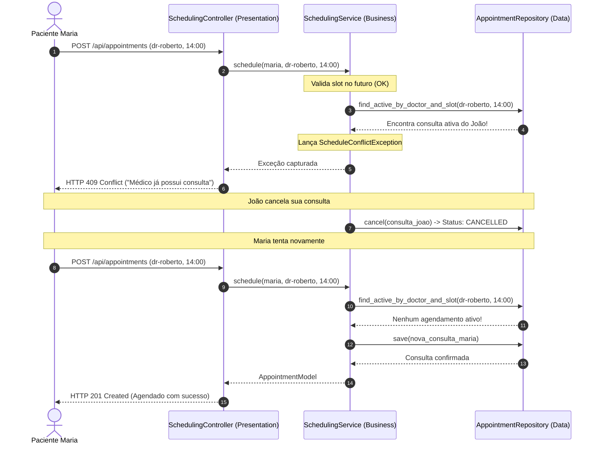

# 🏥 Exemplo 04: Agendamento de Consultas Médicas Hospitalares

> Implementação da **Arquitetura em Camadas** para o domínio de agendamento clínico, demonstrando validações temporais complexas, prevenção de conflitos de agenda simultânea e mapeamento para **HTTP 409 Conflict**.

---

## 🎯 1. Cenário do Dia a Dia

Em sistemas de gestão hospitalar (como MV, Tasy ou portais de telemedicina), o agendamento de consultas possui regras de concorrência estritas:
1. Um médico não pode atender dois pacientes no mesmo horário.
2. Um paciente não pode agendar duas consultas com médicos diferentes no mesmo instante.
3. Consultas não podem ser marcadas retroativamente em horários passados.
4. Ao cancelar uma consulta, o horário correspondente deve ficar imediatamente disponível para outros pacientes.

---

## 💡 2. Justificativa Arquitetural

- **Centralização de Regras Temporais**: A validação de datas e sobreposição de agendas reside exclusivamente no `SchedulingService`. 
- **Desacoplamento de Protocolo**: O `SchedulingController` traduz o `ScheduleConflictException` para o código HTTP padrão `409 Conflict`, mantendo a semântica clara para frontends ou integrações externas.
- **Consultas Especializadas no Repositório**: A camada de persistência expõe métodos expressivos como `find_active_by_doctor_and_slot` que buscam apenas agendamentos com status ativo (`SCHEDULED`), ignorando consultas canceladas.

---

## 📊 3. Diagrama de Sequência em Camadas (Mermaid)



---

## 📁 4. Estrutura dos Arquivos

```text
04-hospital-appointment-scheduling/
├── README.md               # Esta documentação
├── main.py                 # Demonstração executável de conflitos e liberação
├── presentation/
│   └── controller.py       # Endpoints de agendamento, cancelamento e 409 Conflict
├── business/
│   ├── service.py          # Regras de conflito médico, paciente e tempo
│   └── exceptions.py       # ScheduleConflictException, PastDateException
└── data/
    ├── models.py           # Modelos de AppointmentModel e status
    └── repository.py       # Consultas de slots ativos de agenda
```

---

## 🧼 5. Princípios de Clean Code & SOLID Aplicados

- **Semântica Temporal Clara**: Validação de datas utiliza ISO 8601 (`YYYY-MM-DDTHH:MM`), padronizando a comunicação entre camadas.
- **Single Responsibility Principle**: O repositório não decide se a sobreposição é um erro grave ou permitido; ele apenas informa se há registro ativo. O `SchedulingService` é o detentor da regra de negócio.
- **Fail-Fast**: A verificação de data no passado é realizada antes de qualquer consulta de rede ou banco, abortando operações inválidas no primeiro milissegundo.

---

## ⚖️ 6. Trade-offs

| Vantagem | Custo / Limitação |
|---|---|
| Domínio clínico blindado contra dupla marcação | Concorrência real de múltiplos cliques simultâneos no mesmo milissegundo exige índice único ou trava de banco. |
| Facilidade de expansão para novas especialidades | O modelo de dados está diretamente exposto entre a camada de dados e de negócio. |

---

## 🚀 7. Como Executar

```bash
# A partir desta pasta:
python3 main.py
```
