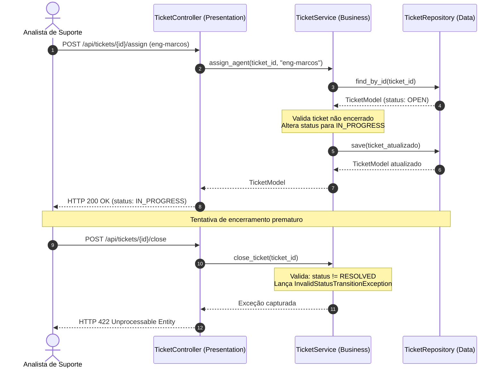

# 🎫 Exemplo 05: Sistema de Chamados de Suporte e SLA

> Implementação da **Arquitetura em Camadas** para gerenciamento de chamados técnicos (Help Desk), demonstrando **máquina de estados estrita** de tickets e matriz de cálculo de **SLA (Service Level Agreement)** na camada de negócio.

---

## 🎯 1. Cenário do Dia a Dia

Plataformas como Jira Service Management, Zendesk ou Freshdesk gerenciam incidentes reportados por clientes:
1. Um chamado crítico (*CRITICAL*) recebe SLA prioritário de 2 horas para resposta e resolução.
2. O ciclo de vida do chamado obedece a uma máquina de estados: `OPEN` -> `IN_PROGRESS` -> `RESOLVED` -> `CLOSED`.
3. Um analista não pode fechar um chamado sem antes registrá-lo como resolvido com notas técnicas.
4. Chamados encerrados (`CLOSED`) tornam-se imutáveis para garantir conformidade e histórico auditável.

---

## 💡 2. Justificativa Arquitetural

- **Garantia de Transições de Estado no Serviço**: A camada `TicketService` é o guardião das transições legais de status. O `TicketRepository` apenas persiste o objeto sem opinar sobre a legalidade da transição.
- **Isolamento da Matriz de SLA**: Mudanças nos acordos contratuais de SLA afetam exclusivamente a constante `SLA_MATRIX` dentro da camada de negócio, sem reverberar no banco ou nos controllers.
- **Tradução Semântica REST**: Erros de transição de estado disparam `InvalidStatusTransitionException`, que o `TicketController` converte para `HTTP 422 Unprocessable Entity`.

---

## 📊 3. Diagrama de Sequência em Camadas (Mermaid)



---

## 📁 4. Estrutura dos Arquivos

```text
05-support-ticket-system/
├── README.md               # Esta documentação
├── main.py                 # Demonstração do ciclo de vida e bloqueios
├── presentation/
│   └── controller.py       # Endpoints de tickets e mapeamento HTTP 422
├── business/
│   ├── service.py          # Máquina de estados, matriz de SLA e regras
│   └── exceptions.py       # Exceções de transição de estado e chamados fechados
└── data/
    ├── models.py           # Modelos de TicketModel e enums de prioridade/status
    └── repository.py       # Repositório de persistência e filtros
```

---

## 🧼 5. Princípios de Clean Code & SOLID Aplicados

- **Enums Fortemente Tipados**: O uso de `TicketPriority` e `TicketStatus` derivados de `str, Enum` elimina magic strings e erros de digitação em todas as camadas.
- **Fail-Fast com Guards**: O método auxiliar privado `_get_ticket_or_fail` centraliza a conferência de existência e lançamento de `TicketNotFoundException`.
- **Encapsulamento de Comportamento**: As regras sobre quando um ticket pode ser fechado pertencem ao `TicketService`, não permitindo que a camada de apresentação force estados ilegais.

---

## ⚖️ 6. Trade-offs

| Vantagem | Custo / Limitação |
|---|---|
| Regras de negócio e SLAs 100% centralizadas e fáceis de auditar | Em sistemas legados com dezenas de estados, a máquina de estados pode demandar o padrão *State* (GoF). |
| Totalmente desacoplado de bibliotecas web | Persistência em tabela única pode exigir índices compostos em bancos relacionais reais. |

---

## 🚀 7. Como Executar

```bash
# A partir desta pasta:
python3 main.py
```
