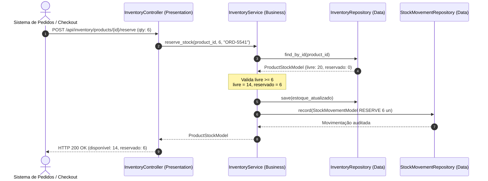

# 📦 Exemplo 06: Controle de Estoque e Armazém (WMS)

> Implementação da **Arquitetura em Camadas** para gerenciamento de estoque em armazéns físicos, demonstrando regras de segregação entre estoque disponível e reservado, auditoria de movimentações e alerta automático de ponto de reposição crítica (**Reorder Point**).

---

## 🎯 1. Cenário do Dia a Dia

Em sistemas de e-commerce e logística (WMS/ERP), controlar produtos envolve mais do que um saldo simples:
1. Quando um cliente coloca um item no carrinho e vai para o checkout, o produto precisa ser **reservado** para evitar que outros comprem o mesmo item (evitando *overselling*).
2. O estoque físico total é a soma de `available_qty + reserved_qty`.
3. Quando a doca de expedição despacha a caixa, a quantidade é abatida do saldo reservado e uma movimentação física (`DISPATCH`) é gravada.
4. Se o estoque total cair abaixo de um limite mínimo (`reorder_point`), o sistema dispara um alerta imediato para o time de suprimentos/compras emitir nova ordem aos fornecedores.

---

## 💡 2. Justificativa Arquitetural

- **Por que Camadas aqui?**
  - O cálculo da disponibilidade (`available vs reserved`) e a verificação do ponto de reposição são regras centrais de negócio geridas pelo `InventoryService`.
  - A persistência separa o estado consolidado atual (`ProductStockModel`) da esteira histórica de movimentações de armazém (`StockMovementModel`).
  - O `InventoryController` expõe uma interface REST limpa sem expor as minúcias de como os cálculos de estoque foram realizados.

---

## 📊 3. Diagrama de Sequência em Camadas (Mermaid)



---

## 📁 4. Estrutura dos Arquivos

```text
06-inventory-stock-tracking/
├── README.md               # Esta documentação
├── main.py                 # Demonstração executável de reserva, despacho e alerta
├── presentation/
│   └── controller.py       # Endpoints de produtos, reserva e despacho
├── business/
│   ├── service.py          # Regras de saldo livre, reserva e ponto de reposição
│   └── exceptions.py       # Exceções de falta de estoque e regras inválidas
└── data/
    ├── models.py           # Modelos de ProductStock e StockMovement
    └── repository.py       # Repositórios de estoque e histórico de movimentação
```

---

## 🧼 5. Princípios de Clean Code & SOLID Aplicados

- **Modelagem Expressiva**: A propriedade computada `@property def total_physical_qty` encapsula o cálculo do estoque real dentro do modelo, garantindo consistência sem repetição de lógica.
- **Auditoria Transacional**: Toda e qualquer alteração de saldo gera obrigatoriamente um registro no `StockMovementRepository`, viabilizando reconciliação contábil e inventário físico.
- **Separação de Preocupações**: A checagem de reabastecimento (`reorder_point`) não interrompe a operação de despacho, mas devolve uma flag booleana explícita para que a camada superior notifique os setores responsáveis.

---

## ⚖️ 6. Trade-offs

| Vantagem | Custo / Limitação |
|---|---|
| Controle rígido de armazém sem risco de venda de produtos inexistentes | Para armazéns gigantes com múltiplos CDs (Centros de Distribuição), a modelagem precisaria de uma camada adicional de nós geográficos. |
| Separação clara entre estoque livre para venda e estoque já comprometido | Requer disciplina para expirar reservas não pagas (jobs de release). |

---

## 🚀 7. Como Executar

```bash
# A partir desta pasta:
python3 main.py
```
