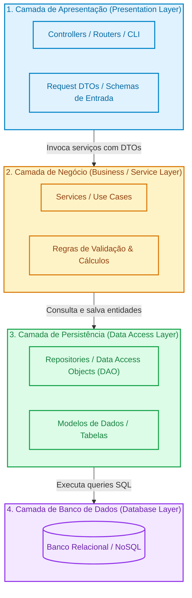

# 🍰 Arquitetura em Camadas (Layered Architecture / N-Tier)

> O padrão arquitetural mais difundido e adotado na indústria de software: organização do sistema em camadas horizontais especializadas com fluxo unidirecional de controle e responsabilidades estritas.

---

## 📖 1. O que é e Origem Histórica

A **Arquitetura em Camadas (Layered Architecture)**, historicamente conhecida como *N-Tier*, emergiu nos anos 1990 para superar as limitações das aplicações cliente-servidor monolíticas de 2 camadas (*two-tier*), onde as regras de negócio ficavam misturadas na interface visual ou em procedimentos armazenados (*Stored Procedures*) no banco de dados.

O padrão se consagrou na era dos sistemas corporativos (Java EE, .NET, Spring, Django) ao formalizar a separação clássica de 3 ou 4 camadas:
1. **Camada de Apresentação (*Presentation / Interface Layer*)**: Ponto de contato com o usuário ou chamador externo (Controllers HTTP, CLI, APIs REST). Não contém regras de negócio.
2. **Camada de Aplicação / Negócio (*Business / Service Layer*)**: O cérebro do sistema. Executa regras de validação, fluxos de orquestração de domínio, cálculos e cálculos fiscais.
3. **Camada de Acesso a Dados / Persistência (*Data Access / Persistence Layer*)**: Responsável por comunicar-se com o meio de armazenamento (banco de dados, arquivos, ORMs, repositórios).
4. **Camada de Banco de Dados (*Database Layer*)**: O armazenamento físico dos dados (PostgreSQL, MySQL, etc.).

---

## 📊 2. Diagrama Conceitual da Arquitetura (Mermaid)

---

## 🔒 3. Regras Invariantes (O que NUNCA fazer)

1. **Dependência Exclusivamente Unidirecional (Top-Down)**: Uma camada superior pode conhecer a camada imediatamente inferior. A camada inferior **NUNCA** pode importar, referenciar ou chamar a camada superior.
2. **Sem Pular Camadas em Camadas Fechadas (*Closed Layers*)**: A camada de Apresentação nunca deve acessar diretamente o Repositório ou disparar queries SQL pulando o Service. Todas as operações devem passar pela camada de Negócio.
3. **Isolamento de Responsabilidade**:
   - Controllers **não** calculam regras de negócio (apenas traduzem HTTP/CLI para chamadas de Service).
   - Repositórios **não** validam se o cliente tem saldo ou se a promoção é válida (apenas salvam, atualizam e recuperam registros).
4. **Tratamento de Exceções em Fronteiras**: Erros de banco de dados (ex: violação de constraint única) devem ser capturados e traduzidos na camada de serviço ou controller para mensagens compreensíveis de negócio, nunca vazando `psycopg2.OperationalError` para o cliente.

---

## ⚖️ 4. Vantagens e Trade-offs Reais

### Vantagens
- **Facilidade de Compreensão e Onboarding**: Todo desenvolvedor no mercado compreende imediatamente onde colocar um Controller, um Service e um Repository.
- **Separação Natural de Preocupações (SoC)**: Permite dividir trabalho entre especialistas de frontend/API e engenheiros de banco de dados.
- **Desenvolvimento Acelerado (Time-to-Market)**: Para MVPs e operações predominantemente CRUD, a velocidade de entrega é imbatível.

### Desvantagens e Trade-offs
- **Anti-Pattern de Duto Vazio (*Architecture Sinkhole Anti-Pattern*)**: Em operações CRUD simples, o Controller apenas repassa o objeto para o Service, que apenas repassa para o Repository sem nenhuma regra de negócio real, gerando código burocrático e passagens desnecessárias.
- **Forte Acoplamento ao Banco de Dados**: Na arquitetura em camadas tradicional, as camadas de cima costumam depender diretamente do modelo de dados da camada inferior. Mudanças no esquema da tabela frequentemente reverberam até o Controller.
- **Monólito Difícil de Dividir se mal isolado**: Camadas horizontais tornam o agrupamento por domínio (*bounded contexts*) mais difícil de enxergar com o crescimento do sistema.

---

## 🚦 5. Quando Usar vs Quando NÃO Usar

### Quando Usar
- Aplicações corporativas convencionais centradas em dados e operações CRUD.
- MVPs rápidos onde a prioridade é colocar o produto no ar com mínima curva de aprendizado para a equipe.
- Sistemas com regras de negócio diretas e fluxo linear de persistência.

### Quando NÃO Usar
- Sistemas de altíssima complexidade de regras de domínio que mudam frequentemente independentemente do banco (utilize *Clean Architecture* ou *Onion*).
- Pipelines de streaming de dados em tempo real ou processamento paralelo (utilize *Pipes and Filters* ou *Event-Driven*).

---

## 📁 6. Índice dos Exemplos Práticos

Cada pasta interna implementa as 3 camadas clássicas (**Presentation**, **Business/Service** e **Data/Repository**) com código limpo em Python 3:

| Pasta | Cenário do Dia a Dia | Regra Central de Negócio | Lição Arquitetural |
|---|---|---|---|
| [`01-ecommerce-order-management/`](./01-ecommerce-order-management/) | **Gestão de Pedidos E-commerce** | Cálculo de frete, cupons e estoque | Separação estrita entre Controller, OrderService e OrderRepository. |
| [`02-user-auth-and-profiles/`](./02-user-auth-and-profiles/) | **Autenticação e Perfis de Usuário** | Hashing seguro de senhas, roles e login | Tratamento de segurança e DTOs de entrada isolando modelos internos. |
| [`03-financial-wallet-ledger/`](./03-financial-wallet-ledger/) | **Carteira Digital e Extrato** | Crédito, débito atômico e extrato | Regras de saldo insuficiente e isolamento transacional no Service. |
| [`04-hospital-appointment-scheduling/`](./04-hospital-appointment-scheduling/) | **Agendamento de Consultas Médicas** | Conflito de horários do médico e cancelamento | Validações temporais de agenda médica mantidas exclusivamente no Service. |
| [`05-support-ticket-system/`](./05-support-ticket-system/) | **Sistema de Chamados de Suporte** | Máquina de estados de tickets e cálculo de SLA | Transições de status permitidas e regras de priorização em camadas. |
| [`06-inventory-stock-tracking/`](./06-inventory-stock-tracking/) | **Controle e Movimentação de Estoque** | Entradas, saídas e alerta de reposição | Auditoria de movimentações e integridade física de produtos. |

---

  Navegue pelas pastas acima para explorar a implementação de cada cenário.

