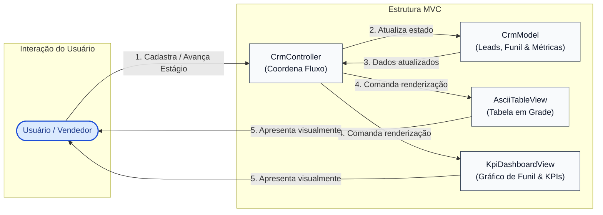

# 📈 Exemplo 01: CRM & Analytics Dashboard (Padrão MVC)

> Implementação canônica da **Arquitetura MVC (Model-View-Controller)** para um pipeline de vendas comercial, demonstrando a independência total entre as regras do funil de vendas (**Model**) e múltiplas formas de renderização visual (**Views** Operacional e Executiva).

---

## 🎯 1. Cenário do Dia a Dia

Em ferramentas de gestão comercial como Salesforce, HubSpot ou Pipedrive:
1. Vendedores e gerentes cadastram oportunidades (*leads*) com valores estimados e avançam seus estágios ao longo do funil de vendas (`PROSPECT -> QUALIFIED -> PROPOSAL -> CLOSED_WON / CLOSED_LOST`).
2. O time operacional precisa de uma visão detalhada em grade/tabela para listar e atualizar contatos.
3. A diretoria precisa de uma visão executiva agregada com taxa de conversão, receita total ganha, ticket médio e gráfico de barras do funil.

---

## 💡 2. Justificativa Arquitetural

- **Por que MVC aqui?**
  - **Reutilização de Modelo (1 Model, N Views)**: O `CrmModel` calcula as métricas puras (`calculate_metrics`) sem saber se o resultado será desenhado como uma tabela de caracteres, um gráfico de barras no terminal, uma página HTML ou um JSON de API REST.
  - **Controller Enxuto (Thin Controller)**: O `CrmController` apenas recebe os dados do usuário, delega a mutação para o `CrmModel` e aciona a `View` apropriada.
  - **View Passiva**: A `AsciiTableView` e a `KpiDashboardView` não alteram dados; apenas formatam números em moeda brasileira (`R$ 140.000,00`) e desenham barras gráficas (`████`).

---

## 📊 3. Diagrama Conceitual MVC (Mermaid)



---

## 📁 4. Estrutura dos Arquivos

```text
01-crm-dashboard-analytics/
├── README.md               # Esta documentação
├── main.py                 # Demonstração executável interativa
├── models/
│   └── crm_model.py        # Lead, LeadStage, cálculos estatísticos e regras de funil
├── views/
│   └── dashboard_view.py   # AsciiTableView e KpiDashboardView (renderização)
└── controllers/
    └── crm_controller.py   # Despacho de ações do usuário e seleção de View
```

---

## 🧼 5. Princípios de Clean Code & SOLID Aplicados

- **Single Responsibility Principle (SRP)**: O Model cuida da integridade do funil de vendas; as Views cuidam exclusivamente da formatação textual e alinhamento visual de colunas; o Controller conecta os dois.
- **Open/Closed Principle (OCP)**: Adicionar uma terceira visualização (ex: `ExportJsonView` ou `CsvView`) não requer qualquer alteração no `CrmModel`.
- **Formatação Centralizada**: A formatação de valores monetários e barras textuais fica isolada na camada visual, garantindo que o Model trabalhe com números reais de ponto flutuante (`float`) sem strings decoradas.

---

## ⚖️ 6. Trade-offs

| Vantagem | Custo / Limitação |
|---|---|
| Separação cristalina entre lógica analítica e apresentação | Para operações CRUD simples, pode parecer que o Controller é apenas um intermediário redundante. |
| Altíssima testabilidade unitária do `CrmModel` sem dependências visuais | O Controller precisa conhecer as Views disponíveis para coordenar a renderização. |

---

## 🚀 7. Como Executar

```bash
# A partir desta pasta:
python3 main.py
```
