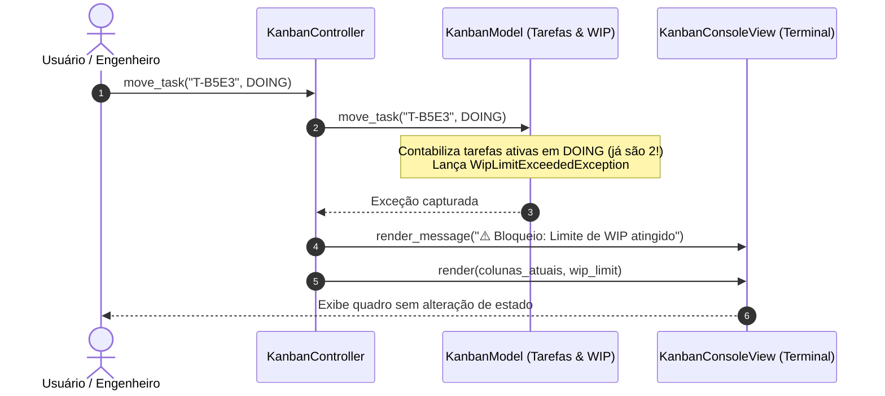

# 📋 Exemplo 02: Quadro Kanban Interativo com Limite de WIP

> Implementação da **Arquitetura MVC (Model-View-Controller)** para um quadro ágil de tarefas (estilo Trello/Jira), demonstrando renderização de colunas no terminal (**View**), regras de limitação de trabalho em progresso (**Model**) e coordenação de fluxo (**Controller**).

---

## 🎯 1. Cenário do Dia a Dia

Em metodologias ágeis (Kanban), equipes organizam tarefas em colunas (`A FAZER`, `EM PROGRESSO`, `CONCLUÍDO`). 

Um dos princípios fundamentais do Kanban é a **limitação de WIP (Work in Progress)**: um time não deve ter mais do que $N$ tarefas simultâneas em andamento (por exemplo, no máximo 2 tarefas em desenvolvimento ao mesmo tempo). Tentar puxar uma 3ª tarefa gera um bloqueio visual até que uma tarefa atual seja concluída.

---

## 💡 2. Justificativa Arquitetural

- **Por que MVC aqui?**
  - **Reatividade Visual**: Cada comando do usuário (adicionar tarefa, mover card) dispara a atualização do `KanbanModel`, e o `KanbanController` comanda a `KanbanConsoleView` para redesenhar o quadro com o novo estado.
  - **Regra de Negócio Isolada no Model**: A checagem de limite de WIP (`doing_wip_limit`) é realizada estritamente pelo `KanbanModel`. Se o limite for excedido, o Model lança `WipLimitExceededException` e o estado não é corrompido.
  - **View Especializada**: A `KanbanConsoleView` resolve o desafio puramente estético de alinhar caracteres de larguras diferentes em colunas horizontais (`| [TODO] | [DOING] | [DONE] |`).

---

## 📊 3. Diagrama Conceitual MVC (Mermaid)



---

## 📁 4. Estrutura dos Arquivos

```text
02-task-kanban-board/
├── README.md               # Esta documentação
├── main.py                 # Demonstração executável de criação, movimentação e WIP
├── models/
│   └── kanban_model.py     # KanbanTask, TaskColumn, regras de WIP e exceções
├── views/
│   └── kanban_view.py      # Desenho de colunas lado a lado no console
└── controllers/
    └── kanban_controller.py# Coordenação das ações e re-renderização
```

---

## 🧼 5. Princípios de Clean Code & SOLID Aplicados

- **Single Responsibility Principle (SRP)**: O Model gerencia o estado das listas e regras; a View cuida exclusivamente da diagramação de texto e truncamento de títulos (`_format_card`); o Controller comanda a orquestração.
- **Fail-Safe**: Erros de negócio não travam o processo; a mensagem amigável é exibida ao usuário através da View e o quadro permanece estável.
- **Enums Tipados**: `TaskColumn` e `TaskPriority` garantem integridade das colunas e ordenação.

---

## ⚖️ 6. Trade-offs

| Vantagem | Custo / Limitação |
|---|---|
| Interface visual auto-atualizada a cada comando | Toda operação exige redesenho do quadro completo (em interfaces Web complexas, exigiria Virtual DOM ou atualização cirúrgica de componentes). |
| Fácil substituição por uma View Web/HTML | O Controller fica responsável por coordenar quando chamar a View. |

---

## 🚀 7. Como Executar

```bash
# A partir desta pasta:
python3 main.py
```
