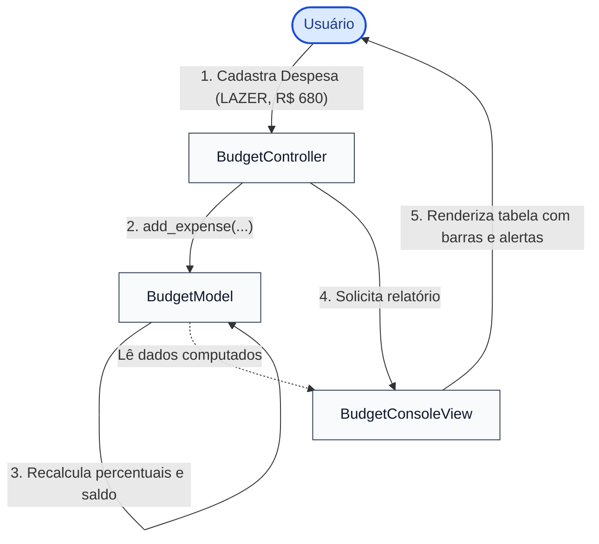

# 💰 Exemplo 03: Gestão Orçamentária Pessoal (Padrão MVC)

> Implementação da **Arquitetura MVC** para planejamento financeiro pessoal, demonstrando como o **Model** computa tetos, percentuais de despesas e excedentes, enquanto a **View** projeta barras de progresso visuais e alertas de orçamento estourado.

---

## 🎯 1. Cenário do Dia a Dia

Aplicativos de finanças pessoais (como Guiabolso, Mobills ou YNAB - *You Need A Budget*):
1. O usuário estipula uma renda mensal e tetos de gastos para cada categoria (`MORADIA`, `ALIMENTAÇÃO`, `TRANSPORTE`, `LAZER`, `SAÚDE`).
2. À medida que despesas são cadastradas, o sistema calcula o percentual consumido e o saldo restante.
3. Se os gastos ultrapassarem 100% do limite estipulado, o sistema sinaliza um alerta visual de estouro orçamentário.

---

## 💡 2. Justificativa Arquitetural

- **Por que MVC aqui?**
  - **Model Rico e Matemático**: O `BudgetModel` realiza os cálculos de consumo percentual, saldo restante e poupança líquida de forma agnóstica. Ele não precisa saber se o resultado será desenhado com barras de progresso `[██████░░░░]`, gráficos de pizza ou tabelas HTML.
  - **View com Formatação Específica**: A `BudgetConsoleView` converte números brutos em moeda brasileira formatada (`R$ 2.500,00`) e desenha a barra gráfica proporcional com caracteres Unicode.
  - **Controller Orquestrador**: O `BudgetController` expõe os métodos de comando da aplicação, recebendo entradas e comandando a renderização visual.

---

## 📊 3. Diagrama Conceitual MVC (Mermaid)



---

## 📁 4. Estrutura dos Arquivos

```text
03-personal-finance-budget/
├── README.md               # Esta documentação
├── main.py                 # Demonstração executável de limites e despesas
├── models/
│   └── budget_model.py     # Despesas, limites, resumos por categoria e saldo
├── views/
│   └── budget_view.py      # Renderização de barras de progresso e cartões de saldo
└── controllers/
    └── budget_controller.py# Coordenação das ações financeiras
```

---

## 🧼 5. Princípios de Clean Code & SOLID Aplicados

- **Single Responsibility Principle (SRP)**: O Model nunca gera strings de desenho de barra de progresso; a View nunca executa a subtração de saldo.
- **Value Objects & Imutabilidade**: A despesa `Expense` é imutável (`@dataclass(frozen=True)`), prevenindo adulteração acidental de valores após o lançamento.
- **Formatação Defensiva**: O método `_draw_bar` na View isola a lógica matemática de conversão percentual em blocos visuais (`fill = min(width, ...)`).

---

## ⚖️ 6. Trade-offs

| Vantagem | Custo / Limitação |
|---|---|
| Cálculos orçamentários facilmente testáveis sem depender de interface | Mudanças na estrutura de dados do resumo exigem ajustes na View correspondente. |
| Flexibilidade para plugar novas visualizações (Web/Mobile) | O Controller intermediário pode parecer simples demais para fluxos diretos. |

---

## 🚀 7. Como Executar

```bash
# A partir desta pasta:
python3 main.py
```
