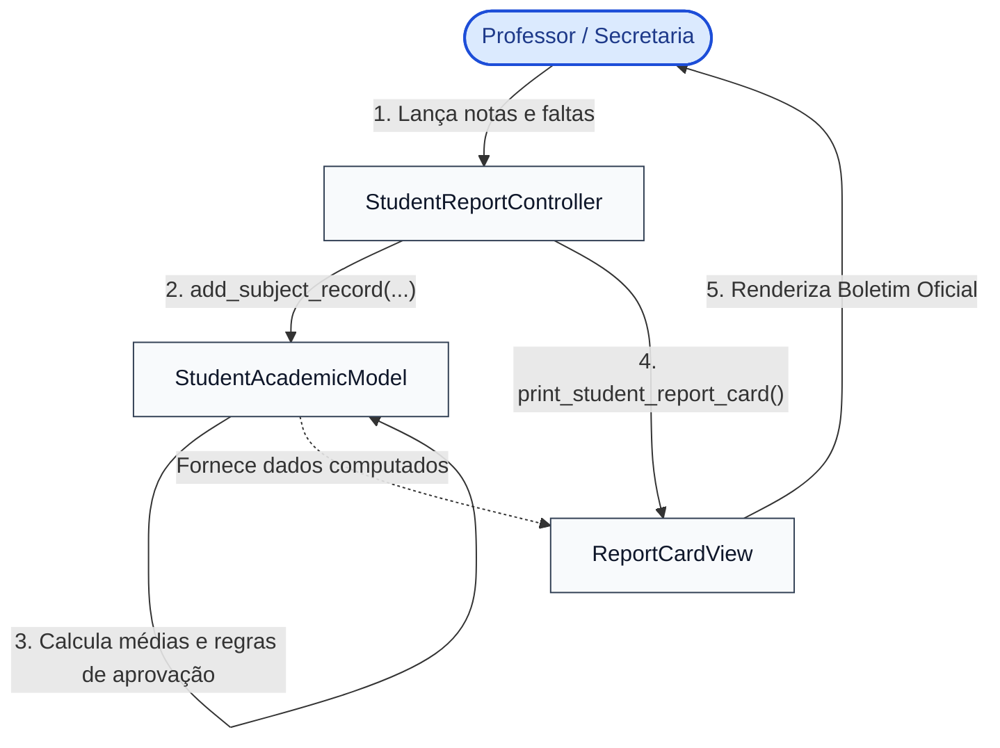

# 🎓 Exemplo 04: Boletim e Notas Escolares (Padrão MVC)

> Implementação da **Arquitetura MVC** para um sistema acadêmico escolar, demonstrando cálculo de médias bimestrais, regras estatutárias de frequência mínima (**Model**) e renderização diagramada do boletim escolar oficial (**View**).

---

## 🎯 1. Cenário do Dia a Dia

Em secretarias escolares e portais de estudantes (como SIGAA, Moodle ou Totvs Educacional):
1. Professores lançam notas bimestrais ($N1, N2, N3, N4$) e a frequência percentual dos alunos.
2. O sistema avalia regras estatutárias do Ministério da Educação (MEC):
   - Frequência abaixo de 75% resulta em reprovação automática por falta, independentemente da nota.
   - Média $\ge 7.0$ com frequência $\ge 75\%$ confere aprovação direta.
   - Média entre $5.0$ e $6.9$ encaminha para recuperação final.
   - Média $< 5.0$ resulta em reprovação direta por nota.
3. A secretaria e o aluno visualizam o boletim diagramado com todas as notas e a situação legal do ano letivo.

---

## 💡 2. Justificativa Arquitetural

- **Model Independente e Jurídico**: As regras pedagógicas e limites de aprovação residem em propriedades computadas (`@property def status`) dentro do `SubjectRecord`. Se a instituição mudar a média de corte de 7.0 para 6.0, apenas o Model é ajustado.
- **View com Formatação Tabular**: A `ReportCardView` cuida exclusivamente da estética do documento (alinhamento de colunas, cabeçalhos, separadores e formatação decimal com uma casa flutuante).
- **Controller de Lançamento**: O `StudentReportController` recebe os dados de notas de formulários ou planilhas e comanda a exibição.

---

## 📊 3. Diagrama Conceitual MVC (Mermaid)



---

## 📁 4. Estrutura dos Arquivos

```text
04-school-grades-report/
├── README.md                   # Esta documentação
├── main.py                     # Demonstração executável com aprovação, recuperação e faltas
├── models/
│   └── academic_model.py       # SubjectRecord, regras de corte e StudentAcademicModel
├── views/
│   └── report_card_view.py     # Renderização visual do boletim escolar
└── controllers/
    └── report_card_controller.py # Lançamento de notas e comando de emissão
```

---

## 🧼 5. Princípios de Clean Code & SOLID Aplicados

- **Propriedades Computadas Transparentes**: `final_average` e `status` são propriedades dinâmicas, eliminando campos desatualizados ou desincronizados no modelo.
- **Validações Pré-condicionais**: Validação estrita de número de notas (exatamente 4 bimestres), notas dentro do intervalo $[0.0, 10.0]$ e frequência em $[0\%, 100\%]$.
- **Enums Expressivos**: `AcademicStatus` descreve com precisão a razão da situação do aluno (`APROVADO`, `RECUPERAÇÃO`, `REPROVADO POR NOTA`, `REPROVADO POR FALTA`).

---

## ⚖️ 6. Trade-offs

| Vantagem | Custo / Limitação |
|---|---|
| Regras pedagógicas blindadas e testáveis isoladamente | Em escolas com centenas de turmas, o controller necessitaria de paginação e filtros adicionais na View. |
| Fácil geração de novos formatos de boletim (PDF, HTML) | O Controller acopla a chamada da View no método de impressão. |

---

## 🚀 7. Como Executar

```bash
# A partir desta pasta:
python3 main.py
```
