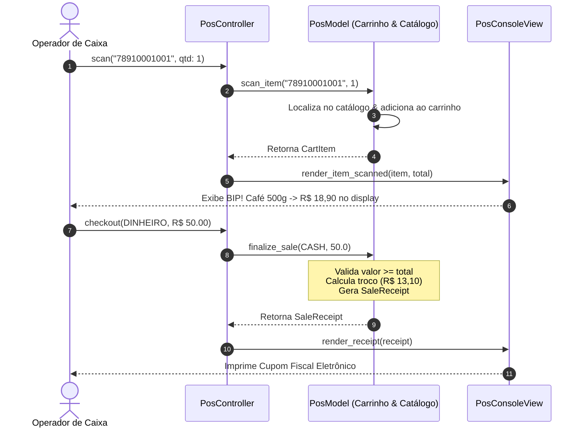

# 🛒 Exemplo 05: Frente de Caixa / PDV de Varejo (Padrão MVC)

> Implementação da **Arquitetura MVC** para sistemas de Ponto de Venda (PDV / Frente de Caixa), demonstrando bipagem de itens por código de barras, cancelamento de itens e simulação da impressão do **Cupom Fiscal Eletrônico (SAT/NFC-e)**.

---

## 🎯 1. Cenário do Dia a Dia

Em caixas de supermercados, farmácias e lojas de conveniência:
1. O operador bipa produtos com leitor óptico de código de barras. A cada bip, o display visual do caixa precisa exibir o nome do produto, valor unitário e o subtotal acumulado da esteira.
2. O cliente pode desistir de um item na fila, exigindo o estorno/cancelamento imediato do último item ou de um item específico.
3. No fechamento, o operador registra a forma de pagamento (Dinheiro, Cartão, PIX), calcula o troco devido e aciona a impressora térmica para emitir o Cupom Fiscal.

---

## 💡 2. Justificativa Arquitetural

- **Model com Integridade Comercial**: O `PosModel` armazena os itens adicionados, calcula o total da compra e valida se o valor entregue em dinheiro cobre o saldo antes de fechar a venda e calcular o troco.
- **View com Dupla Especialização**: A `PosConsoleView` encapsula tanto a exibição instantânea do leitor (`render_item_scanned`) quanto a formatação fiscal regulatória do cupom em largura fixa de 52 colunas (`render_receipt`).
- **Controller de Operações**: O `PosController` mapeia as teclas/eventos do operador (Bipar, Cancelar, Fechar Venda), intermediando o hardware de entrada com o modelo de dados.

---

## 📊 3. Diagrama Conceitual MVC (Mermaid)



---

## 📁 4. Estrutura dos Arquivos

```text
05-point-of-sale-pos/
├── README.md               # Esta documentação
├── main.py                 # Demonstração executável de esteira de checkout
├── models/
│   └── pos_model.py        # Catálogo, CartItem, SaleReceipt e cálculos de troco
├── views/
│   └── pos_view.py         # Display do operador e Cupom Fiscal térmico
└── controllers/
    └── pos_controller.py   # Fluxo de abertura, bipagem e finalização
```

---

## 🧼 5. Princípios de Clean Code & SOLID Aplicados

- **Single Responsibility Principle (SRP)**: O Model não sabe como desenhar traços de impressora térmica; a View não sabe como pesquisar códigos de barras no catálogo; o Controller apenas conecta os eventos.
- **Tolerância a Falhas e Validação Imediata**: O Model impede o fechamento de vendas com carrinho vazio ou valor de pagamento insuficiente, garantindo que o cupom nunca seja impresso com saldo devedor.
- **Modelos Imutáveis**: O produto do catálogo (`Product`) é imutável (`@dataclass(frozen=True)`), prevenindo alteração acidental de preços durante a venda.

---

## ⚖️ 6. Trade-offs

| Vantagem | Custo / Limitação |
|---|---|
| Reuso direto de regras para PDVs físicos e terminais de autoatendimento (*self-checkout*) | Em produção, a View precisaria conversar com protocolos de impressoras reais (ESC/POS). |
| Total desacoplamento das telas do operador | O Controller gerencia o estado da sessão de venda ativa. |

---

## 🚀 7. Como Executar

```bash
# A partir desta pasta:
python3 main.py
```
