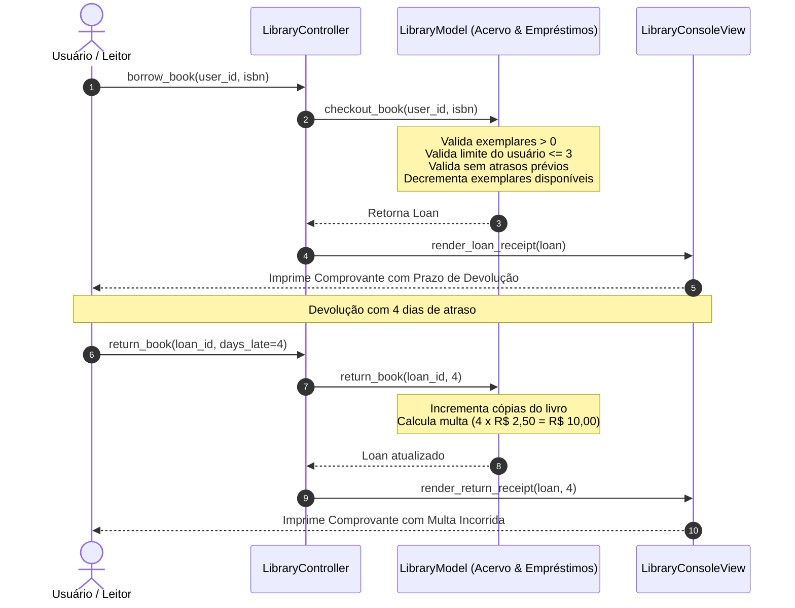

# 📚 Exemplo 06: Empréstimo e Devolução de Livros (Padrão MVC)

> Implementação da **Arquitetura MVC** para um sistema de gestão de biblioteca municipal, demonstrando regras de negócio para limite de empréstimos, exemplares concorrentes e cálculo de multa por atraso (**Model**), além de recibos e catálogo diagramado (**View**).

---

## 🎯 1. Cenário do Dia a Dia

Em bibliotecas públicas e universitárias (como Koha ou Pergamum):
1. Usuários consultam o acervo para verificar se ainda existem exemplares físicos disponíveis na prateleira.
2. Ao realizar o empréstimo, o sistema valida se o usuário já atingiu o limite de livros emprestados simultaneamente (ex: máximo de 3) e se não possui nenhum livro com prazo vencido em atraso.
3. Se o exemplar for o último do acervo, seu status muda automaticamente para *ESGOTADO*.
4. Na devolução, se o usuário ultrapassou a data limite estipulada, o sistema calcula a multa diária de mora (ex: R$ 2,50/dia) e imprime o comprovante de devolução.

---

## 💡 2. Justificativa Arquitetural

- **Model Detentor de Políticas de Acervo**: O `LibraryModel` concentra o decremento/incremento de cópias físicas disponíveis e o cálculo de multas diárias sem qualquer acoplamento a como esses dados serão exibidos.
- **View Rica em Recibos e Catálogos**: A `LibraryConsoleView` cuida de formatar tabelas de consulta do acervo e diagramar recibos de empréstimo com datas e avisos legais.
- **Controller Orquestrador**: O `LibraryController` captura erros de negócio do Model (como exemplares esgotados) e comunica o resultado visualmente para o operador.

---

## 📊 3. Diagrama Conceitual MVC (Mermaid)



---

## 📁 4. Estrutura dos Arquivos

```text
06-library-book-checkout/
├── README.md               # Esta documentação
├── main.py                 # Demonstração executável de empréstimo e multa
├── models/
│   └── library_model.py    # Book, Loan, regras de acervo e multas
├── views/
│   └── library_view.py     # Catálogo do acervo e recibos de empréstimo/devolução
└── controllers/
    └── library_controller.py # Coordenação das operações do balcão
```

---

## 🧼 5. Princípios de Clean Code & SOLID Aplicados

- **Single Responsibility Principle (SRP)**: O `LibraryModel` não gera texto impresso; a `LibraryConsoleView` não decide o valor da multa nem decrementa o estoque de livros; o `LibraryController` orquestra.
- **Datas Imutáveis**: O cálculo de prazos utiliza `datetime` e `timedelta` da biblioteca padrão, prevenindo erros de fuso e manipulação manual de strings.
- **Transparência de Estado**: O método `@property def is_available` encapsula a regra de disponibilidade de exemplares diretamente na entidade `Book`.

---

## ⚖️ 6. Trade-offs

| Vantagem | Custo / Limitação |
|---|---|
| Políticas de empréstimo e multas desacopladas de qualquer framework web | Para catálogos massivos com milhares de livros, a busca em memória precisaria de índices de busca (ex: Elasticsearch/Postgres). |
| Fácil substituição por uma interface Web ou totem de autoatendimento | O fluxo de empréstimo e devolução é orquestrado de forma síncrona. |

---

## 🚀 7. Como Executar

```bash
# A partir desta pasta:
python3 main.py
```
