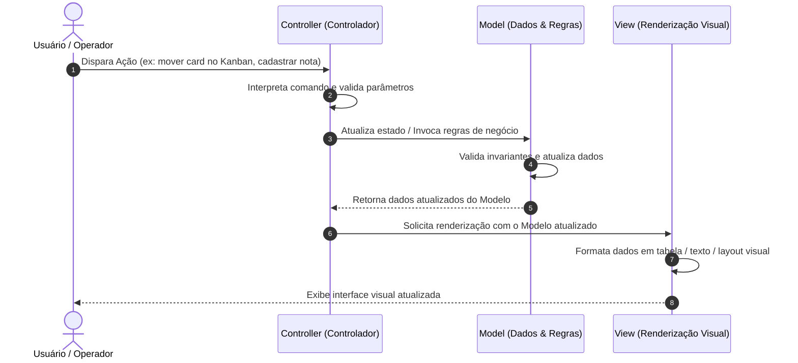

# 🎭 Arquitetura MVC (Model-View-Controller)

> O padrão arquitetural pioneiro na separação entre dados, apresentação visual e controle de fluxo do usuário, concebido na Xerox PARC e fundamental para interfaces modernas e frameworks Web.

---

## 📖 1. O que é e Origem Histórica

O padrão **Model-View-Controller (MVC)** foi formulado em **1979 por Trygve Reenskaug** enquanto trabalhava com a linguagem Smalltalk-80 no lendário centro de pesquisas Xerox PARC. O objetivo era resolver a desordem em aplicações com interfaces gráficas ricas (GUI), onde a renderização de telas, o tratamento de cliques de mouse e a manipulação dos dados ficavam misturados em um código espaguete ingovernável.

Com o advento da Web nos anos 2000, o MVC ganhou uma segunda vida através de frameworks paradigmáticos como **Ruby on Rails, Django (MVT), ASP.NET MVC e Spring MVC**.

### Os Três Papéis do MVC:
1. **Model (Modelo)**: O coração da aplicação. Contém os dados, as entidades de negócio, as regras de validação e o estado. É completamente agnóstico sobre como será exibido na tela.
2. **View (Visão)**: A representação visual do Model para o usuário (telas, páginas HTML, relatórios de terminal, JSON para APIs). A View lê os dados do Model para renderizar, mas nunca altera os dados por conta própria.
3. **Controller (Controlador)**: O intermediário e maestro. Escuta as ações do usuário (cliques, comandos CLI, submissões de formulário), decide o que deve ser feito, atualiza o Model correspondente e instrui a View a se renderizar com os novos dados.

---

## 📊 2. Diagrama Conceitual da Arquitetura (Mermaid)

---

## 🔒 3. Regras Invariantes (O que NUNCA fazer)

1. **A View NUNCA executa regras de negócio**: A View pode formatar uma data (`DD/MM/YYYY`) ou colorir um texto em vermelho se o saldo for negativo, mas nunca deve calcular juros, verificar se um aluno foi aprovado ou mutacionar registros.
2. **O Model NUNCA conhece a View**: O Model não deve importar classes de UI, nem conter tags HTML, formatações de terminal ou códigos de escape ANSI. O Model deve ser puramente centrado em dados e regras.
3. **Evitar o Anti-Pattern "Fat Controller" (Controlador Gordo)**: Controllers devem ser enxutos (*Thin Controllers*). A responsabilidade do Controller é apenas coordenar a entrada, acionar o Model e despachar a View. Se o seu Controller tem 500 linhas cheias de `if/else` calculando impostos ou validando dados, essa lógica pertence ao Model!
4. **Desacoplamento de Visões**: Um mesmo Model deve poder ser renderizado por múltiplas Views diferentes (ex: uma View de terminal ASCII, uma View de Relatório em Texto e uma View JSON) sem que nenhuma linha do Model precise mudar.

---

## ⚖️ 4. Vantagens e Trade-offs Reais

### Vantagens
- **Reutilização Extrema de Visões**: É trivial adicionar uma nova forma de visualização (ex: exportação CSV ou painel em grade) reutilizando exatamente o mesmo Model e Controller.
- **Testabilidade Desacoplada**: É possível testar todas as regras de negócio testando apenas as classes do Model, sem precisar instanciar componentes visuais ou simular cliques de tela.
- **Divisão Clara de Especialidades**: Designers e desenvolvedores frontend focam na View, enquanto engenheiros de backend focam no Model e Controller.

### Desvantagens e Trade-offs
- **Complexidade para Telas Muito Simples**: Para telas triviais estáticas, a separação em 3 partes adiciona arquivos e indireções extras.
- **Risco de Acoplamento Bidirecional**: Em implementações com o padrão Observer clássico (onde a View escuta eventos do Model diretamente), pode haver vazamento de abstração se não houver disciplina estrita.

---

## 🚦 5. Quando Usar vs Quando NÃO Usar

### Quando Usar
- Aplicações com interfaces de usuário ativas (CLI ricas, aplicações desktop com Tkinter/PyQt, dashboards).
- Sistemas Web onde a renderização de páginas (Server-Side Rendering) ou geração de relatórios visuais é central.
- Ferramentas onde o usuário realiza operações interativas contínuas e precisa de feedback visual imediato na tela.

### Quando NÃO Usar
- APIs puramente REST headless ou microsserviços sem interface visual (onde a arquitetura em camadas, Clean Architecture ou Hexagonal são mais aderentes).
- Pipelines de dados em lote (*batch processing*) ou ETL assíncrono (utilize *Pipes and Filters*).

---

## 📁 6. Índice dos Exemplos Práticos

Cada pasta interna implementa o padrão MVC com pastas segregadas (`models/`, `views/`, `controllers/`) e demonstrações interativas em Python 3:

| Pasta | Cenário do Dia a Dia | Destaque do Model | Destaque da View |
|---|---|---|---|
| [`01-crm-dashboard-analytics/`](./01-crm-dashboard-analytics/) | **Dashboard de Vendas e CRM** | Pipeline de leads, taxas de conversão e cálculo de ticket médio | Visão em Tabela ASCII com gráficos de barra de texto e Visão Executiva em KPIs |
| [`02-task-kanban-board/`](./02-task-kanban-board/) | **Quadro Kanban Interativo** | Máquina de estados das tarefas (TODO, DOING, DONE) e prioridades | Renderização gráfica em colunas alinhadas no terminal |
| [`03-personal-finance-budget/`](./03-personal-finance-budget/) | **Gestão Orçamentária Pessoal** | Despesas por categoria, limites mensais e saldo corrente | Barras de progresso visual de consumo de orçamento e alertas |
| [`04-school-grades-report/`](./04-school-grades-report/) | **Boletim e Notas Escolares** | Cálculo de médias ponderadas, frequência e regras de aprovação | Boletim escolar diagramado com status Aprovado/Recuperação/Reprovado |
| [`05-point-of-sale-pos/`](./05-point-of-sale-pos/) | **Frente de Caixa (PDV de Varejo)** | Carrinho de compras, leitor de código de barras e troco | Simulação de Cupom Fiscal de supermercado e display do operador |
| [`06-library-book-checkout/`](./06-library-book-checkout/) | **Empréstimo de Livros e Biblioteca** | Controle de exemplares disponíveis e cálculo de multas de atraso | Recibo de empréstimo com data de devolução e catálogo visual |

---

  Navegue pelas pastas acima para explorar a implementação de cada cenário.

