# 🚰 Exemplo 01: Pipeline ETL de Importação de Extrato Bancário

> Implementação da **Arquitetura Pipes and Filters** para processamento, higienização, conversão cambial e classificação contábil de transações financeiras brutas de arquivos bancários.

---

## 🎯 1. Cenário do Dia a Dia

Sistemas contábeis e ERPs (como ContaAzul, SAP, Totvs) precisam importar extratos bancários de múltiplos bancos e formatos (CSV, OFX, TXT):
1. Linhas brutas chegam com espaços extras, letras minúsculas e formatos inconsistentes.
2. Algumas transações são internacionais (em Dólar USD ou Euro EUR) e precisam ser convertidas para a moeda contábil oficial (BRL) usando a cotação do dia.
3. Linhas com datas corrompidas ou campos faltantes não podem quebrar o processamento inteiro do arquivo; devem ser direcionadas para uma esteira de quarentena (*Dead Letter Sink*).
4. As transações válidas são enriquecidas com categorias contábeis (`RECEITA`, `DESPESA_FIXA`, `DESPESA_VARIAVEL`) e salvas no livro-razão contábil.

---

## 💡 2. Justificativa Arquitetural

- **Por que Pipes and Filters aqui?**
  - **Filtros Especializados e Reutilizáveis**: O `SanitizerFilter` (limpeza de caracteres) e o `CurrencyConverterFilter` (câmbio) podem ser reaproveitados em qualquer outro pipeline da empresa.
  - **Princípio Aberto/Fechado (OCP)**: Se amanhã for necessário adicionar um filtro de deduplicação ou detecção de fraudes, basta invocar `pipeline.add_filter(NovoFiltro())` sem alterar nenhuma linha dos filtros existentes.
  - **Tratamento de Exceções sem Interrupção**: Registros inválidos carregam `is_valid = False` e continuam fluindo de forma limpa até o duto de desvio para quarentena.

---

## 📊 3. Diagrama do Pipeline (Mermaid)

```mermaid
flowchart LR
    Source([Linha Bruta CSV]) --> P0[Pipe]
    
    subgraph Pipeline ["Pipeline ETL Bancário"]
        P0 --> F1["CsvRowParserFilter<br/>(Decompõe Colunas)"]
        F1 --> P1[Pipe]
        P1 --> F2["SanitizerFilter<br/>(Normaliza Texto)"]
        F2 --> P2[Pipe]
        P2 --> F3["DateValidatorFilter<br/>(Valida Formato ISO)"]
        F3 --> P3[Pipe]
        P3 --> F4["CurrencyConverterFilter<br/>(Câmbio USD -> BRL)"]
        F4 --> P4[Pipe]
        P4 --> F5["CategorizerFilter<br/>(Receita / Despesa)"]
    end
    
    P5[Pipe]
    F5 --> P5
    P5 --> Valid{"Válido?"}
    Valid -- "Sim" --> SinkSuccess([Contabilidade / Ledger])
    Valid -- "Não" --> SinkDeadLetter([Quarentena / Auditoria])

    classDef pipe fill:#e2e8f0,stroke:#64748b,stroke-width:1px,color:#334155;
    classDef filter fill:#dbeafe,stroke:#2563eb,stroke-width:2px,color:#1e40af;
    classDef io fill:#fef3c7,stroke:#d97706,stroke-width:2px,color:#92400e;

    class P0,P1,P2,P3,P4,P5 pipe;
    class F1,F2,F3,F4,F5 filter;
    class Source,SinkSuccess,SinkDeadLetter io;
```



---

## 📁 4. Estrutura dos Arquivos

```text
01-etl-bank-statement-import/
├── README.md                           # Esta documentação
├── main.py                             # Montagem fluente do pipeline e execução em lote
├── pipeline/
│   ├── base.py                         # Filter abstrato e Pipeline encadeador
│   └── context.py                      # TransactionRecord (objeto de dados do duto)
└── filters/
    ├── csv_parser_filter.py            # Decomposição de linha em campos
    ├── sanitizer_filter.py             # Limpeza de caracteres e maiúsculas
    ├── date_validator_filter.py        # Validação estrita de data ISO
    ├── currency_converter_filter.py    # Conversão de moedas estrangeiras
    └── categorizer_filter.py           # Classificação contábil por palavras-chave
```

---

## 🧼 5. Princípios de Clean Code & SOLID Aplicados

- **Single Responsibility Principle (SRP)**: Cada filtro executa rigorosamente apenas uma transformação (o conversor de câmbio não valida datas; o validador de datas não formata texto).
- **Generic Typing**: A classe base `Filter(ABC, Generic[TInput, TOutput])` utiliza tipagem genérica do Python (`typing.TypeVar`), garantindo contratos seguros entre dutos.
- **Fluent Interface (Builder Pattern)**: O método `pipeline.add_filter()` retorna a própria instância do pipeline, viabilizando encadeamentos legíveis.

---

## ⚖️ 6. Trade-offs

| Vantagem | Custo / Limitação |
|---|---|
| Componibilidade total e facilidade de teste unitário | Se o pipeline tiver 20 filtros, há pequena sobrecarga de passagens de referência em memória. |
| Fácil paralelização por lotes de registros | Filtros que dependem de estado acumulado prévio (ex: saldo cumulativo) exigem contexto compartilhado. |

---

## 🚀 7. Como Executar

```bash
# A partir desta pasta:
python3 main.py
```
