# 🛡️ Exemplo 04: Sanitização de Logs e Detecção de Ameaças (Pipes and Filters)

> Implementação da **Arquitetura Pipes and Filters** para uma esteira de ingestão de logs e observabilidade (SIEM), demonstrando mascaramento de dados sensíveis (PII: CPF, Cartões, E-mails) para conformidade **LGPD/GDPR**, enriquecimento de **GeoIP** e detecção de ataques de **SQL Injection** em tempo real.

---

## 🎯 1. Cenário do Dia a Dia

Em plataformas de observabilidade e auditoria (como Datadog, Elasticsearch, Splunk, Graylog):
1. Microsserviços e APIs corporativas emitem milhões de linhas de log por minuto.
2. Desenvolvedores frequentemente loggam sem perceber mensagens com dados pessoais do cliente (números de cartão de crédito, CPFs, e-mails). Deixar esses dados transitarem em texto puro viola diretamente a LGPD/GDPR e normas do setor de pagamentos (PCI-DSS).
3. A esteira de logs deve interceptar a mensagem no duto (*in-flight*), aplicar regex de anonimização, enriquecer com cidade/país do IP de origem e inspecionar assinaturas de ataques cibernéticos (como injeção SQL ou travessia de diretório).

---

## 💡 2. Justificativa Arquitetural

- **Por que Pipes and Filters aqui?**
  - **Processamento de Streaming e Baixa Latência**: Cada estágio de filtro processa a mensagem de forma independente sem reter o fluxo global.
  - **Filtros Especializados e Segregação de Responsabilidade**: O `PiiMaskerFilter` foca unicamente em privacidade e regex; o `GeoIpFilter` foca em enriquecimento geográfico; o `ThreatDetectorFilter` foca em assinaturas de cibersegurança.
  - **Plugabilidade de Novos Analisadores**: É trivial plugar novos filtros de detecção (ex: análise de sentimentos ou detecção de senhas vazadas) sem modificar os filtros existentes.

---

## 📊 3. Diagrama do Pipeline de Logs (Mermaid)

```mermaid
flowchart LR
    Source([Log Bruto JSON]) --> P0[Pipe]
    
    subgraph Pipeline ["Pipeline de Observabilidade e Segurança"]
        P0 --> F1["JsonLogParserFilter<br/>(Desserializa JSON)"]
        F1 --> P1[Pipe]
        P1 --> F2["PiiMaskerFilter<br/>(Anonimiza CPF / Cartão)"]
        F2 --> P2[Pipe]
        P2 --> F3["GeoIpFilter<br/>(Enriquece Cidade / País)"]
        F3 --> P3[Pipe]
        P3 --> F4["ThreatDetectorFilter<br/>(Detecta SQL Injection)"]
    end
    
    F4 --> P4[Pipe]
    P4 --> Sink([Elasticsearch / SIEM Indexer])

    classDef pipe fill:#e2e8f0,stroke:#64748b,stroke-width:1px,color:#334155;
    classDef filter fill:#dbeafe,stroke:#2563eb,stroke-width:2px,color:#1e40af;
    classDef io fill:#fef3c7,stroke:#d97706,stroke-width:2px,color:#92400e;

    class P0,P1,P2,P3,P4 pipe;
    class F1,F2,F3,F4 filter;
    class Source,Sink io;
```



---

## 📁 4. Estrutura dos Arquivos

```text
04-log-enrichment-and-masking-security/
├── README.md                           # Esta documentação
├── main.py                             # Execução do pipeline sobre eventos de log
├── pipeline/
│   ├── base.py                         # Interface Filter e LogPipeline
│   └── context.py                      # LogEvent e GeoLocation
└── filters/
    ├── json_parser_filter.py           # Parser JSON com tratamento de erro
    ├── pii_masker_filter.py            # Anonimização de CPF, cartão e e-mail
    ├── geo_ip_filter.py                # Enriquecimento por banco de GeoIP
    └── threat_detector_filter.py       # Identificação de injeção SQL e traversal
```

---

## 🧼 5. Princípios de Clean Code & SOLID Aplicados

- **Privacy by Design**: Mascaramento de dados sensíveis ocorre antes da indexação no banco de logs.
- **Single Responsibility Principle (SRP)**: Cada filtro é responsável por uma regra de negócio ou aspecto regulatório isolado.
- **Fail-Safe**: Logs malformados não quebram o pipeline, gerando eventos sinalizados com `is_valid = False` que podem ser direcionados para uma fila de análise de falhas.

---

## ⚖️ 6. Trade-offs

| Vantagem | Custo / Limitação |
|---|---|
| Garantia total de conformidade legal com LGPD e PCI-DSS | Expressões regulares complexas para milhões de mensagens exigem compilação de regex (`re.compile`) para evitar overhead de CPU. |
| Elevada resiliência contra ataques | A detecção de ameaças baseada em regex não substitui um WAF dedicado de borda. |

---

## 🚀 7. Como Executar

```bash
# A partir desta pasta:
python3 main.py
```
