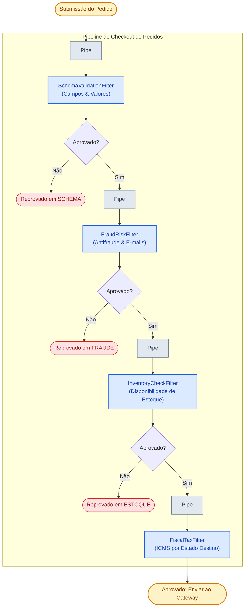

# 🛍️ Exemplo 05: Pipeline de Validação de Pedidos E-commerce (Pipes and Filters)

> Implementação da **Arquitetura Pipes and Filters** para esteiras transacionais de checkout de e-commerce, demonstrando **Interrupção Precoce (*Short-Circuiting*)**, análise de risco antifraude, conferência de estoque de armazém e cálculo tributário interestadual (ICMS).

---

## 🎯 1. Cenário do Dia a Dia

Antes de disparar uma chamada onerosa de cobrança no cartão de crédito do cliente em um e-commerce:
1. O pedido deve passar por uma série de portões de qualidade e conformidade sequenciais.
2. Se o cliente utilizou um e-mail temporário descartável (`tempmail.com`), o pedido é reprovado pelo filtro de fraude sem onerar o estoque.
3. Se os itens do carrinho não possuem saldo livre no armazém, o pedido é abortado antes do cálculo tributário.
4. Se todos os critérios forem atendidos, o filtro fiscal calcula o imposto de acordo com a unidade federativa de destino (`UF`) e consolida o valor final da cobrança.

---

## 💡 2. Justificativa Arquitetural

- **Por que Pipes and Filters aqui?**
  - **Padrão Short-Circuiting**: O `OrderValidationPipeline` interrompe a execução assim que qualquer filtro marca `is_approved = False`. Isso poupa chamadas de rede, consultas de estoque e requisições pagas a gateways de pagamento.
  - **Desacoplamento de Regras**: As regras fiscais de ICMS (`FiscalTaxFilter`) estão completamente isoladas da lógica de antifraude (`FraudRiskFilter`).
  - **Auditoria de Rejeição**: O pedido reprovado armazena exatamente qual estágio causou a recusa (`rejection_stage`) e a justificativa legível (`rejection_reason`).

---

## 📊 3. Diagrama do Pipeline com Short-Circuiting (Mermaid)



---

## 📁 4. Estrutura dos Arquivos

```text
05-ecommerce-order-checkout-pipeline/
├── README.md                           # Esta documentação
├── main.py                             # Execução com pedidos legítimos e reprovados
├── pipeline/
│   ├── base.py                         # Interface Filter e OrderValidationPipeline com short-circuit
│   └── context.py                      # OrderCheckoutContext e CheckoutItem
└── filters/
    ├── schema_validation_filter.py     # Checagem de integridade de dados e carrinho
    ├── fraud_risk_filter.py            # Avaliação de e-mails suspeitos e limites
    ├── inventory_check_filter.py       # Verificação de estoque físico
    └── fiscal_tax_filter.py            # Cálculo tributário interestadual (ICMS)
```

---

## 🧼 5. Princípios de Clean Code & SOLID Aplicados

- **Fail-Fast & Economia de Recursos**: Se a validação básica de schema falhar, o pipeline não executa consultas pesadas de estoque ou cálculos tributários.
- **Single Responsibility Principle (SRP)**: O `InventoryCheckFilter` recebe o inventário por injeção e se preocupa apenas com a quantidade livre de itens.
- **Encapsulamento de Propriedades**: Subtotais e totais finais são mantidos em atributos protegidos com arredondamento monetário preciso (`round(..., 2)`).

---

## ⚖️ 6. Trade-offs

| Vantagem | Custo / Limitação |
|---|---|
| Rejeição instantânea de pedidos fraudulentos sem onerar recursos internos | Se um pedido for reprovado no 3º estágio, nenhuma alteração prévia deve ter sido gravada de forma permanente (exige que as etapas prévias sejam apenas de leitura). |
| Fácil calibração de regras fiscais e antifraude | A esteira opera de forma estritamente serial; se os filtros fossem paralelos, demandaria um padrão *Scatter-Gather*. |

---

## 🚀 7. Como Executar

```bash
# A partir desta pasta:
python3 main.py
```
