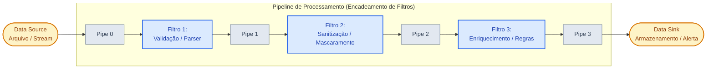

# 🚰 Arquitetura Pipes and Filters (Dutos e Filtros)

> O padrão arquitetural por excelência para processamento, transformação e enriquecimento contínuo de fluxos de dados em estágios sequenciais ou concorrentes independentes.

---

## 📖 1. O que é e Origem Histórica

A ideia de **Pipes and Filters** remonta a **1964**, quando Doug McIlroy propôs nos Bell Labs a criação de "dutos" de comunicação no sistema operacional Unix: a capacidade de encadear programas pequenos onde a saída padrão de um se tornava a entrada do próximo (`cat dados.csv | grep "SP" | sort | uniq -c`).

O padrão foi formalizado na literatura de engenharia de software no clássico livro *Pattern-Oriented Software Architecture (POSA 1)* e consolidado nos *Enterprise Integration Patterns (EIP)* por Gregor Hohpe.

### Os Componentes do Padrão:
1. **Filtro (Filter)**: Componente autônomo e autocontido de processamento. Recebe dados de entrada por um duto, aplica uma transformação específica (validação, enriquecimento, sanitização, compressão, mascaramento) e emite os dados transformados para o duto de saída.
2. **Duto (Pipe)**: O canal de transporte que conecta a saída de um filtro à entrada do próximo. Pode ser um buffer em memória, uma fila de mensagens (RabbitMQ, SQS) ou um stream concorrente.
3. **Origem (Data Source)**: O gerador de dados inicial (arquivo CSV, stream de sockets, sensor, requisição HTTP).
4. **Destino (Data Sink)**: O consumidor final do fluxo (banco de dados analítico, bucket S3, console, indexador).

---

## 📊 2. Diagrama Conceitual da Arquitetura (Mermaid)

---

## 🔒 3. Regras Invariantes (O que NUNCA fazer)

1. **Filtros NUNCA devem conhecer uns aos outros**: O Filtro 2 não deve importar o Filtro 1 nem o Filtro 3. Um filtro só conhece seu próprio contrato de entrada e saída.
2. **Sem Estado Global Compartilhado (*Stateless Transformation*)**: Os filtros não devem alterar variáveis globais ou bancos de dados intermediários compartilhados para passar parâmetros ocultos; toda a informação necessária deve trafegar pelo Pipe através do objeto de contexto/mensagem.
3. **Componibilidade e Reordenabilidade**: Deve ser possível adicionar um novo filtro no meio do pipeline ou remover um filtro existente sem quebrar a lógica interna dos outros filtros.
4. **Isolamento de Efeitos Colaterais**: Se um registro falhar em um filtro de validação, o pipeline deve ter uma estratégia explícita (descarte, log de quarentena / *Dead Letter Channel* ou interrupção elegante), nunca travando os filtros anteriores.

---

## ⚖️ 4. Vantagens e Trade-offs Reais

### Vantagens
- **Reutilização Extrema**: Um filtro de mascaramento de CPF/LGPD construído para logs pode ser reutilizado no pipeline de extrato bancário ou no de cadastro de clientes.
- **Princípio Aberto/Fechado (OCP)**: Adicionar um novo passo de negócio (ex: conversão de moeda) consiste apenas em plugar um novo filtro na esteira, sem alterar uma única linha dos filtros existentes.
- **Paralelismo e Streaming**: Filtros podem rodar concorrentemente em threads separadas, processando o item $N$ no filtro final enquanto o item $N+1$ ainda está sendo lido no filtro inicial.

### Desvantagens e Trade-offs
- **Sobrecarga de Passagem de Dados**: Se o volume de dados for astronômico e os pipes envolverem cópia de memória ou serialização JSON/Binário em rede, o custo de transporte entre estágios pode se tornar o gargalo.
- **Complexidade de Tratamento de Erros e Rollback**: Como cada filtro opera em etapas separadas, fazer uma compensação transacional em caso de erro na 5ª etapa exige padrões adicionais como Sagas ou canais de erro dedicados.

---

## 🚦 5. Quando Usar vs Quando NÃO Usar

### Quando Usar
- Pipelines de ETL (Extração, Transformação e Carga) de dados contábeis, planilhas e relatórios.
- Sanitização de segurança, auditoria e anonimização de logs sensíveis (LGPD/GDPR).
- Compiladores, analisadores léxicos/sintáticos e motores de regras.
- Processamento de multimídia (redimensionamento de imagens, compressão de vídeo, transcodificação).

### Quando NÃO Usar
- Sistemas de diálogo interativo síncrono CRUD simples (onde uma requisição precisa apenas de um `INSERT` direto no banco).
- Aplicações com operações transacionais fortemente acopladas que exigem ACID distribuído em múltiplos passos com rollback imediato.

---

## 📁 6. Índice dos Exemplos Práticos

Cada pasta interna implementa o padrão com interfaces abstratas, filtros reutilizáveis e orquestradores de pipeline em Python 3:

| Pasta | Cenário do Dia a Dia | Transformação Central | Lição Arquitetural |
|---|---|---|---|
| [`01-etl-bank-statement-import/`](./01-etl-bank-statement-import/) | **Pipeline ETL de Extrato Bancário** | CSV -> Parser -> Normalização -> Câmbio USD/BRL -> Sink | Como processar linhas brutas financeiras em estágios desacoplados. |
| [`02-image-metadata-and-watermark/`](./02-image-metadata-and-watermark/) | **Processamento de Mídia e Metadados** | Validação -> Remoção de EXIF (Privacidade) -> Watermark | Proteção de dados sensíveis de imagens e aplicação de marca d'água. |
| [`03-compiler-lexer-parser-evaluator/`](./03-compiler-lexer-parser-evaluator/) | **Mini Compilador de Expressões** | Texto -> Tokenizer -> Validador de Sintaxe -> Evaluator | Estruturação de etapas clássicas de computação e linguagens formais. |
| [`04-log-enrichment-and-masking-security/`](./04-log-enrichment-and-masking-security/) | **Sanitização de Logs para LGPD** | Log Bruto -> Mascarador PII (CPF/Cartão) -> GeoIP -> Alerta | Segurança defensiva e conformidade jurídica em esteiras de observabilidade. |
| [`05-ecommerce-order-checkout-pipeline/`](./05-ecommerce-order-checkout-pipeline/) | **Pipeline de Validação de Pedido** | Schema -> Análise de Risco/Fraude -> Estoque -> Cálculo Fiscal | Interrupção precoce (*Short-circuiting*) quando uma etapa falha. |
| [`06-audio-transcription-normalizer/`](./06-audio-transcription-normalizer/) | **Pipeline de Tratamento de Áudio** | Validação Formato -> Silêncio -> Redução Ruído -> Transcrição | Pipeline multimídia com enriquecimento progressivo de contexto. |

---

  Navegue pelas pastas acima para explorar a implementação de cada cenário.

