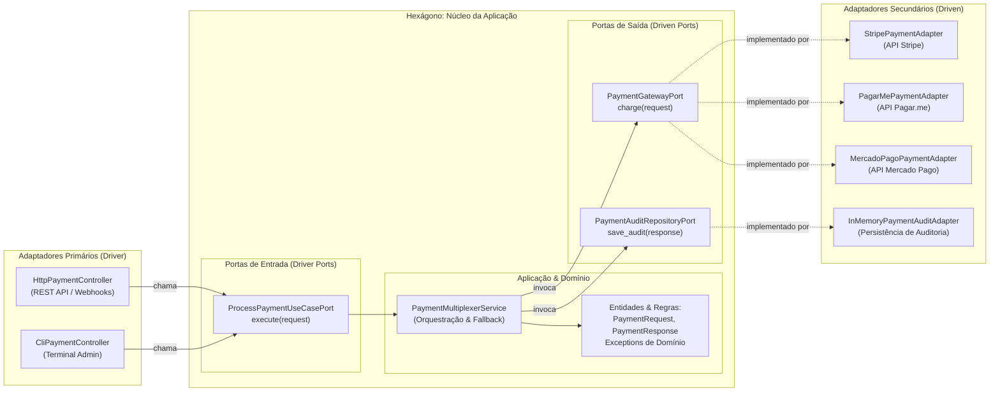

# Exemplo 01: Payment Gateway Multiplexer com Fallback

## 1. Visão Geral e Contexto de Negócio

No ecossistema de pagamentos digitais (e-commerce, SaaS, marketplaces), a dependência rígida de um único adquirente financeiro (Stripe, Pagar.me, Mercado Pago) gera riscos severos de indisponibilidade e perda de faturamento. Quando a API de um provedor oscila ou sofre manutenção, o sistema deve automaticamente desviar o tráfego para provedores secundários em cascata (*fallback* transparente), sem interromper a experiência de compra do cliente.

A **Arquitetura Hexagonal (Ports & Adapters)** é a escolha ideal para esse desafio:
- O **Core / Núcleo de Domínio** contém unicamente a inteligência de negócios: validações de cobrança, ordenação de prioridade de gateways e política de retentativa/fallback.
- O núcleo **não importa nenhum SDK externo** (`import stripe` ou bibliotecas de terceiros jamais entram no hexágono).
- A comunicação com o mundo externo ocorre estritamente através de **Portas** (Driver Ports para quem chama e Driven Ports para quem é chamado).

---

## 2. Diagrama da Arquitetura Hexagonal



---

## 3. Estrutura do Exemplo

```text
01-payment-gateway-multiplexer/
├── domain/
│   ├── models.py                # PaymentRequest, PaymentResponse, PaymentStatus
│   └── exceptions.py            # PaymentDomainException, AllGatewaysFailedException
├── ports/
│   ├── driver.py                # ProcessPaymentUseCasePort (Porta Inbound)
│   └── driven.py                # PaymentGatewayPort, PaymentAuditRepositoryPort (Portas Outbound)
├── core/
│   └── service.py               # PaymentMultiplexerService (Lógica pura do hexágono)
├── adapters/
│   ├── primary/
│   │   ├── http_payment_controller.py  # Controlador HTTP REST simulado
│   │   └── cli_payment_controller.py   # Controlador de linha de comando CLI
│   └── secondary/
│       ├── stripe_adapter.py           # Conector simulado Stripe
│       ├── pagarme_adapter.py          # Conector simulado Pagar.me
│       ├── mercadopago_adapter.py      # Conector simulado Mercado Pago
│       └── in_memory_audit_adapter.py  # Conector simulado de repositório
├── main.py                      # Composition Root e execução dos cenários
└── README.md                    # Documentação do exemplo
```

---

## 4. Cenários Demonstrados no `main.py`

1. **Transação Padrão:** O provedor prioritário (Stripe) processa e aprova a cobrança com sucesso.
2. **Fallback Simples:** O Stripe é marcado com status offline (healthcheck falho); o núcleo transparentemente desvia para o segundo colocado (Pagar.me).
3. **Fallback Duplo:** Tanto Stripe quanto Pagar.me estão indisponíveis; a cobrança é roteada com sucesso para o Mercado Pago.
4. **Múltiplos Disparadores (Drivers):** Uma cobrança é acionada via console CLI pelo operador de suporte, reutilizando 100% da lógica do hexágono sem nenhuma alteração.
5. **Proteção de Invariantes de Domínio:** Tentativa de cobrança com valor negativo é rejeitada pelo hexágono antes de qualquer contato com os gateways.
6. **Auditoria Centralizada:** Registro histórico de todas as transações autorizadas no repositório secundário.

---

## 5. Como Executar

Execute diretamente usando o Python 3 da sua máquina (sem bibliotecas externas necessárias):

```bash
python3 main.py
```
