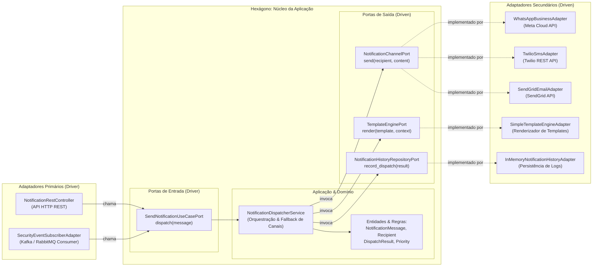

# Exemplo 02: Multi-Channel Notification Service com Fallback

## 1. Visão Geral e Contexto de Negócio

Em sistemas modernos, a entrega de notificações críticas (como tokens de autenticação em dois fatores `2FA`, confirmações de compra ou alertas de fraude) não pode depender de um canal único. Se a API de WhatsApp sofrer instabilidade ou bloqueio de taxa de envio (*rate-limiting*), o sistema precisa automaticamente realizar *failover* para SMS e, em última instância, para E-mail.

A **Arquitetura Hexagonal** isola as regras do serviço de mensageria das APIs de provedores externos (SendGrid, Twilio, Meta WhatsApp Cloud API), permitindo:
- Testabilidade 100% isolada e determinação determinística de comportamento de fallback.
- Facilidade de plugar novos canais (como WebPush ou Telegram) criando apenas um novo adaptador secundário, sem alterar uma única linha do núcleo de despacho.
- Suporte a múltiplos pontos de entrada: tanto requisições síncronas HTTP (REST) quanto mensagens assíncronas consumidas de filas/tópicos (Kafka, RabbitMQ, SQS).

---

## 2. Diagrama da Arquitetura Hexagonal



---

## 3. Estrutura do Exemplo

```text
02-multi-channel-notification-service/
├── domain/
│   ├── models.py                       # Entidades puras (Recipient, NotificationMessage, etc.)
│   └── exceptions.py                   # Exceções de negócio (InvalidRecipient, AllChannelsExhausted)
├── ports/
│   ├── driver.py                       # SendNotificationUseCasePort
│   └── driven.py                       # NotificationChannelPort, TemplateEnginePort, HistoryPort
├── core/
│   └── service.py                      # NotificationDispatcherService (Lógica de despacho e fallback)
├── adapters/
│   ├── primary/
│   │   ├── rest_api_adapter.py         # Inbound HTTP REST
│   │   └── event_subscriber_adapter.py # Inbound Event Consumer (Message Broker)
│   └── secondary/
│       ├── sendgrid_email_adapter.py   # Outbound SendGrid
│       ├── twilio_sms_adapter.py       # Outbound Twilio
│       ├── whatsapp_business_adapter.py# Outbound WhatsApp
│       ├── jinja_template_adapter.py   # Outbound Renderizador
│       └── in_memory_history_adapter.py# Outbound Repositório
├── main.py                             # Composition Root e cenários de execução
└── README.md                           # Documentação técnica
```

---

## 4. Cenários Demonstrados no `main.py`

1. **Despacho Direto via Canal Preferencial:** Notificação crítica de 2FA entregue imediatamente via WhatsApp.
2. **Fallback Simples em Tempo de Execução:** Simulação de queda da API do WhatsApp; o serviço chaveia transparentemente para SMS via Twilio.
3. **Fallback Secundário:** Com WhatsApp e SMS fora do ar, o despacho é efetuado via E-mail (SendGrid).
4. **Múltiplos Drivers:** Disparo de notificação originada de um evento assíncrono de segurança do sistema, acionando a mesma porta sem duplicar regras.
5. **Validação de Invariantes:** Bloqueio de envio para destinatário sem dados válidos de contato.
6. **Auditoria Centralizada:** Consulta do histórico completo de despachos no adaptador de repositório.

---

## 5. Como Executar

```bash
python3 main.py
```
