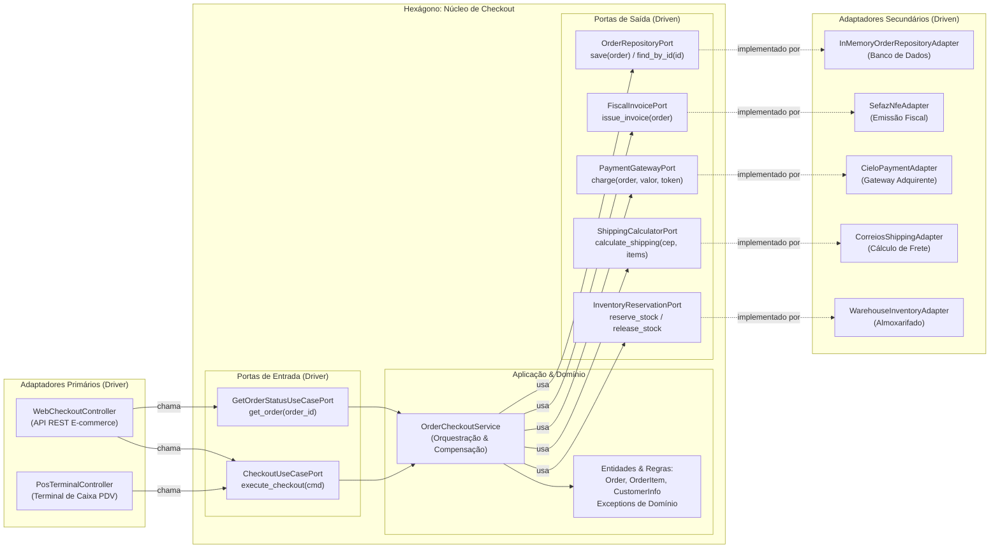

# Exemplo 03: Order Checkout Core com Transações de Compensação

## 1. Visão Geral e Contexto de Negócio

O processo de fechamento de compra (*checkout*) em um e-commerce é uma das partes mais críticas de uma organização. Ele envolve a orquestração precisa de múltiplos serviços e domínios auxiliares:
1. Validação dos itens do carrinho e cálculo de totais.
2. Cálculo dinâmico de taxa de entrega baseado em endereço/CEP.
3. Reserva atômica de unidades de produtos no almoxarifado/WMS.
4. Captura financeira no gateway/adquirente de cartão de crédito.
5. Se a cobrança for recusada, liberação de compensação (*rollback*) imediata do estoque previamente reservado.
6. Emissão da Nota Fiscal Eletrônica (NF-e) nos servidores do fisco.
7. Persistência do pedido no banco de dados.

A **Arquitetura Hexagonal** brilha nesse caso de uso porque o fluxo de orquestração de checkout é 100% puro dentro do hexágono. Não há acoplamento com bibliotecas de banco de dados, APIs de correios ou adquirentes específicos. Ademais, o mesmo núcleo atende tanto o canal Web/E-commerce quanto um terminal físico de Ponto de Venda (PDV/POS).

---

## 2. Diagrama da Arquitetura Hexagonal



---

## 3. Estrutura do Exemplo

```text
03-order-checkout-core/
├── domain/
│   ├── models.py                     # Order, OrderItem, CustomerInfo, OrderStatus, etc.
│   └── exceptions.py                 # EmptyCart, InsufficientStock, PaymentAuthorization
├── ports/
│   ├── driver.py                     # CheckoutUseCasePort, GetOrderStatusUseCasePort
│   └── driven.py                     # Inventory, Shipping, Payment, Fiscal, Repository Ports
├── core/
│   └── service.py                    # OrderCheckoutService (Orquestração pura e compensações)
├── adapters/
│   ├── primary/
│   │   ├── web_checkout_controller.py  # Controlador Web REST
│   │   └── pos_terminal_controller.py  # Controlador de Caixa Físico (PDV)
│   └── secondary/
│       ├── warehouse_inventory_adapter.py # Adaptador de estoque
│       ├── correios_shipping_adapter.py   # Adaptador de cálculo de frete
│       ├── acquirer_payment_adapter.py    # Adaptador de pagamento Cielo
│       ├── sefaz_nfe_adapter.py           # Adaptador fiscal SEFAZ
│       └── sql_order_repository_adapter.py# Adaptador de repositório
├── main.py                           # Composition Root e cenários de execução
└── README.md                         # Documentação técnica
```

---

## 4. Cenários Demonstrados no `main.py`

1. **Checkout Web com Sucesso:** Execução ponta a ponta com reserva de estoque, cálculo de frete, aprovação na adquirente, emissão de NF-e e salvamento.
2. **Transação de Compensação:** Pagamento recusado pelo emissor do cartão; o serviço dispara o *rollback* do estoque imediatamente, garantindo que os itens não fiquem bloqueados indevidamente.
3. **Rejeição por Saldo Insuficiente:** Tentativa de compra com quantidade maior do que o estoque disponível é bloqueada antes de contactar adquirente ou fisco.
4. **Múltiplos Adaptadores Primários:** Um terminal físico de balcão (PDV de Shopping) executa uma venda usando o mesmo núcleo sem nenhuma modificação.
5. **Consulta de Estado do Pedido:** Recuperação de dados do pedido persistido através da Driver Port de consulta.

---

## 5. Como Executar

```bash
python3 main.py
```
