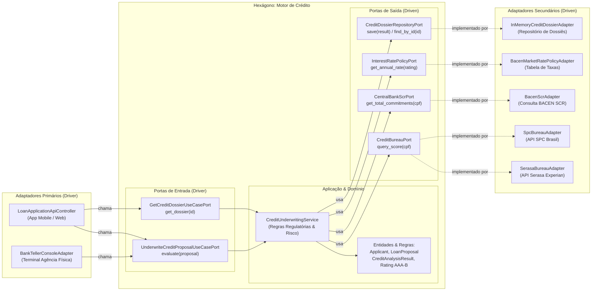

# Exemplo 04: Loan Credit Analysis & Risk Underwriting

## 1. Visão Geral e Contexto de Negócio

A concessão de crédito em instituições bancárias e fintechs exige um motor de decisão altamente auditável, desacoplado e protegido contra variações de APIs externas. O motor deve receber dados do proponente (CPF, renda, valor pretendido, prazo), consultar múltiplos birôs de crédito (Serasa Experian, SPC Brasil, Quod), verificar o endividamento consolidado no BACEN SCR (Sistema de Informações de Crédito) e calcular a viabilidade financeira (comprometimento máximo de 30% da renda líquida).

A **Arquitetura Hexagonal** assegura que:
- O motor atuarial e as políticas regulatórias do BACEN permaneçam encapsulados no interior do hexágono.
- Novos birôs de proteção ao crédito possam ser plugados ou trocados sem alterar o cálculo de risco ou a tabela Price.
- A esteira possa ser disparada pelo aplicativo móvel de autoatendimento (via API REST) ou pelo sistema de caixa e gerência de agência física (via terminal console).

---

## 2. Diagrama da Arquitetura Hexagonal



---

## 3. Estrutura do Exemplo

```text
04-loan-credit-analysis/
├── domain/
│   ├── models.py                     # Applicant, LoanProposal, CreditAnalysisResult, Rating
│   └── exceptions.py                 # InvalidProposalException, BureauUnavailableException
├── ports/
│   ├── driver.py                     # UnderwriteCreditProposalUseCasePort, GetCreditDossierUseCasePort
│   └── driven.py                     # CreditBureauPort, CentralBankScrPort, RatePolicy, Repository
├── core/
│   └── service.py                    # CreditUnderwritingService (Regras atuariais e amortização)
├── adapters/
│   ├── primary/
│   │   ├── loan_application_api_controller.py # Inbound REST API
│   │   └── bank_teller_console_adapter.py    # Inbound Terminal de Agência
│   └── secondary/
│       ├── serasa_bureau_adapter.py          # Outbound Serasa
│       ├── spc_bureau_adapter.py             # Outbound SPC
│       ├── bacen_scr_adapter.py              # Outbound Banco Central SCR
│       ├── market_rate_policy_adapter.py     # Outbound Política de Juros
│       └── in_memory_dossier_adapter.py      # Outbound Repositório
├── main.py                           # Composition Root e cenários de execução
└── README.md                         # Documentação técnica
```

---

## 4. Cenários Demonstrados no `main.py`

1. **Aprovação Rating AAA:** Proponente com renda sólida e score de 915 pontos; aprovação com taxa de juros competitiva e parcela dentro do limite.
2. **Reprovação por Restrição Cadastral:** Proponente com apontamento de inadimplência ativa; bloqueio preventivo antes do cálculo de parcelas.
3. **Reprovação por Capacidade de Pagamento:** Parcela excede a regra mandatória de 30% da renda líquida comprovada.
4. **Acionamento Multicanal:** Gerente de agência física operando no terminal de balcão utilizando o mesmo núcleo do aplicativo web.
5. **Rejeição por Regra de Domínio:** Bloqueio de propostas com renda negativa ou inconsistente.
6. **Recuperação de Dossiê:** Consulta do laudo detalhado gravado no repositório.

---

## 5. Como Executar

```bash
python3 main.py
```
