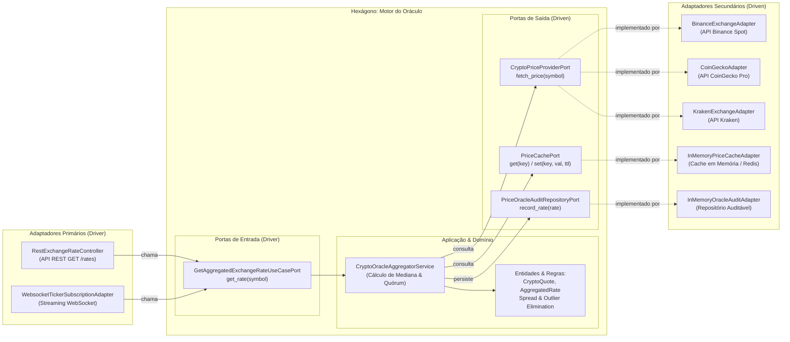

# Exemplo 05: Crypto Currency Exchange Rates (Oráculo Descentralizado)

## 1. Visão Geral e Contexto de Negócio

Em ecossistemas de corretoras cripto, pagamentos internacionais e protocolos DeFi, depender da cotação de uma única exchange (como Binance ou Kraken) é extremamente arriscado. Falhas de conectividade, picos artificiais de preço (*flash loans* ou liquidações em cascata) e lentidão em APIs podem corromper cálculos financeiros.

Um **Oráculo de Preços** resolve esse problema agregando múltiplos feeds de mercado em tempo real, calculando a **taxa mediana** (imune a distorções pontuais de *outliers*), exigindo um **quórum mínimo** de fontes saudáveis e aplicando uma camada de cache temporário com TTL para economizar limites de requisição (*rate limits*).

A **Arquitetura Hexagonal** permite:
- Manter o cálculo de mediana estatística e as regras de quórum 100% isoladas de bibliotecas HTTP ou SDKs de exchanges.
- Trocar, adicionar ou remover corretoras (Binance, CoinGecko, Kraken, OKX) criando apenas novos adaptadores secundários que implementam `CryptoPriceProviderPort`.
- Conectar múltiplos adaptadores primários (REST API para consultas pontuais e WebSockets para streaming contínuo).

---

## 2. Diagrama da Arquitetura Hexagonal



---

## 3. Estrutura do Exemplo

```text
05-crypto-currency-exchange-rates/
├── domain/
│   ├── models.py                     # CryptoQuote, AggregatedRate
│   └── exceptions.py                 # UnsupportedSymbol, OracleQuorumFailed
├── ports/
│   ├── driver.py                     # GetAggregatedExchangeRateUseCasePort
│   └── driven.py                     # CryptoPriceProviderPort, PriceCachePort, AuditPort
├── core/
│   └── service.py                    # CryptoOracleAggregatorService (Mediana e Quórum)
├── adapters/
│   ├── primary/
│   │   ├── rest_exchange_rate_controller.py # Inbound REST API
│   │   └── websocket_ticker_adapter.py      # Inbound Streaming WebSocket
│   └── secondary/
│       ├── binance_adapter.py               # Outbound Binance
│       ├── coingecko_adapter.py             # Outbound CoinGecko
│       ├── kraken_adapter.py                # Outbound Kraken
│       ├── in_memory_price_cache_adapter.py # Outbound Cache com TTL
│       └── in_memory_oracle_audit_adapter.py# Outbound Auditoria
├── main.py                           # Composition Root e cenários de execução
└── README.md                         # Documentação técnica
```

---

## 4. Cenários Demonstrados no `main.py`

1. **Agregação em Tempo Real:** Consulta aos 3 provedores simultâneos com apuração da mediana oficial.
2. **Cache Hit:** Consulta imediata subsequente atendida pelo adaptador de cache sem onerar provedores externos.
3. **Resistência a Outliers e Glitches:** Simulação de preço incorreto reportado por uma das fontes ($ 98.000); o cálculo mediano absorve a anomalia sem contaminar o resultado final.
4. **Proteção por Quórum Mínimo:** Se mais fontes caírem do que o limite de segurança, a operação falha deliberadamente em vez de expor preços manipuláveis ou com baixa liquidez.
5. **Streaming via WebSocket:** Adaptador primário assíncrono emitindo ticks atualizados para clientes inscritos.
6. **Validação de Moedas Homologadas:** Rejeição de símbolos não cadastrados no domínio.

---

## 5. Como Executar

```bash
python3 main.py
```
