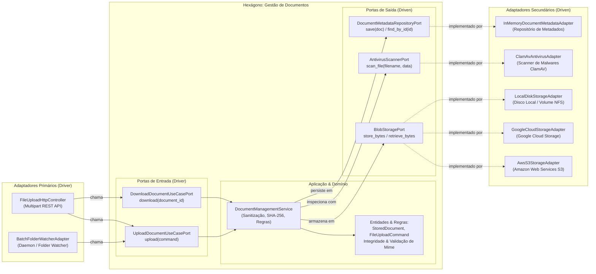

# Exemplo 06: File Processing & Multi-Cloud Storage Agnostic

## 1. Visão Geral e Contexto de Negócio

No ciclo de vida de arquivos em aplicações corporativas (contratos, prontuários médicos, notas fiscais, imagens cadastrais), sistemas frequentemente sofrem de acoplamento com provedores proprietários de nuvem (como SDKs de AWS S3, Google Cloud Storage, Azure Blob Storage ou sistemas de arquivos locais).

Quando o código de negócio importa bibliotecas como `boto3` ou `google-cloud-storage` diretamente dentro de regras de upload e validação:
- Testes unitários tornam-se lentos e difíceis, exigindo emuladores complexos (LocalStack, MinIO).
- Migrações multi-nuvem ou estratégias híbridas tornam-se inviáveis financeiramente.
- Políticas corporativas de sanitização (varredura antivírus, cálculo de integridade SHA-256 e validação de extensão) ficam espalhadas e inconsistentes.

A **Arquitetura Hexagonal** resolve esse problema mantendo a lógica de validação, cálculo de integridade e inspeção contra ameaças puramente dentro do hexágono. O armazenamento físico em si é apenas um detalhe implementado por adaptadores secundários que implementam `BlobStoragePort`.

---

## 2. Diagrama da Arquitetura Hexagonal



---

## 3. Estrutura do Exemplo

```text
06-file-processing-and-storage/
├── domain/
│   ├── models.py                     # StoredDocument, FileUploadCommand, StorageProviderType
│   └── exceptions.py                 # FileTooLarge, DisallowedFileType, MalwareDetected
├── ports/
│   ├── driver.py                     # UploadDocumentUseCasePort, DownloadDocumentUseCasePort
│   └── driven.py                     # BlobStoragePort, AntivirusScannerPort, MetadataRepositoryPort
├── core/
│   └── service.py                    # DocumentManagementService (Sanitização e Integridade)
├── adapters/
│   ├── primary/
│   │   ├── file_upload_http_controller.py # Inbound REST API
│   │   └── batch_folder_watcher_adapter.py# Inbound Batch Ingestion
│   └── secondary/
│       ├── aws_s3_storage_adapter.py         # Outbound AWS S3
│       ├── google_cloud_storage_adapter.py   # Outbound GCS
│       ├── local_disk_storage_adapter.py     # Outbound Disco Local
│       ├── clamav_antivirus_adapter.py       # Outbound Antivírus
│       └── in_memory_metadata_adapter.py     # Outbound Metadados
├── main.py                           # Composition Root e cenários de execução
└── README.md                         # Documentação técnica
```

---

## 4. Cenários Demonstrados no `main.py`

1. **Upload Padrão para AWS S3:** Ingestão de PDF de contrato com geração de hash SHA-256 e gravação segura.
2. **Download e Verificação de Integridade:** Recuperação de conteúdo original com auditoria de integridade.
3. **Substituição Dinâmica de Provedor de Nuvem:** Troca transparente do destino de armazenamento do S3 para Google Cloud Storage (GCS) sem alteração no código de aplicação.
4. **Bloqueio por Scanner Antivírus:** Detecção preventiva de ameaças maliciosas (assinatura EICAR) via Driven Port antes de qualquer gravação em disco ou nuvem.
5. **Rejeição por Extensão Perigosa:** Bloqueio imediato de arquivos executáveis `.sh` ou `.exe`.
6. **Ingestão em Lote via Watcher:** Daemon de diretório enviando arquivos de forma concorrente para o mesmo núcleo.
7. **Auditoria Centralizada de Metadados:** Exibição dos registros salvos no repositório secundário.

---

## 5. Como Executar

```bash
python3 main.py
```
