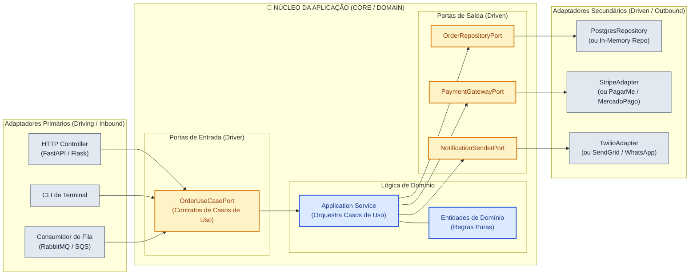

# 🔷 Arquitetura Hexagonal (Ports & Adapters)

> Concebida por Alistair Cockburn em 2005 para libertar o núcleo da aplicação do acoplamento a bancos de dados, interfaces de usuário e frameworks, permitindo que a aplicação seja executada igualmente por usuários, programas, testes automatizados ou scripts de lote.

---

## 📖 1. O que é e Origem Histórica

A **Arquitetura Hexagonal**, formalmente batizada como padrão **Ports & Adapters (Portas e Adaptadores)**, foi criada em **2005 pelo engenheiro Alistair Cockburn**. Ela nasceu para resolver uma falha clássica da arquitetura em camadas tradicional: o vazamento de detalhes de infraestrutura (SQL, HTTP, bibliotecas de terceiros) para o código de negócio.

Na Arquitetura Hexagonal:
- O **Hexágono (Core da Aplicação)** contém toda a lógica de negócio, entidades e regras de domínio. Ele não depende de nada externo.
- As **Portas (Ports)** são contratos abstratos (interfaces puras em Python via `abc.ABC` ou `typing.Protocol`) que definem como o mundo exterior entra no núcleo, ou como o núcleo se comunica com serviços externos.
- Os **Adaptadores (Adapters)** são as pontes tecnológicas que implementam ou chamam as portas, adaptando o formato externo para o contrato que o Core compreende.

### Tipos de Portas e Adaptadores:
1. **Portas Primárias (Driver / Inbound Ports)**:
   - Definem a API de casos de uso do Core (o que a aplicação é capaz de fazer).
   - Exemplos: `CheckoutUseCasePort`, `RegisterUserPort`.
2. **Adaptadores Primários (Driver / Inbound Adapters)**:
   - Quem inicia a chamada em direção ao Core.
   - Exemplos: Controller HTTP (FastAPI, Flask), CLI de terminal, consumidor de mensageria (RabbitMQ, Kafka).
3. **Portas Secundárias (Driven / Outbound Ports)**:
   - Definem o que o Core necessita do mundo exterior para cumprir sua tarefa.
   - Exemplos: `PaymentGatewayPort`, `OrderRepositoryPort`, `NotificationPort`.
4. **Adaptadores Secundários (Driven / Outbound Adapters)**:
   - Quem é chamado pelo Core para executar operações de I/O.
   - Exemplos: `StripePaymentAdapter`, `PostgresOrderRepository`, `AwsS3StorageAdapter`, `TwilioSmsAdapter`.

---

## 📊 2. Diagrama Conceitual da Arquitetura (Mermaid)

---

## 🔒 3. Regras Invariantes (O que NUNCA fazer)

1. **A Regra de Ouro da Inversão de Dependência (DIP)**: O código dentro de `domain/` e `core/` **NUNCA** pode importar módulos dentro de `adapters/`. Todas as dependências apontam para dentro, em direção às abstrações de portas.
2. **O Domínio NUNCA Conhece Bibliotecas de Terceiros de I/O**: Nada de `import requests`, `import sqlalchemy`, `import boto3` ou `import stripe` no domínio. Se precisar de uma requisição externa, crie uma Porta e implemente o cliente no Adaptador.
3. **Substituibilidade de Adaptadores**: Deve ser possível substituir um adaptador de banco real por um adaptador em memória (`InMemoryRepository`) sem alterar **nenhuma** linha do `service.py` ou do `domain/`.
4. **Isolamento de DTOs nas Fronteiras**: Erros de bibliotecas externas (ex: `stripe.error.CardError` ou `botocore.exceptions.ClientError`) devem ser interceptados dentro do Adaptador e traduzidos para exceções de domínio ou retornos tipados da Porta.

---

## ⚖️ 4. Vantagens e Trade-offs Reais

### Vantagens
- **Testabilidade Absoluta sem Mocks Complexos**: Como toda a I/O é uma Porta, seus testes unitários podem rodar em milissegundos injetando adaptadores em memória falsos (*fakes*), sem precisar subir containers Docker ou mockar sockets de rede.
- **Proteção Total contra Vendor Lock-in**: Trocar de provedor de nuvem (AWS S3 para Google Cloud Storage) ou de gateway de pagamento (Stripe para Pagarme) afeta apenas um único arquivo adaptador. O negócio permanece intacto.
- **Múltiplos Meios de Entrada Gratuitos**: A mesma aplicação pode ser disparada simultaneamente por rotas HTTP, linha de comando CLI ou testes automatizados, plugando adaptadores diferentes na mesma porta de entrada.

### Desvantagens e Trade-offs
- **Proliferação de Classes e Interfaces**: Para cada integração externa é necessário criar a Porta abstrata, o Adaptador concreto e fazer o mapeamento entre objetos de domínio e DTOs externos.
- **Curva de Aprendizado**: Desenvolvedores habituados ao modelo tradicional de importar o ORM diretamente nos serviços precisam se acostumar com a Inversão de Controle e Injeção de Dependências.

---

## 🚦 5. Quando Usar vs Quando NÃO Usar

### Quando Usar
- Aplicações que integram múltiplos serviços externos variáveis (gateways de pagamento, emissão de notas fiscais, SMS/WhatsApp).
- Sistemas com regras de negócio críticas onde a testabilidade sem dependências externas é mandatória.
- Softwares corporativos de longa vida útil sujeitos a trocas de infraestrutura ao longo dos anos.

### Quando NÃO Usar
- Scripts utilitários descartáveis ou MVPs de curtíssimo prazo com poucas regras de negócio (onde o custo das interfaces não se paga).
- CRUDs triviais sem nenhuma integração externa (utilize arquitetura em camadas direta).

---

## 📁 6. Índice dos Exemplos Práticos

Cada pasta interna implementa o padrão com pastas explícitas (`domain/`, `ports/`, `core/`, `adapters/`) e código limpo em Python 3:

| Pasta | Cenário do Dia a Dia | Porta em Destaque | Adaptadores Plugados |
|---|---|---|---|
| [`01-payment-gateway-multiplexer/`](./01-payment-gateway-multiplexer/) | **Múltiplos Gateways com Fallback** | `PaymentGatewayPort` | StripeAdapter, PagarmeAdapter, MercadoPagoAdapter |
| [`02-multi-channel-notification-service/`](./02-multi-channel-notification-service/) | **Notificações Multicanal** | `NotificationSenderPort` | SendGridEmailAdapter, TwilioSmsAdapter, WhatsAppAdapter |
| [`03-order-checkout-core/`](./03-order-checkout-core/) | **Core de Pedidos com Múltiplos Inbound** | `CheckoutUseCasePort` | CliInputAdapter e HttpRestInputAdapter sobre o mesmo Core |
| [`04-loan-credit-analysis/`](./04-loan-credit-analysis/) | **Análise de Crédito Imobiliário** | `CreditBureauPort` | SerasaAdapter, BoaVistaAdapter, MockBureauAdapter |
| [`05-crypto-currency-exchange-rates/`](./05-crypto-currency-exchange-rates/) | **Oráculo de Cotações com Mediana** | `ExchangeRateOraclePort` | BinanceAdapter, CoinGeckoAdapter, KrakenAdapter |
| [`06-file-processing-and-storage/`](./06-file-processing-and-storage/) | **Storage Agnóstico de Arquivos** | `FileStoragePort` | LocalStorageAdapter, AwsS3StorageAdapter, GcsStorageAdapter |

---

  Navegue pelas pastas acima para explorar a implementação de cada cenário.

