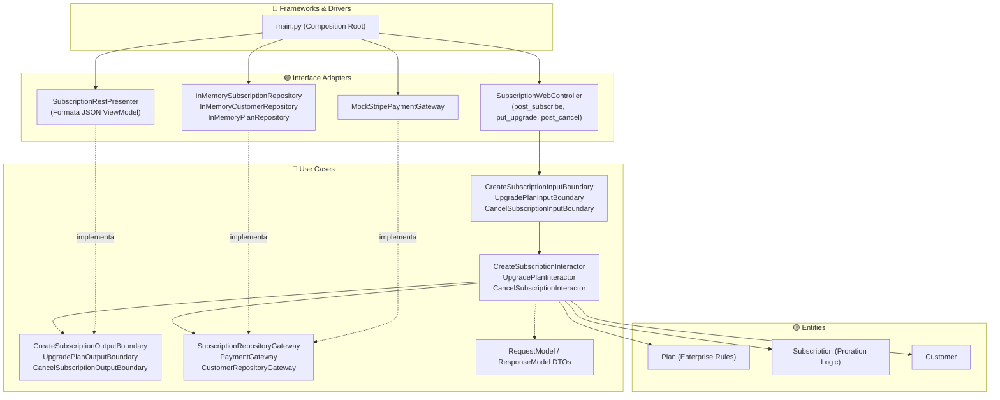

# Exemplo 01: Subscription Billing SaaS (Faturamento Recorrente)

## 1. Visão Geral e Contexto de Negócio

Em modelos de negócio SaaS (Software as a Service), o ciclo de faturamento recorrente envolve regras empresariais críticas que não devem se misturar com detalhes de frameworks web ou bibliotecas de pagamento (Stripe, Pagarme, PayPal):
- **Cálculo de Proration:** Ao realizar um upgrade no meio do ciclo de faturamento, o valor não utilizado do plano anterior é abatido como crédito proporcional para o novo plano.
- **Ciclos de Cobrança:** Suporte a planos mensais e anuais com precificação diferenciada.
- **Cancelamento e Bloqueio de Estados Inválidos:** Proibição de operações como upgrade sobre assinaturas já canceladas.

A **Clean Architecture** permite que a fórmula atuarial de proration e os estados da assinatura pertençam exclusivamente à camada **Entities**, enquanto o fluxo de ativação, cobrança e persistência seja orquestrado pelos **Use Cases**, isolando totalmente o gateway de cartão e o banco de dados.

---

## 2. Diagrama das Camadas da Clean Architecture



---

## 3. Estrutura do Exemplo

```text
01-subscription-billing-saas/
├── entities/
│   ├── models.py                # Plan, Customer, Subscription, Proration Logic
│   └── exceptions.py            # InvalidPlan, SubscriptionAlreadyCancelled
├── use_cases/
│   ├── dto.py                   # Request e Response Models (DTOs)
│   ├── boundaries.py            # Input Boundaries, Output Boundaries, Gateway Interfaces
│   └── interactors.py           # CreateSubscription, UpgradePlan, CancelSubscription
├── interface_adapters/
│   ├── controllers.py           # SubscriptionWebController
│   ├── presenters.py            # SubscriptionRestPresenter
│   └── gateways.py              # InMemory Repositories e PaymentGateway
├── main.py                      # Composition Root e execução dos cenários
└── README.md                    # Documentação do exemplo
```

---

## 4. Cenários Demonstrados no `main.py`

1. **Assinatura Mensal Inicial:** Cliente assina o plano Professional com cobrança de R$ 99,00 autorizada e cálculo da data de renovação.
2. **Upgrade com Proration:** Upgrade para Enterprise calculando o crédito não utilizado do ciclo atual e cobrando apenas a diferença residual.
3. **Recusa de Cartão de Crédito:** Tratamento gracioso quando o gateway recusa a transação, sem deixar a assinatura em estado inconsistente.
4. **Validação de Caso de Uso:** Tentativa de assinar plano inexistente no catálogo tratada pelo interactor.
5. **Cancelamento:** Encerramento formal do ciclo e inativação da assinatura.
6. **Proteção de Invariante Corporativa:** Bloqueio de upgrade sobre assinatura previamente cancelada.

---

## 5. Como Executar

```bash
python3 main.py
```
