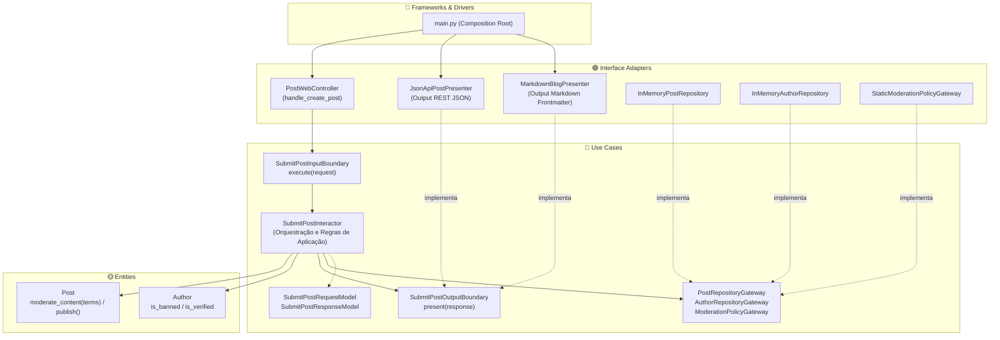

# Exemplo 02: Social Media Content Publishing & Automated Moderation

## 1. Visão Geral e Contexto de Negócio

Plataformas de publicação e redes sociais exigem políticas rigorosas de moderação de conteúdo (como identificação de termos proibidos, spam e proteção contra fraudes). Além disso, o mesmo conteúdo aprovado pode precisar ser entregue em diferentes formatos:
1. Em formato **JSON** para consumo por aplicativos móveis e APIs REST.
2. Em formato **Markdown** com frontmatter para renderizadores de páginas estáticas (Jekyll, Hugo, Astro).

A **Clean Architecture** demonstra seu maior trunfo através do **Output Boundary (Presenter)**:
- O Caso de Uso (`SubmitPostInteractor`) e a Entidade (`Post`) executam as validações de autor e moderação de forma 100% pura.
- O Caso de Uso não sabe como os dados serão exibidos. Ele emite um `SubmitPostResponseModel` para o `SubmitPostOutputBoundary`.
- Dois apresentadores distintos (`JsonApiPostPresenter` e `MarkdownBlogPresenter`) implementam essa mesma interface de saída, provando a independência absoluta de UI e formatos de entrega.

---

## 2. Diagrama das Camadas da Clean Architecture



---

## 3. Estrutura do Exemplo

```text
02-social-media-content-publishing/
├── entities/
│   ├── models.py                     # Post, Author, Regras de Moderação
│   └── exceptions.py                 # AuthorBannedException
├── use_cases/
│   ├── dto.py                        # SubmitPostRequestModel, ResponseModel
│   ├── boundaries.py                 # InputBoundary, OutputBoundary, Gateways
│   └── interactors.py                # SubmitPostInteractor
├── interface_adapters/
│   ├── controllers.py                # PostWebController
│   ├── presenters.py                 # JsonApiPostPresenter e MarkdownBlogPresenter
│   └── gateways.py                   # Repositórios e Políticas de Moderação
├── main.py                           # Composition Root e cenários
└── README.md                         # Documentação técnica
```

---

## 4. Cenários Demonstrados no `main.py`

1. **Publicação Válida via API REST:** Post aprovado na moderação e formatado como JSON estruturado pelo `JsonApiPostPresenter`.
2. **Mesmo Caso de Uso Gerando Markdown:** Artigo técnico aprovado e formatado como post Markdown com metadados de cabeçalho pelo `MarkdownBlogPresenter`.
3. **Rejeição por Regra de Domínio:** Bloqueio preventivo na Entidade ao detectar termos impróprios ("pirataria", "fraude").
4. **Rejeição por Regra de Caso de Uso:** Bloqueio de envio originado de autor suspenso/banido da plataforma.
5. **Consulta de Conteúdo Aprovado:** Recuperação dos artigos publicados a partir da interface do repositório.

---

## 5. Como Executar

```bash
python3 main.py
```
