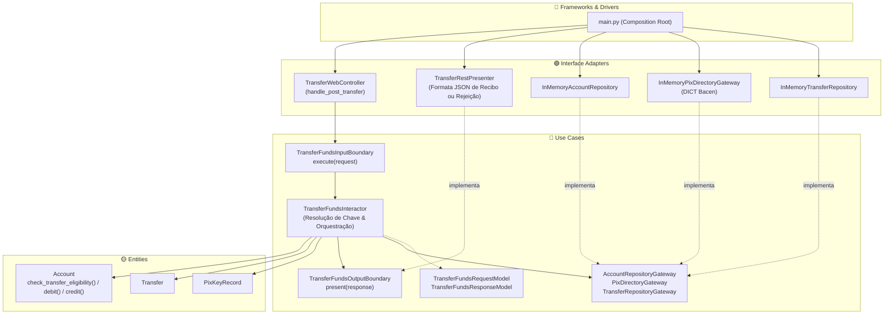

# Exemplo 03: Digital Banking Transfers (PIX & TED com Regras BACEN)

## 1. Visão Geral e Contexto de Negócio

Em sistemas bancários digitais e fintechs, a integridade transacional e o cumprimento de diretrizes regulatórias do Banco Central (BACEN) são mandatórios:
- **Resolução de Chaves PIX (DICT):** O caso de uso deve consultar o diretório central para traduzir chaves (E-mail, CPF, Telefone) para os dados da conta favorecida.
- **Limites de Horário Noturno:** Regra de segurança regulatória que impõe um teto reduzido (ex: R$ 1.000,00) para transações entre 20h e 06h.
- **Validação de Invariantes na Entidade:** Saldo positivo, bloqueio preventivo de conta e débito/crédito atômicos operam exclusivamente na camada `Entities`.

A **Clean Architecture** garante que:
- O cálculo de saldo e as regras de limite noturno não dependem de banco de dados ou da biblioteca web.
- A consulta ao DICT e a gravação de extratos ocorrem através de interfaces Gateway desacopladas.
- O Presenter converte os resultados em respostas com padrão REST sem vazar objetos internos de banco.

---

## 2. Diagrama das Camadas da Clean Architecture



---

## 3. Estrutura do Exemplo

```text
03-digital-banking-transfers/
├── entities/
│   ├── models.py                     # Account, Transfer, PixKeyRecord, Regras de Elegibilidade
│   └── exceptions.py                 # Exceções de regras de domínio
├── use_cases/
│   ├── dto.py                        # TransferFundsRequestModel, ResponseModel
│   ├── boundaries.py                 # InputBoundary, OutputBoundary, Gateways
│   └── interactors.py                # TransferFundsInteractor
├── interface_adapters/
│   ├── controllers.py                # TransferWebController
│   ├── presenters.py                 # TransferRestPresenter
│   └── gateways.py                   # InMemory Repositórios e DICT Mock
├── main.py                           # Composition Root e cenários de execução
└── README.md                         # Documentação técnica
```

---

## 4. Cenários Demonstrados no `main.py`

1. **Transferência PIX Diurna:** Envio autorizado via chave de e-mail com atualização de saldos atômica.
2. **Transferência TED:** Envio autorizado para número de conta direta.
3. **Bloqueio por Saldo Insuficiente:** Entidade de negócio recusa a operação antes de gerar qualquer efeito colateral.
4. **Violação do Limite Noturno do BACEN:** Transferência acima de R$ 1.000,00 no período noturno recusada pela política de segurança.
5. **Conta Bloqueada Administrativamente:** Bloqueio preventivo de movimentações para contas em averiguação.
6. **Chave Inexistente no DICT:** Caso de uso trata a ausência da chave no diretório central.
7. **Auditoria de Transações:** Consulta de histórico completo de débitos, créditos e transações recusadas.

---

## 5. Como Executar

```bash
python3 main.py
```
