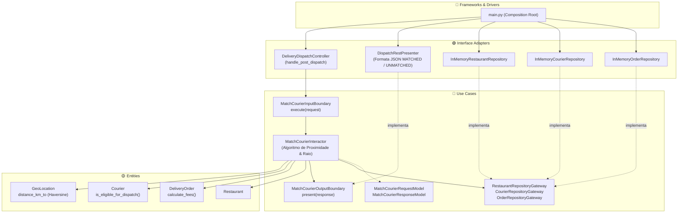

# Exemplo 04: Food Delivery Courier Dispatch & Geo-Matching

## 1. Visão Geral e Contexto de Negócio

Em plataformas de entrega sob demanda (iFood, Rappi, Uber Eats, DoorDash), a alocação de entregadores (*dispatch/matching*) requer velocidade, exatidão de regras geodésicas e desacoplamento de provedores de mapas (como Google Maps ou Mapbox):
- **Cálculo Geodésico Puro:** A fórmula de Haversine para cálculo de distância entre coordenadas de latitude e longitude é uma regra matemática que reside puramente na camada **Entities** (`GeoLocation`).
- **Elegibilidade Corporativa:** Entregadores com bicicleta possuem raio máximo de deslocamento (ex: até 4 km), e entregadores ocupados são descartados das buscas.
- **Divisão de Tarifas (Logística):** Cálculo automatizado do frete cobrado do cliente versus o repasse proporcional pago ao entregador.

A **Clean Architecture** permite simular e evoluir o algoritmo de matching sem necessidade de banco de dados espacial (como PostGIS) ou bibliotecas externas pesadas, operando com total determinismo e rapidez em testes de regressão.

---

## 2. Diagrama das Camadas da Clean Architecture



---

## 3. Estrutura do Exemplo

```text
04-food-delivery-matching/
├── entities/
│   ├── models.py                     # GeoLocation (Haversine), Courier, DeliveryOrder, Restaurant
│   └── exceptions.py                 # DeliveryEntityException
├── use_cases/
│   ├── dto.py                        # MatchCourierRequestModel, ResponseModel
│   ├── boundaries.py                 # Boundaries e Gateways
│   └── interactors.py                # MatchCourierInteractor
├── interface_adapters/
│   ├── controllers.py                # DeliveryDispatchController
│   ├── presenters.py                 # DispatchRestPresenter
│   └── gateways.py                   # Repositórios em memória
├── main.py                           # Composition Root e cenários de execução
└── README.md                         # Documentação técnica
```

---

## 4. Cenários Demonstrados no `main.py`

1. **Alocação Ótima Inicial:** Pedido associado ao entregador disponível mais próximo (distância de pickup ~0.5 km) com cálculo de comissão.
2. **Segundo Pedido Sequencial:** Primeiro entregador torna-se ocupado (`is_busy=True`); o sistema seleciona o segundo entregador mais próximo disponível.
3. **Esgotamento de Raio (Unmatched):** Sem entregadores disponíveis dentro do raio de tolerância do restaurante (404 Not Found estruturado).
4. **Proteção de Inexistência de Restaurante:** Rejeição segura ao solicitar corrida para restaurante não catalogado.

---

## 5. Como Executar

```bash
python3 main.py
```
