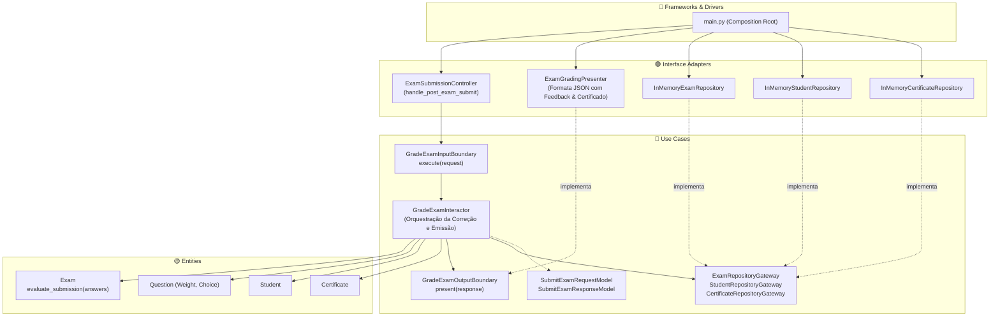

# Exemplo 05: Online Exam Grading Platform & Certificate Issuer

## 1. Visão Geral e Contexto de Negócio

Plataformas de provas e certificações profissionais (Coursera, Udemy, certificações Cloud) exigem precisão absoluta em suas regras de pontuação e critérios de corte:
- **Pontuação Ponderada:** Cada questão tem um peso específico (`weight`) atribuído pela banca examinadora.
- **Avaliação Pura na Entidade:** A comparação entre o gabarito oficial e as alternativas assinaladas pelo aluno, o cálculo percentual e a verificação do percentual de corte (`min_passing_percent`) são regras corporativas da entidade `Exam`.
- **Emissão Condicional de Certificado:** Se o estudante for aprovado, o caso de uso cria e arquiva um certificado com hash identificador único.

A **Clean Architecture** assegura que o algoritmo de avaliação e as regras de pontuação permaneçam 100% isolados de bibliotecas de geração de PDF, banco de dados ou frameworks de front-end.

---

## 2. Diagrama das Camadas da Clean Architecture



---

## 3. Estrutura do Exemplo

```text
05-online-exam-grading-platform/
├── entities/
│   ├── models.py                     # Exam, Question, Student, Certificate, evaluate_submission
│   └── exceptions.py                 # ExamEntityException
├── use_cases/
│   ├── dto.py                        # SubmitExamRequestModel, ResponseModel
│   ├── boundaries.py                 # InputBoundary, OutputBoundary, Gateways
│   └── interactors.py                # GradeExamInteractor
├── interface_adapters/
│   ├── controllers.py                # ExamSubmissionController
│   ├── presenters.py                 # ExamGradingPresenter
│   └── gateways.py                   # Repositórios de exames e certificados
├── main.py                           # Composition Root e cenários de execução
└── README.md                         # Documentação técnica
```

---

## 4. Cenários Demonstrados no `main.py`

1. **Aprovação Plena com Certificado:** Aluno atinge 100% de aproveitamento em exame de Clean Architecture; certificado oficial emitido e registrado no repositório.
2. **Reprovação por Nota de Corte:** Aluna com rendimento de 40% (abaixo do corte mínimo de 70%); feedback detalhado sem emissão de certificado.
3. **Validação de Exame Inexistente:** Tratamento de identificador de prova inválido.
4. **Auditoria Oficial de Certificado:** Recuperação de registro histórico no repositório persistente.

---

## 5. Como Executar

```bash
python3 main.py
```
