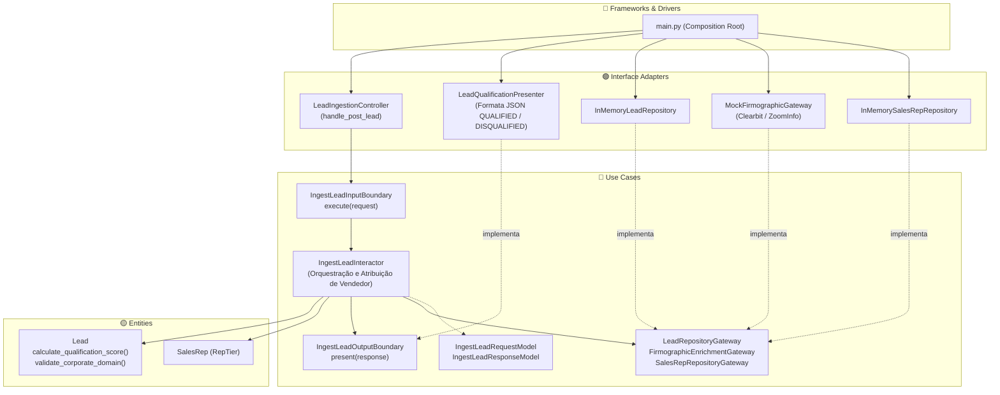

# Exemplo 06: B2B CRM Lead Enrichment & Scoring Pipeline

## 1. Visão Geral e Contexto de Negócio

Em estratégias de vendas B2B (Salesforce, HubSpot, Apollo), a qualificação rápida e precisa de novos contatos (*inbound leads*) determina a taxa de conversão comercial. O pipeline deve executar:
- **Validação de Domínio Corporativo:** Rejeição de endereços gratuitos (@gmail, @hotmail) para evitar ruído no funil de vendas.
- **Enriquecimento Firmográfico:** Consulta a fontes de inteligência de mercado para descobrir porte de funcionários e faturamento estimado da empresa.
- **Pontuação Ponderada na Entidade (Lead Scoring):** A entidade `Lead` calcula a pontuação somando critérios de tamanho, receita e senioridade do contato (C-Level, Diretor, Gerente).
- **Atribuição Automatizada (SDR/Account Executive):** Encaminhamento do lead para vendedores especializados conforme o porte (Enterprise, Mid-Market ou SMB).

A **Clean Architecture** permite que a fórmula de scoring e os critérios de roteamento comercial sejam alterados e testados com rapidez, sem acoplamento a APIs específicas de CRM ou serviços de terceiros de dados firmográficos.

---

## 2. Diagrama das Camadas da Clean Architecture



---

## 3. Estrutura do Exemplo

```text
06-crm-lead-enrichment-pipeline/
├── entities/
│   ├── models.py                     # Lead, SalesRep, calculate_qualification_score
│   └── exceptions.py                 # CrmEntityException
├── use_cases/
│   ├── dto.py                        # IngestLeadRequestModel, ResponseModel
│   ├── boundaries.py                 # InputBoundary, OutputBoundary, Gateways
│   └── interactors.py                # IngestLeadInteractor
├── interface_adapters/
│   ├── controllers.py                # LeadIngestionController
│   ├── presenters.py                 # LeadQualificationPresenter
│   └── gateways.py                   # Repositórios e Gateway firmográfico
├── main.py                           # Composition Root e cenários de execução
└── README.md                         # Documentação técnica
```

---

## 4. Cenários Demonstrados no `main.py`

1. **Lead Enterprise (HOT):** CTO de empresa com 1.200 colaboradores e US$ 85M de receita; atinge 100 pontos e é roteado para o executivo de contas Enterprise.
2. **Lead Mid-Market (WARM):** Gerente de TI em empresa de médio porte; atinge 65 pontos e é atribuído ao time Mid-Market.
3. **Lead SMB (COLD):** Atendente de microempresa; atinge 15 pontos e é direcionado para nutrição por automação (SMB).
4. **Desqualificação Preventiva:** Rejeição imediata de cadastro com e-mail gratuito pessoal (@gmail.com).

---

## 5. Como Executar

```bash
python3 main.py
```
