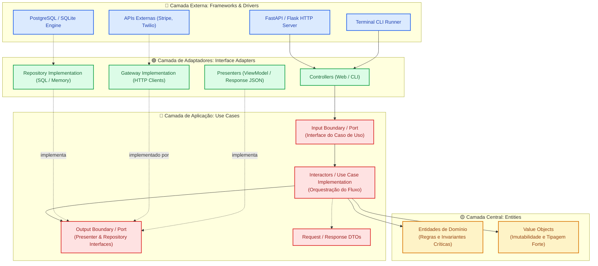
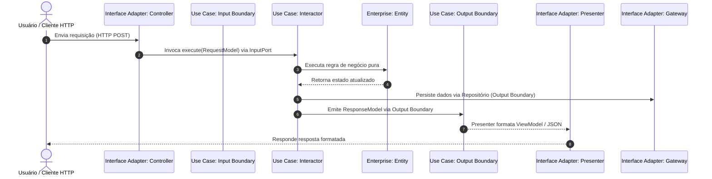

# 🏛️ Clean Architecture (Arquitetura Limpa)

> Formulada por Robert C. Martin ("Uncle Bob") em 2012, a Clean Architecture unifica e aperfeiçoa as propostas da Arquitetura Hexagonal (Cockburn), Onion Architecture (Palermo) e Screaming Architecture. Seu pilar fundamental é a **Regra da Dependência (The Dependency Rule)**: o código-fonte deve apontar exclusivamente para dentro, das camadas de menor nível (detalhes técnicos) em direção às camadas de maior nível (regras de negócio puras).

---

## 📖 1. O que é e Origem Histórica

Ao longo das décadas de 1990 e 2000, diferentes autores propuseram soluções para o mesmo sintoma: sistemas que se tornavam reféns de seus frameworks, bancos de dados e interfaces com o usuário. Em 2012, **Robert C. Martin ("Uncle Bob")** publicou o manifesto unificador da **Clean Architecture**, consolidando esses padrões em **quatro círculos concêntricos fundamentais**:

```text
+-----------------------------------------------------------------------+
|  Frameworks & Drivers (Web, UI, Dispositivos, DB, CLI)                 |
|   +---------------------------------------------------------------+   |
|   |  Interface Adapters (Controllers, Gateways, Presenters)       |   |
|   |   +-------------------------------------------------------+   |   |
|   |   |  Use Cases (Application Business Rules)               |   |   |
|   |   |   +-----------------------------------------------+   |   |   |
|   |   |   |  Entities (Enterprise Business Rules)          |   |   |   |
|   |   |   +-----------------------------------------------+   |   |   |
|   |   +-------------------------------------------------------+   |   |
|   +---------------------------------------------------------------+   |
+-----------------------------------------------------------------------+
```

### Os 4 Círculos Concêntricos

1. **🟡 Entities (Regras de Negócio Corporativas / Enterprise Business Rules):**
   - É o coração mais interno do sistema.
   - Encapsulam as regras e invariantes que existiriam mesmo se a empresa operasse sem computadores (ex: cálculo de juros, regras contábeis, validação de itens de pedido).
   - Não mudam quando o banco de dados, o framework web ou as telas sofrem alterações.

2. **🔴 Use Cases (Regras de Negócio da Aplicação / Application Business Rules):**
   - Orquestram o fluxo de dados que entra e sai das entidades.
   - Definem o "o que a aplicação faz": `CreateSubscriptionUseCase`, `TransferFundsUseCase`, etc.
   - Operam através de contratos abstratos (Input Ports e Output Ports) e manipulam apenas **Request/Response DTOs**, nunca classes concretas de banco de dados ou formulários HTML.

3. **🟢 Interface Adapters (Adaptadores de Interface):**
   - Convertem dados entre os formatos convenientes para os casos de uso e os formatos convenientes para os agentes externos.
   - Contêm:
     - **Controllers:** Recebem requisições externas e acionam os casos de uso.
     - **Presenters:** Preparam os dados gerados pelo caso de uso para a exibição (ViewModel/JSON/HTML).
     - **Gateways & Repositories:** Implementam os contratos de persistência e serviços externos exigidos pelos casos de uso.

4. **🔵 Frameworks & Drivers (Infraestrutura / Detalhes Técnicos):**
   - É a camada mais externa e volátil.
   - Contém bancos de dados específicos (PostgreSQL, SQLite, DynamoDB), frameworks web (FastAPI, Flask, Django), bibliotecas de mensageria, serviços de terceiros e consoles de terminal.
   - **Toda essa camada é tratada como um mero detalhe descartável.**

---

## 📊 2. Diagrama Conceitual da Arquitetura (Mermaid)



---

## 🔄 3. O Fluxo de Controle vs A Regra da Dependência

Um dos conceitos mais refinados da Clean Architecture é a separação entre a **direção do fluxo de execução em tempo de execução** e a **direção das dependências de código-fonte em tempo de compilação**:



> [!NOTE]
> Observe que o **Interactor** chama o **Presenter** através de uma interface abstrata (`Output Boundary`). O Interactor **não sabe** se a resposta será renderizada em HTML, exibida no console ou devolvida como JSON de uma API REST!

---

## 🔒 4. Regras Invariantes (O que NUNCA fazer)

1. **A Regra da Dependência é Absoluta:**
   - Nenhuma linha de código nas camadas internas pode citar nomes de classes, funções ou pacotes definidos nas camadas externas.
   - `entities/` e `use_cases/` **NUNCA** contêm `import fastapi`, `import sqlalchemy`, `import requests` ou `import pydantic`.
2. **Entidades NUNCA Atravessam a Fronteira de Apresentação:**
   - O Controller não recebe entidades; recebe DTOs brutos.
   - O Presenter não recebe entidades de domínio; recebe estritamente um `ResponseModel` (DTO de saída) emitido pelo caso de uso.
3. **Casos de Uso NÃO Retornam Exceções de Framework:**
   - Erros de banco (ex: `OperationalError` do SQLite/Postgres) são capturados no Gateway/Repositório e traduzidos para falhas declaradas nos contratos do caso de uso.
4. **Isolamento de Persistência:**
   - A entidade de domínio **não é** um modelo ORM. Se você usar SQLAlchemy ou Django ORM, as tabelas pertencem à camada `Frameworks & Drivers`. O repositório converte o modelo ORM para a entidade pura do domínio.

---

## ⚖️ 5. Vantagens e Trade-offs Reais

### Vantagens
- **Independência de Frameworks:** O framework é um plugin. Trocar FastAPI por Flask ou CLI exige apenas alterar a camada externa.
- **Testabilidade Total:** Casos de uso e entidades podem ser testados unitariamente em frações de segundo sem banco de dados, sem servidor web e sem mockar requisições de rede.
- **Independência de Banco de Dados:** Você pode alternar entre PostgreSQL, MongoDB ou armazenamento em memória sem tocar em uma única linha de regras de negócio.
- **Arquitetura Gritante (Screaming Architecture):** A estrutura de pastas reflete os casos de uso do negócio (ex: `CancelSubscriptionUseCase`), não os frameworks técnicos.

### Desvantagens e Trade-offs
- **Complexidade e Número de Arquivos:** Cada operação envolve DTO de entrada, DTO de saída, Input Port, Output Port, Interactor, Controller, Presenter e Gateway.
- **Overhead de Mapeamento de Dados:** Dados precisam ser copiados de DTOs para Entidades, de Entidades para DTOs e de DTOs para ViewModels.
- **Overkill para Sistemas Triviais:** Para CRUDs simples de leitura e escrita direta, a Clean Architecture adiciona sobrecarga desnecessária.

---

## 🚦 6. Quando Usar vs Quando NÃO Usar

| Cenário | Usar Clean Architecture? | Justificativa |
|---|:---:|---|
| **SaaS com Regras Críticas de Negócio** (Billing, Fintech, Logística) | ✅ **SIM** | Isola regras financeiras e fluxos contratuais de provedores de infraestrutura. |
| **Sistemas com Múltiplas Interfaces** (Web, Mobile, CLI, Cron) | ✅ **SIM** | O mesmo Interactor e Entidades atendem a todas as interfaces sem duplicação. |
| **Aplicações de Longo Ciclo de Vida** (> 3-5 anos) | ✅ **SIM** | Protege o investimento do negócio contra obsolescência de bibliotecas e frameworks. |
| **Projetos CRUD Triviais / Painéis de Admin Simples** | ❌ **NÃO** | Use arquitetura em camadas tradicional ou MVC simples para evitar boilerplate inútil. |
| **Scripts descartáveis / Ferramentas de Automação Rápida** | ❌ **NÃO** | Scripts procedurais com funções diretas são ordens de grandeza mais produtivos. |

---

## 📁 7. Índice dos 6 Exemplos Práticos

Cada exemplo abaixo foi implementado seguindo rigorosamente a divisão em 4 camadas concêntricas (`entities/`, `use_cases/`, `interface_adapters/`, `frameworks_and_drivers/`), acompanhado de testes de execução:

| Exemplo | Domínio de Aplicação | Regra Crítica de Negócio | Destaque Arquitetural |
|---|---|---|---|
| [`01-subscription-billing-saas/`](./01-subscription-billing-saas/) | **SaaS de Assinatura Recorrente** | Cálculo de *proration*, upgrade de plano e ciclo de faturamento | Presenter desacoplado formatando respostas para Web e CLI |
| [`02-social-media-content-publishing/`](./02-social-media-content-publishing/) | **Moderação e Publicação de Posts** | Moderação com checagem de palavras proibidas e regras de publicação | Múltiplos Presenters (API JSON vs Blog Markdown) |
| [`03-digital-banking-transfers/`](./03-digital-banking-transfers/) | **Transferências PIX / TED** | Limites noturnos, verificação de saldo e chave PIX | Input/Output Boundaries e Repositório agnóstico |
| [`04-food-delivery-matching/`](./04-food-delivery-matching/) | **Matching de Pedidos de Delivery** | Algoritmo de proximidade de entregadores e cálculo de comissão | Interactor puro orquestrando Entidades e Gateway |
| [`05-online-exam-grading-platform/`](./05-online-exam-grading-platform/) | **Correção de Provas e Certificados** | Pontuação ponderada, corte estatístico e emissão de certificado | Entidades puras com invariantes imutáveis |
| [`06-crm-lead-enrichment-pipeline/`](./06-crm-lead-enrichment-pipeline/) | **Qualificação e Scoring de Leads B2B** | Atribuição de pontos baseada em tamanho da empresa e senioridade | Pipeline de regras de negócio sem acoplamento externo |

---

<div align="center">
  <sub>Navegue pelas pastas acima para inspecionar o código-fonte e executar cada exemplo localmente.</sub>
</div>
