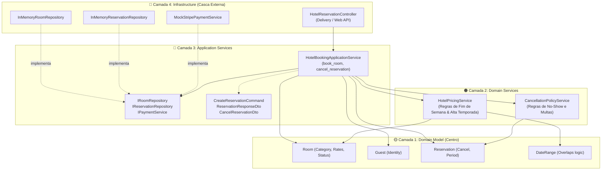

# Exemplo 01: Hotel Room Reservation & Dynamic Pricing

## 1. Visão Geral e Contexto de Negócio

Em sistemas de gestão hoteleira (PMS - Property Management System), as regras de precificação e políticas de cancelamento variam dinamicamente por fatores externos sem que o núcleo do sistema deva se tornar acoplado a frameworks de banco de dados ou meios de pagamento:
- **Precificação Sazonal e Finais de Semana:** A diária base de um quarto sofre acréscimos automáticos de alta temporada (meses de férias) e tarifas especiais de fim de semana (sextas e sábados).
- **Políticas de Cancelamento e No-Show:** Reembolso integral se cancelado com mais de 48h; retenção de 50% de multa se cancelado entre 24h e 48h; retenção total (100% de multa) se cancelado a menos de 24h do check-in.
- **Prevenção de Overbooking:** Verificação de sobreposição temporal de estadias em quartos específicos.

A **Onion Architecture** organiza o sistema em camadas concêntricas perfeitas:
- **Domain Model:** Entidades `Room`, `Guest`, `Reservation` e o Value Object `DateRange`.
- **Domain Services:** `HotelPricingService` (regras sazonais de preço) e `CancellationPolicyService` (cálculo de reembolsos e multas).
- **Application Services:** `HotelBookingApplicationService` orquestra a transação, repositórios e serviços de pagamento.
- **Infrastructure:** Implementações em memória dos repositórios e gateways de pagamento na casca externa.

---

## 2. Diagrama das Camadas da Onion Architecture



---

## 3. Estrutura do Exemplo

```text
01-hotel-room-reservation/
├── domain/
│   ├── model/
│   │   ├── room.py                   # Room, RoomCategory, RoomStatus
│   │   ├── guest.py                  # Guest
│   │   ├── reservation.py            # Reservation, DateRange, ReservationStatus
│   │   └── exceptions.py             # HotelDomainException
│   └── services/
│       ├── pricing_service.py        # HotelPricingService (Domain Service)
│       └── cancellation_policy.py    # CancellationPolicyService (Domain Service)
├── application/
│   ├── interfaces.py                 # IRoomRepository, IReservationRepository, IPaymentService
│   ├── dto.py                        # CreateReservationCommand, Response DTOs
│   └── booking_service.py            # HotelBookingApplicationService
├── infrastructure/
│   ├── repositories.py               # InMemory Repositórios
│   ├── payment_gateway.py            # MockStripePaymentService
│   └── web_controller.py             # HotelReservationController
├── main.py                           # Composition Root da cebola
└── README.md                         # Documentação técnica
```

---

## 4. Cenários Demonstrados no `main.py`

1. **Reserva em Baixa Temporada:** Diária regular de R$ 200,00 por 3 noites úteis em quarto Standard (R$ 600,00).
2. **Reserva em Alta Temporada + Fim de Semana:** Diária Deluxe com adicional de dezembro (+30%) e fins de semana (+20%) calculada pelo Domain Service.
3. **Bloqueio de Overbooking:** Rejeição de reserva conflitante para período já ocupado.
4. **Cancelamento Antecipado (> 48h):** Reembolso de 100% sem cobrança de multa.
5. **Cancelamento Parcial (24h a 48h):** Reembolso de 50% com retenção de taxa administrativa.
6. **Cancelamento Tardio / No-Show (< 24h):** Retenção total (100% de multa).
7. **Falha de Cartão:** Interrupção segura do fluxo na casca de infraestrutura.

---

## 5. Como Executar

```bash
python3 main.py
```
