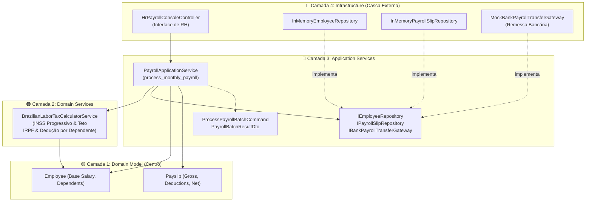

# Exemplo 02: Payroll Processing & Progressive Labor Taxes

## 1. Visão Geral e Contexto de Negócio

O cálculo de folha de pagamento corporativa envolve regras tributárias e previdenciárias complexas da legislação brasileira (CLT):
- **Cálculo Progressivo de INSS:** Alíquotas divididas em 4 faixas (7.5%, 9%, 12% e 14%) com teto máximo de contribuição compulsória (R$ 908,86).
- **Cálculo Progressivo de IRPF:** Dedução prévia do INSS recolhido e dedução legal por dependente (R$ 189,59 por dependente), seguida da aplicação da tabela progressiva da Receita Federal.
- **Desconto de Benefícios:** Coparticipação em vale-refeição limitada a 6% do salário base ou teto legal.
- **Emissão e Crédito em Conta:** Geração de lote bancário para transferência direta dos salários líquidos.

A **Onion Architecture** brilha aqui porque a fórmula tributária não pertence a nenhum framework web ou tabela de banco de dados. Ela reside no segundo anel da cebola como um **Domain Service** puro (`BrazilianLaborTaxCalculatorService`), acionado pelo **Application Service** em lote.

---

## 2. Diagrama das Camadas da Onion Architecture



---

## 3. Estrutura do Exemplo

```text
02-payroll-processing-system/
├── domain/
│   ├── model/
│   │   ├── employee.py               # Employee
│   │   ├── payslip.py                # Payslip
│   │   └── exceptions.py             # PayrollDomainException
│   └── services/
│       └── tax_calculator.py         # BrazilianLaborTaxCalculatorService (Domain Service)
├── application/
│   ├── interfaces.py                 # IEmployeeRepository, IPayrollSlipRepository, IBankGateway
│   ├── dto.py                        # ProcessPayrollBatchCommand, Result DTOs
│   └── payroll_service.py            # PayrollApplicationService
├── infrastructure/
│   ├── repositories.py               # InMemory Repositórios
│   ├── bank_gateway.py               # MockBankPayrollTransferGateway
│   └── hr_console_controller.py      # HrPayrollConsoleController
├── main.py                           # Composition Root da cebola
└── README.md                         # Documentação técnica
```

---

## 4. Cenários Demonstrados no `main.py`

1. **Fechamento em Lote:** Processamento mensal de múltiplos colaboradores em diferentes faixas salariais.
2. **Progressividade e Teto de INSS:** Colaboradores de nível Executivo e Especialista respeitando o teto máximo de R$ 908,86.
3. **Abatimento de Dependentes no IRPF:** Cálculo automático da base de cálculo deduzindo R$ 189,59 por dependente legal.
4. **Disparo de Lote Bancário:** Envio consolidado das ordens de pagamento para a casca de integração bancária.
5. **Auditoria Histórica:** Consulta e arquivamento dos holerites gerados.

---

## 5. Como Executar

```bash
python3 main.py
```
