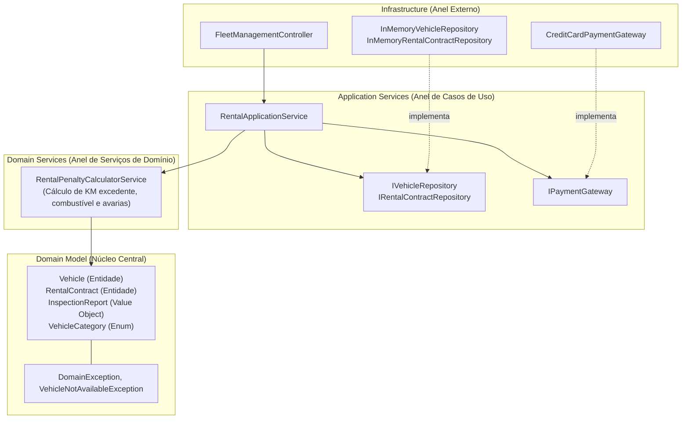

# Exemplo 03: Gestão de Frota e Locação de Veículos (Vehicle Rental Fleet Management)

Este exemplo demonstra a **Onion Architecture** aplicada ao domínio de locação de veículos e vistoria de devolução, onde o cálculo de penalidades por quilometragem excedente, reposição de combustível faltante e cobrança de avarias é isolado em um **Domain Service**, mantendo os modelos de domínio e regras de negócio no centro da aplicação.

---

## 🎯 O Domínio do Problema

Em empresas de locação de veículos (como Localiza ou Movida):
1. **Modelos de Domínio (`domain/model/`)**:
   - `Vehicle`: Mantém o estado físico e contratual do carro (placa, modelo, categoria, odômetro, nível de tanque e status `AVAILABLE`, `RENTED`, `MAINTENANCE`).
   - `RentalContract`: Modela o contrato, franquia diária de KM (ex: 200 km/dia), valores base e taxas extras apuradas.
   - `InspectionReport`: Value Object que encapsula a leitura de retorno (KM de devolução, combustível de devolução em oitavos `1/8..8/8` e lista de avarias).
2. **Domain Service (`domain/services/penalty_calculator.py`)**:
   - Orquestra regras puras de cálculo de penalidades comparando o estado contratual inicial com o relatório de vistoria física de entrega.
   - Calcula taxa de combustível faltante baseado na categoria do veículo.
   - Calcula custo de quilômetros rodados além da franquia.
   - Soma despesas de reparo de avarias detectadas.
3. **Application Services (`application/services/rental_service.py`)**:
   - Coordena abertura de locação e encerramento com vistoria.
   - Depende de interfaces abstratas (`IVehicleRepository`, `IRentalContractRepository`, `IPaymentGateway`).
4. **Infrastructure (`infrastructure/`)**:
   - Implementações concretas de repositórios em memória, gateway de pagamento e controlador de frota.

---

## 🧅 Diagrama de Arquitetura (Camadas Concêntricas)



---

## 📁 Estrutura de Arquivos

```
03-vehicle-rental-fleet-management/
├── domain/
│   ├── __init__.py
│   ├── model/
│   │   ├── __init__.py
│   │   ├── exceptions.py
│   │   ├── vehicle.py
│   │   ├── rental_contract.py
│   │   └── inspection_report.py
│   └── services/
│       ├── __init__.py
│       └── penalty_calculator.py
├── application/
│   ├── __init__.py
│   ├── dtos.py
│   ├── interfaces.py
│   └── rental_service.py
├── infrastructure/
│   ├── __init__.py
│   ├── in_memory_repositories.py
│   ├── payment_gateway.py
│   └── controller.py
├── main.py
└── README.md
```

---

## 🚀 Como Executar

Execute o comando a partir do diretório raiz do projeto:

```bash
python3 07-onion-architecture/03-vehicle-rental-fleet-management/main.py
```

### Cenários Validados no Teste:
1. **Abertura de Locação:** Aluguel de Jeep Renegade com débito antecipado das diárias base e transição de status do veículo para `RENTED`.
2. **Devolução Perfeita:** Devolução com tanque cheio e KM dentro da franquia — nenhuma penalidade cobrada.
3. **Devolução com Penalidades Múltiplas:** Veículo devolvido com 80 km excedentes, 3/8 de combustível faltante e avaria registrada no parachoque traseiro. O `RentalPenaltyCalculatorService` computa o breakdown detalhado e debita no cartão do cliente.
4. **Validação de Invariante de Domínio:** Tentativa de alugar veículo já locado resulta em `VehicleNotAvailableException` e resposta HTTP 400.
5. **Atualização da Frota:** Verificação de que o odômetro e combustível do veículo no pátio foram devidamente atualizados após a vistoria.
