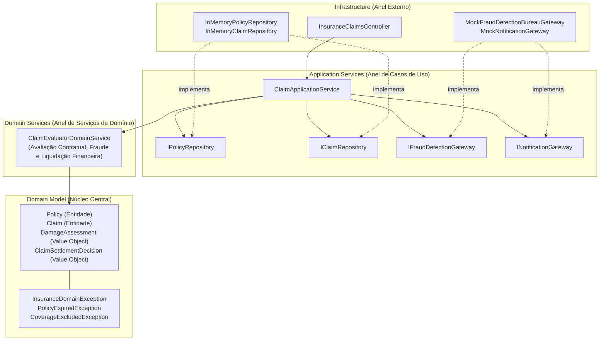

# Exemplo 04: Regulação e Validação de Sinistros de Seguros (Insurance Claim Regulation)

Este exemplo demonstra a aplicação da **Onion Architecture** em um sistema financeiro/securitário de **Regulação e Validação de Sinistros (Insurance Claims)**. O sistema coordena laudos periciais de danos, checagens de apólices, cálculo de franquias/teto indenizatório e detecção de fraudes.

---

## 🎯 O Domínio do Problema

No setor de seguros, a liquidação de sinistros envolve regras contratuais e periciais complexas:
1. **Modelos de Domínio (`domain/model/`)**:
   - `Policy`: Contrato de seguro com vigência, franquia dedutível, Limite Máximo de Indenização (LMI) e cláusulas de riscos expressamente excluídos.
   - `Claim`: O processo do sinistro com data da ocorrência, valor pleiteado e status (`SUBMITTED`, `UNDER_REVIEW`, `APPROVED`, `REJECTED`, `FRAUD_SUSPECTED`).
   - `DamageAssessment`: Relatório pericial/técnico com custo apurado do reparo, itens danificados e causa raiz (ex: colisão, incêndio, desgaste).
   - `ClaimSettlementDecision`: Value Object imutável com a decisão final, abatimentos de franquia e fundamentação legal.
2. **Domain Service (`domain/services/claim_evaluator.py`)**:
   - `ClaimEvaluatorDomainService`: Serviço de domínio puro (Ring 2).
   - Avalia a vigência temporal da apólice no dia exato do fato gerador.
   - Analisa se o evento está na lista de riscos excluídos (ex: desgaste natural por falta de manutenção).
   - Detecta anomalias de fraude (relação discrepante entre o pleiteado pelo segurado e o constatado na perícia técnica).
   - Calcula a indenização financeira líquida respeitando o teto da apólice e a franquia contratada:
     $$\text{Indenização} = \max(0, \min(\text{Prejuízo Periciado}, \text{LMI}) - \text{Franquia})$$
3. **Application Services (`application/`)**:
   - `ClaimApplicationService`: Orquestra os casos de uso de registro de aviso de sinistro e submissão de laudo pericial.
   - Comunica-se com repositórios e serviços externos via interfaces (`IPolicyRepository`, `IClaimRepository`, `IFraudDetectionGateway`, `INotificationGateway`).
4. **Infrastructure (`infrastructure/`)**:
   - Implementação em memória dos repositórios, mocks de birôs de análise de fraude e controladores REST/CLI.

---

## 🧅 Diagrama de Arquitetura (Camadas Concêntricas)



---

## 📁 Estrutura de Arquivos

```
04-insurance-claim-validation/
├── domain/
│   ├── __init__.py
│   ├── model/
│   │   ├── __init__.py
│   │   ├── exceptions.py
│   │   ├── damage_assessment.py
│   │   ├── policy.py
│   │   └── claim.py
│   └── services/
│       ├── __init__.py
│       └── claim_evaluator.py
├── application/
│   ├── __init__.py
│   ├── interfaces.py
│   ├── dtos.py
│   └── claim_service.py
├── infrastructure/
│   ├── __init__.py
│   ├── in_memory_repositories.py
│   ├── external_adapters.py
│   └── controller.py
├── main.py
└── README.md
```

---

## 🚀 Como Executar

Execute o comando a partir do diretório raiz:

```bash
python3 07-onion-architecture/04-insurance-claim-validation/main.py
```

### Cenários Validados no Teste:
1. **Sinistro Válido Aprovado:** Dano de R$ 12.000 com dedução de franquia de R$ 2.500 $\rightarrow$ Indenização líquida de R$ 9.500.
2. **Apólice Expirada:** Sinistro recusado imediatamente ao tentar cadastrar aviso para contrato fora da vigência.
3. **Causa Excluída:** Laudo pericial detecta "desgaste natural" de amortecedores $\rightarrow$ Sinistro recusado por exclusão de cobertura.
4. **Alerta de Fraude:** Cliente solicita R$ 50.000 para um arranhão leve avaliado em R$ 3.000 $\rightarrow$ Status alterado para `FRAUD_SUSPECTED` e encaminhado ao comitê de investigação.
5. **Dano Superior ao Teto Contratual:** Dano total de R$ 115.000 limitado ao teto da apólice (LMI de R$ 80.000) menos a franquia (R$ 4.000) $\rightarrow$ Indenização de R$ 76.000.
6. **Auditoria de Notificações:** Confirmação do disparo de avisos e deliberações ao segurado via gateway de infraestrutura.
