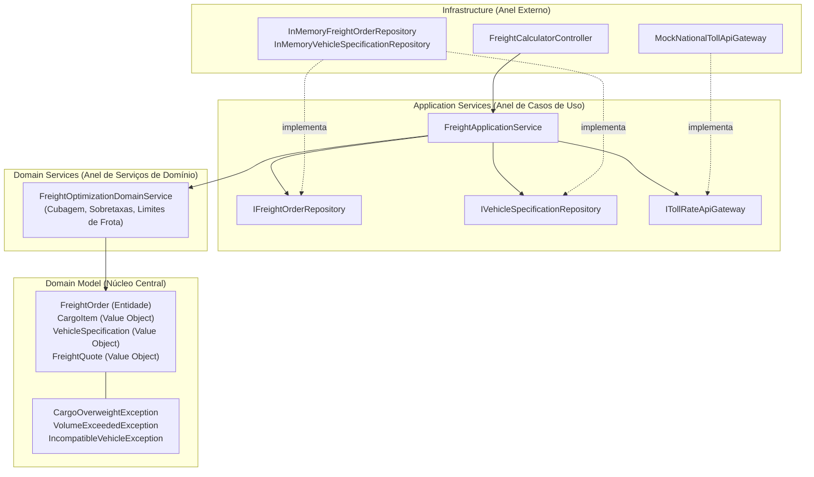

# Exemplo 05: Cálculo de Frete e Otimização Logística (Logistics Freight & Cubing Calculator)

Este exemplo demonstra a aplicação da **Onion Architecture** em um sistema logístico de transporte de cargas rodoviárias. O sistema encapsula cálculos matemáticos de **cubagem**, dimensionamento de capacidade de caminhões, cobrança de pedágios e sobretaxas regulatórias em um **Domain Service**, mantendo a integridade do domínio protegida contra detalhes de I/O.

---

## 🎯 O Domínio do Problema

No transporte rodoviário de cargas:
1. **Modelos de Domínio (`domain/model/`)**:
   - `CargoItem`: Value Object com dimensões lineares ($C \times L \times A$), volume cúbico ($m^3$), peso físico em kg, valor declarado e marcadores de fragilidade e periculosidade (MOPP).
   - `VehicleSpecification`: Value Object com especificações do tipo de caminhão (`VUC`, `TOCO`, `TRUCK`, `CARRETA`), peso máximo suportado, cubagem máxima e custo base por km.
   - `FreightOrder`: Entidade que representa o pedido de frete e sua máquina de estados (`QUOTED`, `CONFIRMED`, `IN_TRANSIT`, `DELIVERED`).
   - `FreightQuote`: Value Object com a decomposição analítica das tarifas de frete.
2. **Domain Service (`domain/services/freight_optimizer.py`)**:
   - `FreightOptimizationDomainService`: Serviço de domínio puro (Ring 2).
   - Calcula o **Peso Taxável (Cubado)**: $\text{Volume} \times 300\text{ kg/m}^3$ vs $\text{Peso Físico}$. O frete é sempre cobrado pelo maior dos dois.
   - Valida capacidade máxima de peso e cubagem do caminhão.
   - Impede o transporte de cargas perigosas em veículos sem licença/certificação.
   - Calcula adicionais de risco (GRIS / Seguro Ad-Valorem) e taxas de manuseio especial.
3. **Application Services (`application/`)**:
   - `FreightApplicationService`: Coordena a geração da cotação consultando APIs externas de pedágio através de portas abstratas (`ITollRateApiGateway`) e persiste pedidos em `IFreightOrderRepository`.
4. **Infrastructure (`infrastructure/`)**:
   - Repositórios em memória, simulação de gateway de tarifas de concessionárias de pedágio e controller REST.

---

## 🧅 Diagrama de Arquitetura (Camadas Concêntricas)



---

## 📁 Estrutura de Arquivos

```
05-logistics-freight-calculator/
├── domain/
│   ├── __init__.py
│   ├── model/
│   │   ├── __init__.py
│   │   ├── exceptions.py
│   │   ├── cargo_item.py
│   │   ├── vehicle_capacity.py
│   │   ├── freight_quote.py
│   │   └── freight_order.py
│   └── services/
│       ├── __init__.py
│       └── freight_optimizer.py
├── application/
│   ├── __init__.py
│   ├── interfaces.py
│   ├── dtos.py
│   └── freight_service.py
├── infrastructure/
│   ├── __init__.py
│   ├── in_memory_repositories.py
│   ├── toll_gateway.py
│   └── controller.py
├── main.py
└── README.md
```

---

## 🚀 Como Executar

Execute o comando a partir do diretório raiz:

```bash
python3 07-onion-architecture/05-logistics-freight-calculator/main.py
```

### Cenários Validados no Teste:
1. **Carga Densa e Pesada:** Bobinas de aço de 8.500 kg onde o peso físico prevalece sobre o volume reduzido.
2. **Carga Volumosa de Baixa Densidade (Cubagem):** Lote de colchões pesando apenas 950 kg, porém ocupando 21.12 m³. O peso tributável é corrigido pelo fator de cubagem para 6.336 kg.
3. **Sobrecarga de Peso:** Bloqueio imediato com `CargoOverweightException` ao tentar embarcar 16.500 kg em caminhão com teto de 14.000 kg.
4. **Incompatibilidade Regulatória:** Recusa ao tentar alocar carga química em veículo urbano (VUC) sem licença MOPP.
5. **Cotação Longa Especial e Despacho:** Carreta articulada entre SP e Salvador (1.950 km) com transporte de produtos inflamáveis e frágeis, computando pedágios de 14 praças, taxa de seguro e confirmação do pedido.
