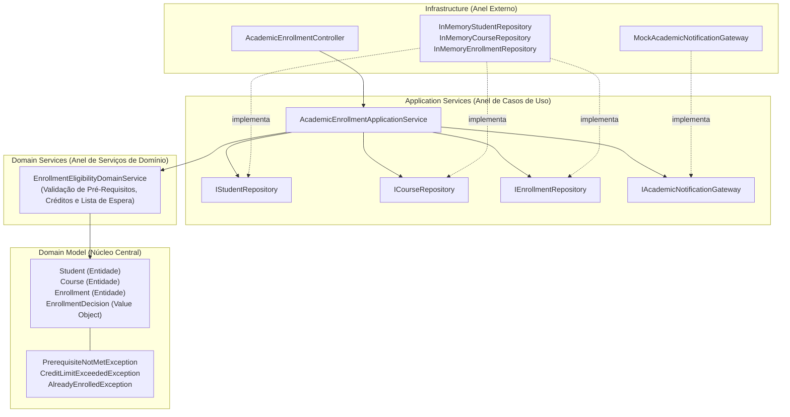

# Exemplo 06: Matrícula Universitária e Validação de Pré-Requisitos (Educational Course Enrollment)

Este exemplo demonstra a aplicação da **Onion Architecture** no domínio de gestão acadêmica universitária. O sistema orquestra regras de negócio para matrícula em disciplinas, encadeamento de pré-requisitos curriculares, limites semestrais de créditos e gestão de lista de espera (waitlist) em turmas com vagas esgotadas.

---

## 🎯 O Domínio do Problema

Em sistemas acadêmicos universitários (como SIGAA, Banner ou Canvas):
1. **Modelos de Domínio (`domain/model/`)**:
   - `Student`: Entidade do estudante, contendo seu histórico de disciplinas já cursadas e aprovadas (`completed_course_ids`), contagem de créditos atuais e teto semestral de créditos (`max_semester_credits`).
   - `Course`: Entidade da disciplina com código, ementa, créditos, capacidade de vagas em sala de aula e conjunto de pré-requisitos obrigatórios (`prerequisite_ids`).
   - `Enrollment`: Entidade do vínculo contratual de matrícula (`CONFIRMED`, `WAITLISTED`, `DROPPED`).
   - `EnrollmentDecision`: Value Object imutável emitido pelo Domain Service contendo o status da solicitação, créditos atribuídos e justificativas acadêmicas.
2. **Domain Service (`domain/services/enrollment_validator.py`)**:
   - `EnrollmentEligibilityDomainService`: Serviço de domínio puro (Ring 2).
   - Valida se o aluno já concluiu a matéria no passado ou já está ativo nela no semestre corrente.
   - Verifica se todas as matérias que constituem a árvore de pré-requisitos foram cumpridas.
   - Garante que a nova matéria não fará o aluno ultrapassar o teto máximo de créditos do semestre.
   - Verifica se há vagas regulares na turma: caso esteja lotada, decide pelo posicionamento automático na lista de espera (`WAITLISTED`).
3. **Application Services (`application/`)**:
   - `AcademicEnrollmentApplicationService`: Orquestra casos de uso de matrícula e trancamento/cancelamento, delegando a inteligência para o Domain Service e persistindo nos repositórios.
4. **Infrastructure (`infrastructure/`)**:
   - Repositórios em memória de estudantes, disciplinas e matrículas, gateway de notificações do portal acadêmico e controlador REST.

---

## 🧅 Diagrama de Arquitetura (Camadas Concêntricas)



---

## 📁 Estrutura de Arquivos

```
06-educational-course-enrollment/
├── domain/
│   ├── __init__.py
│   ├── model/
│   │   ├── __init__.py
│   │   ├── exceptions.py
│   │   ├── course.py
│   │   ├── student.py
│   │   └── enrollment.py
│   └── services/
│       ├── __init__.py
│       └── enrollment_validator.py
├── application/
│   ├── __init__.py
│   ├── interfaces.py
│   ├── dtos.py
│   └── enrollment_service.py
├── infrastructure/
│   ├── __init__.py
│   ├── in_memory_repositories.py
│   ├── notification_gateway.py
│   └── controller.py
├── main.py
└── README.md
```

---

## 🚀 Como Executar

Execute o comando a partir do diretório raiz do repositório:

```bash
python3 07-onion-architecture/06-educational-course-enrollment/main.py
```

### Cenários Validados no Teste:
1. **Matrícula Regular Válida:** Estudante caloura matricula-se em disciplina introdutória sem pré-requisitos (Cálculo I).
2. **Rejeição por Pré-Requisito:** Bloqueio imediato com `PrerequisiteNotMetException` ao tentar cursar Cálculo II sem ter aprovação em Cálculo I.
3. **Matrícula com Pré-Requisito Concluído:** Estudante veterano com Cálculo I concluído consegue se matricular em Cálculo II.
4. **Bloqueio de Teto de Créditos:** Rejeição com `CreditLimitExceededException` quando a inclusão de uma disciplina de 6 créditos faria a estudante ultrapassar o teto de 24 créditos semestrais.
5. **Turma Esgotada & Lista de Espera:** Quando a turma esgota sua capacidade regular, o Domain Service aprova a inscrição alocando o aluno automaticamente em status `WAITLISTED` sem onerar seus créditos regulares.
6. **Trancamento de Matrícula:** Trancamento da disciplina com restituição integral dos créditos ao estudante e liberação de vaga.
7. **Notificações:** Disparo automático de confirmações para o portal acadêmico do aluno.
