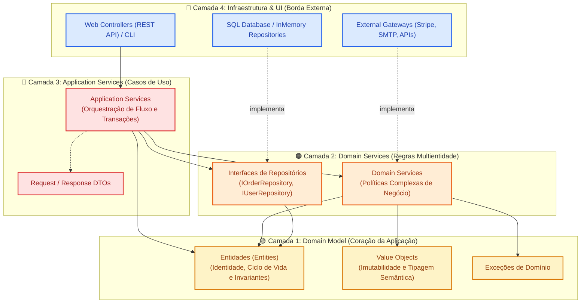

# 🧅 Onion Architecture (Arquitetura Cebola)

> Proposta por Jeffrey Palermo em 2008, a Onion Architecture inverte a hierarquia tradicional de camadas: o banco de dados deixa de ser o alicerce do sistema e passa a ser empurrado para a casca externa. No centro absoluto repousa o **Modelo de Domínio**, protegido por anéis concêntricos de serviços e isolado de qualquer tecnologia ou framework externo.

---

## 📖 1. O que é e Origem Histórica

Durante os anos 2000, o modelo de arquitetura em 3 camadas tradicional (*Presentation $\to$ Business Logic $\to$ Data Access*) apresentava uma fraqueza estrutural crônica: **todas as camadas dependiam da camada de dados**. Mudanças no esquema SQL ou no ORM propagavam alterações em cascata até as regras de negócio.

Em **2008, Jeffrey Palermo** publicou a **Onion Architecture**, fundamentada em quatro princípios arquiteturais:

1. **A aplicação é construída em torno de um Modelo de Domínio independente.**
2. **As camadas internas definem contratos abstratos (interfaces); as camadas externas implementam esses contratos.**
3. **A direção das dependências de código-fonte aponta exclusivamente para o centro.**
4. **Todo código de infraestrutura e acesso a dados reside na borda externa (a "casca" da cebola).**

```text
+--------------------------------------------------------------------+
|  Infrastructure / UI / Tests / External Services (Borda Externa)    |
|   +------------------------------------------------------------+   |
|   |  Application Services (Orquestração de Fluxos e Casos)    |   |
|   |   +----------------------------------------------------+   |   |
|   |   |  Domain Services (Lógicas Multientidade e Políticas)|   |   |
|   |   |   +--------------------------------------------+   |   |   |
|   |   |   |  Domain Model (Entidades, VOs, Invariantes)|   |   |   |
|   |   |   +--------------------------------------------+   |   |   |
|   |   +----------------------------------------------------+   |   |
|   +------------------------------------------------------------+   |
+--------------------------------------------------------------------+
```

---

## 🧅 2. As Quatro Camadas da Cebola

### 1. 🟡 Centro: Domain Model (Modelo de Domínio)
- Contém **Entidades**, **Value Objects**, **Enums** e **Exceções de Domínio**.
- Representa o estado do negócio e seus invariantes imutáveis.
- **Zero dependências externas.** Não importa bibliotecas, frameworks nem camadas superiores.

### 2. 🟠 Segundo Anel: Domain Services (Serviços de Domínio)
- Contém regras de negócio puras que envolvem **múltiplas entidades** ou operações conceituais que não pertencem naturalmente a uma única entidade.
- Define as **interfaces de repositórios** (`IRepository`) e contratos de serviços de infraestrutura que o domínio necessita.
- Depende exclusivamente do *Domain Model*.

### 3. 🔴 Terceiro Anel: Application Services (Serviços de Aplicação)
- Orquestra os casos de uso do sistema (carregar entidades via repositório, invocar serviços de domínio, persistir resultados e disparar eventos).
- Mapeia parâmetros de entrada e devolve DTOs de resposta.
- Não contém regras de negócio corporativas (apenas regras de fluxo/orquestração).
- Depende de *Domain Services* e *Domain Model*.

### 4. 🔵 Casca Externa: Infrastructure & UI (Infraestrutura)
- Implementações concretas de repositórios (SQL, SQLAlchemy, em memória, NoSQL).
- Controladores Web (FastAPI, Flask), consoles CLI, integrações com APIs externas de pagamento, emissão de notas ou envio de e-mails.
- Conecta-se às camadas internas utilizando **Injeção de Dependências (Composition Root)**.

---

## 📊 3. Diagrama Conceitual da Arquitetura (Mermaid)



---

## 🔄 4. Comparativo: Onion vs Hexagonal vs Clean Architecture

Embora compartilhem a Inversão de Controle e o isolamento do domínio, cada padrão possui ênfases estruturais distintas:

| Característica | 🔷 Hexagonal Architecture | 🧅 Onion Architecture | 🏛️ Clean Architecture |
|---|---|---|---|
| **Criador & Ano** | Alistair Cockburn (2005) | Jeffrey Palermo (2008) | Robert C. Martin (2012) |
| **Metáfora Central** | Portas e Adaptadores (Inbound vs Outbound) | Anéis concêntricos de cebola em torno do Domínio | 4 Círculos com Regra de Dependência estrita |
| **Estrutura Interna do Domínio** | Não prescreve subdivisão (o Core é uma caixa preta) | **Prescreve explicitamente:** Domain Model $\to$ Domain Services $\to$ Application Services | Entities $\to$ Use Cases $\to$ Interface Adapters |
| **Camada de Apresentação** | Driver Adapter genérico | UI na casca externa | Controller + Presenter com ViewModel desacoplada |
| **Foco Principal** | Testabilidade e múltiplos adaptadores I/O | Alinhamento com Domain-Driven Design (DDD) | Independência total de frameworks e UI |

---

## 🔒 5. Regras Invariantes (O que NUNCA fazer)

1. **O Domínio NUNCA importa Infraestrutura:**
   - Classes em `domain/` ou `domain_services/` jamais podem conter `import sqlalchemy`, `import sqlite3` ou chamar clientes HTTP.
2. **Interfaces pertencem às camadas internas:**
   - O contrato `IReservationRepository` é definido no anel de domínio/aplicação. A classe `SqlReservationRepository` na infraestrutura apenas a implementa.
3. **Application Services NÃO contêm regras corporativas:**
   - Se o cálculo depende de regras fiscais, taxas ou regras de negócio, essa lógica pertence ao `Domain Model` ou a um `Domain Service`, nunca ao `Application Service`.
4. **Dependências fluem em direção centrípeta (para dentro):**
   - Um anel interno nunca tem conhecimento da existência dos anéis exteriores.

---

## 📁 6. Índice dos 6 Exemplos Práticos

Cada exemplo abaixo foi implementado seguindo rigorosamente a estrutura em anéis concêntricos (`domain/model/`, `domain/services/`, `application/`, `infrastructure/`):

| Pasta | Domínio de Aplicação | Regra Crítica no Domain Service | Destaque Arquitetural |
|---|---|---|---|
| [`01-hotel-room-reservation/`](./01-hotel-room-reservation/) | **Reservas de Hotel & No-Show** | Política dinâmica de diárias sazonais e cancelamento | Separação entre Domain Service e Application Service |
| [`02-payroll-processing-system/`](./02-payroll-processing-system/) | **Folha de Pagamento & Encargos** | Cálculo progressivo atuarial de INSS e IRPF | Entidades puras e motor tributário isolado |
| [`03-vehicle-rental-fleet-management/`](./03-vehicle-rental-fleet-management/) | **Locadora de Veículos & Vistoria** | Vistoria de avarias, combustível e quilometragem excedente | Agregado de locação com regras de devolução |
| [`04-insurance-claim-validation/`](./04-insurance-claim-validation/) | **Sinistros de Seguro Auto** | Avaliação de franquia, cobertura de apólice e detecção de fraude | Regras de apólice encapsuladas no domínio |
| [`05-logistics-freight-calculator/`](./05-logistics-freight-calculator/) | **Cálculo de Fretes Rodoviários** | Cubagem, restrição de peso por eixo e pedágios | Algoritmo de cubicagem puro em Domain Service |
| [`06-educational-course-enrollment/`](./06-educational-course-enrollment/) | **Matrícula Universitária** | Validação de pré-requisitos cursados e conflitos de horário | Validação de histórico acadêmico pelo domínio |

---

<div align="center">
  <sub>Navegue pelas pastas acima para inspecionar os anéis de código e executar os cenários de teste.</sub>
</div>
