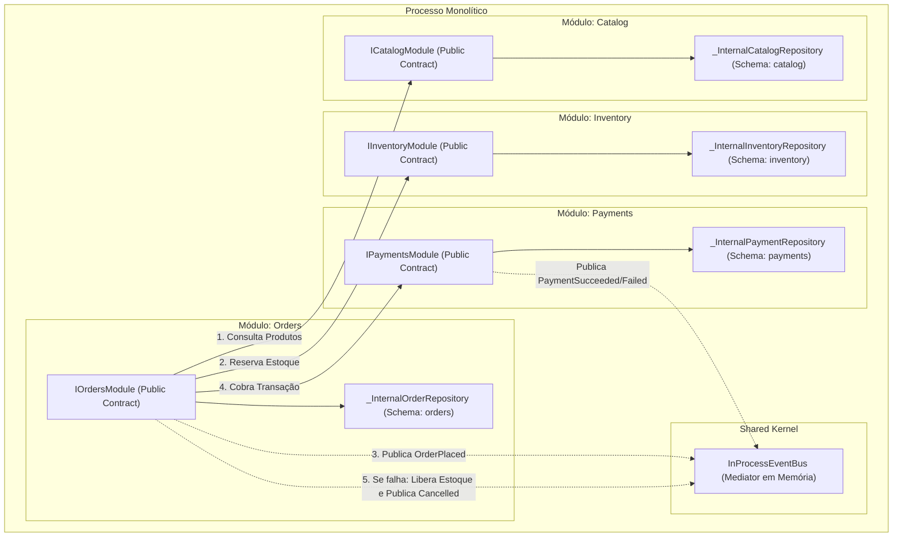

# Exemplo 01: E-Commerce Modular ERP

Este exemplo demonstra os princípios fundamentais da **Modular Monolith Architecture** aplicados a um ERP de comércio eletrônico, composto pelos módulos:
- **`Catalog`**: Catálogo de produtos, precificação e status de ativação.
- **`Inventory`**: Controle físico de estoque, bloqueio temporário de reservas e baixa definitiva.
- **`Payments`**: Gateway de processamento de cobranças (cartão, Pix) e emissão de eventos financeiros.
- **`Orders`**: Orquestrador de pedidos que interage exclusivamente com as APIs públicas dos módulos adjacentes.
- **`Shared Kernel`**: Barramento de eventos em memória (`InProcessEventBus`) que permite reatividade e compensação sem acoplamento direto.

---

## 🎯 Regras de Isolamento de Módulo

1. **Acesso Exclusivo via Contratos Públicos:** Nenhum módulo importa arquivos de pastas `internal/` de outros módulos. Por exemplo, `Orders` consome `IInventoryModule` e `ReserveStockItem`, sem ter acesso a `_InternalStockItem` ou `_InternalInventoryRepository`.
2. **Isolamento de Dados:** Cada módulo gerencia seu próprio repositório em memória simulando schemas distintos de banco de dados (`catalog`, `inventory`, `orders`, `payments`).
3. **Consistência e Compensação Reativa:** Quando uma tentativa de pagamento falha, o módulo `Orders` publica o evento `OrderCancelledDomainEvent` e comanda a liberação do estoque reservado (`release_stock`), mantendo a consistência do sistema.

---

## 🏛️ Diagrama de Módulos e Interações (Mermaid)



---

## 📁 Estrutura de Pastas

```
01-ecommerce-modular-erp/
├── shared/
│   ├── __init__.py
│   └── events.py
├── modules/
│   ├── catalog/
│   │   ├── __init__.py
│   │   ├── public_contracts.py
│   │   ├── catalog_module.py
│   │   └── internal/
│   │       └── catalog_internal.py
│   ├── inventory/
│   │   ├── __init__.py
│   │   ├── public_contracts.py
│   │   ├── inventory_module.py
│   │   └── internal/
│   │       └── inventory_internal.py
│   ├── payments/
│   │   ├── __init__.py
│   │   ├── public_contracts.py
│   │   ├── payments_module.py
│   │   └── internal/
│   │       └── payments_internal.py
│   └── orders/
│       ├── __init__.py
│       ├── public_contracts.py
│       ├── orders_module.py
│       └── internal/
│           └── orders_internal.py
├── main.py
└── README.md
```

---

## 🚀 Como Executar

Execute o comando a partir da raiz do repositório:

```bash
python3 08-modular-monolith/01-ecommerce-modular-erp/main.py
```

### Cenários Validados no Teste:
1. **Pedido Válido e Faturado (Happy Path):** Produtos consultados no catálogo, estoque reservado com sucesso, pagamento autorizado e estoque baixado permanentemente.
2. **Estoque Insuficiente:** Tentativa de comprar quantidade superior à disponível resulta em rejeição atômica antes de qualquer cobrança financeira.
3. **Compensação por Pagamento Recusado:** Quando o cartão é recusado, o módulo de pedidos reverte a reserva de estoque e publica `OrderCancelledDomainEvent` no barramento em memória.
4. **Produto Inexistente:** Bloqueio rápido ao solicitar SKU não cadastrado.
5. **Auditoria de Eventos:** Exibição da trilha completa de eventos de domínio que trafegaram na memória RAM durante a execução.
