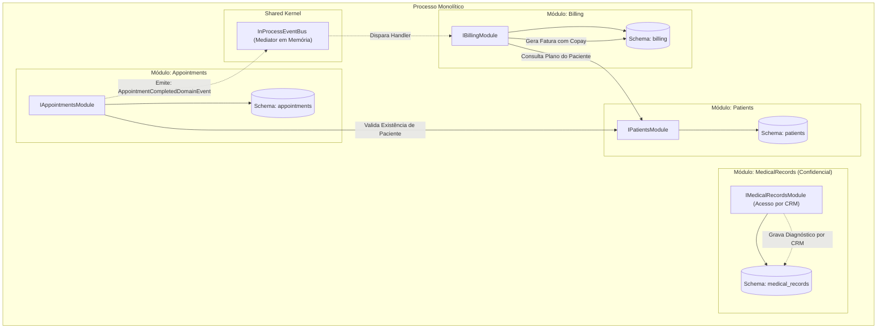

# Exemplo 02: Gestão de Clínica de Saúde e Prontuários (Healthcare Clinic Management)

Este exemplo demonstra a aplicação da **Modular Monolith Architecture** em um sistema médico-hospitalar onde a privacidade de dados (LGPD / HIPAA) exige que o prontuário clínico seja estritamente isolado da recepção e do faturamento.

---

## 🎯 Bounded Contexts e Separação de Responsabilidades

1. **`Patients` (Cadastro e Convênios):** Gerencia a identidade civil do paciente e plano de saúde contratado.
2. **`Appointments` (Agendamento de Consultas):** Controla agenda médica, horários e ciclo de vida da consulta (`SCHEDULED`, `COMPLETED`, `CANCELLED`).
3. **`MedicalRecords` (Prontuário Médico Eletrônico Confidencial):** Armazena anamneses, diagnósticos CID-10 e prescrições medicamentosas. O acesso é estritamente restrito a médicos com CRM ativo, impedindo que a recepção ou o setor de faturamento tenham visibilidade sobre dados clínicos sensíveis.
4. **`Billing` (Faturamento e Coparticipação):** Escuta de forma reativa e desacoplada (`InProcessEventBus`) o evento de conclusão de atendimento para calcular valores de convênio (80%) e coparticipação do paciente (20%).

---

## 🏛️ Diagrama de Módulos e Interações (Mermaid)



---

## 📁 Estrutura de Pastas

```
02-healthcare-clinic-management/
├── shared/
│   ├── __init__.py
│   └── events.py
├── modules/
│   ├── patients/
│   │   ├── __init__.py
│   │   ├── public_contracts.py
│   │   ├── patients_module.py
│   │   └── internal/
│   │       └── patients_internal.py
│   ├── appointments/
│   │   ├── __init__.py
│   │   ├── public_contracts.py
│   │   ├── appointments_module.py
│   │   └── internal/
│   │       └── appointments_internal.py
│   ├── medical_records/
│   │   ├── __init__.py
│   │   ├── public_contracts.py
│   │   ├── medical_records_module.py
│   │   └── internal/
│   │       └── medical_records_internal.py
│   └── billing/
│       ├── __init__.py
│       ├── public_contracts.py
│       ├── billing_module.py
│       └── internal/
│           └── billing_internal.py
├── main.py
└── README.md
```

---

## 🚀 Como Executar

Execute o comando a partir do diretório raiz do repositório:

```bash
python3 08-modular-monolith/02-healthcare-clinic-management/main.py
```

### Cenários Validados no Teste:
1. **Cadastro de Pacientes:** Inscrição com convênio (Unimed) e particular.
2. **Agendamento de Consulta:** Marcação com médico e valor contratual.
3. **Registro Confidencial de Prontuário:** Inclusão de anamnese e CID-10 por médico autorizado.
4. **Faturamento Automático Reativo:** Conclusão da consulta dispara evento que gera fatura com rateio correto entre convênio e coparticipação.
5. **Barreira de Segurança (LGPD / HIPAA):** Tentativa de acesso ao prontuário médico por usuário sem CRM resulta em bloqueio imediato com `PermissionError`.
6. **Consulta Particular:** Atendimento particular gera fatura com 100% de cobrança ao paciente.
