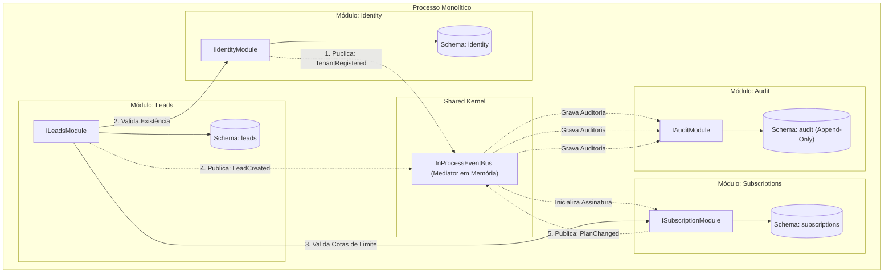

# Exemplo 03: SaaS Multi-Tenant CRM

Este exemplo demonstra a **Modular Monolith Architecture** aplicada a uma plataforma SaaS multitenant de CRM, organizada em quatro módulos com alta coesão e baixo acoplamento:
- **`Identity`**: Cadastro e ciclo de vida de tenants corporativos e usuários administradores.
- **`Subscriptions`**: Catálogo de planos (`STARTER`, `PRO`, `ENTERPRISE`), precificação e controle dinâmico de cotas de recursos.
- **`Leads`**: Pipeline comercial e cadastro de oportunidades, submetido a verificações de limites contratuais.
- **`Audit`**: Trilha imutável (append-only) de auditoria que consome todos os eventos de segurança e negócio via mediator intra-processo.

---

## 🎯 Bounded Contexts e Isolamento Multitenant

1. **Gestão de Cotas por Contrato:** O módulo de `Leads` não possui regras de faturamento nem dados de cartão de crédito. Ele apenas invoca o contrato público `ISubscriptionModule.can_create_lead(tenant_id, current_count)` para checar se a cota do tenant permite novas inserções.
2. **Reatividade na Criação de Tenants:** Quando um novo tenant é cadastrado no módulo `Identity`, o evento `TenantRegisteredDomainEvent` é publicado e os módulos `Subscriptions` e `Audit` reagem sem necessidade de acoplamento direto no código de cadastro.
3. **Auditoria Centralizada Desacoplada:** O módulo `Audit` escuta eventos do monólito e armazena registros protegidos para compliance e segurança.

---

## 🏛️ Diagrama de Módulos e Interações (Mermaid)



---

## 📁 Estrutura de Pastas

```
03-saas-multitenant-crm/
├── shared/
│   ├── __init__.py
│   └── events.py
├── modules/
│   ├── identity/
│   │   ├── __init__.py
│   │   ├── public_contracts.py
│   │   ├── identity_module.py
│   │   └── internal/
│   │       └── identity_internal.py
│   ├── subscriptions/
│   │   ├── __init__.py
│   │   ├── public_contracts.py
│   │   ├── subscriptions_module.py
│   │   └── internal/
│   │       └── subscriptions_internal.py
│   ├── leads/
│   │   ├── __init__.py
│   │   ├── public_contracts.py
│   │   ├── leads_module.py
│   │   └── internal/
│   │       └── leads_internal.py
│   └── audit/
│       ├── __init__.py
│       ├── public_contracts.py
│       ├── audit_module.py
│       └── internal/
│           └── audit_internal.py
├── main.py
└── README.md
```

---

## 🚀 Como Executar

Execute o comando a partir do diretório raiz:

```bash
python3 08-modular-monolith/03-saas-multitenant-crm/main.py
```

### Cenários Validados no Teste:
1. **Onboarding de Tenant:** Cadastro de empresa no plano Starter com inicialização reativa de assinatura.
2. **Uso Dentro da Cota:** Criação de leads respeitando o limite do plano.
3. **Bloqueio por Quota Exceeded:** Tentativa de criar lead além da capacidade do plano dispara exceção sem corromper o estado do banco.
4. **Upgrade de Plano:** Migração de STARTER para PRO libera imediatamente capacidade adicional de leads.
5. **Auditoria Unificada:** Extração do histórico cronológico de eventos ocorridos no tenant.
