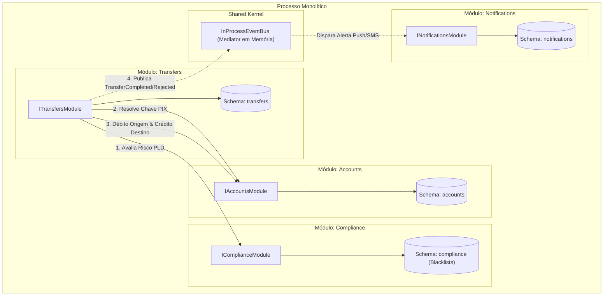

# Exemplo 04: Carteira Digital Fintech (Fintech Digital Wallet & PIX)

Este exemplo demonstra a **Modular Monolith Architecture** em uma fintech de meios de pagamento, onde a liquidação de transferências instantâneas (PIX) é desacoplada de controles regulatórios bancários de conformidade (Compliance / PLD / BACEN).

---

## 🎯 Bounded Contexts e Separação de Módulos

1. **`Accounts` (Contas e Saldos):** Gerencia abertura de contas, chaves PIX (DICT), débito e crédito atômicos de saldo com proteção contra saldo negativo.
2. **`Compliance` (Prevenção à Lavagem de Dinheiro - PLD / COAF):** Avalia listas de sanções (blacklist de chaves fraudulentas), monitora transações atípicas de grande porte e emite pareceres de conformidade sem tocar em saldos ou bancos de dados de contas.
3. **`Transfers` (Orquestrador PIX):** Coordena a transação: valida o compliance, resolve a chave PIX, comanda o débito na origem e crédito no destino, e emite eventos de sucesso ou rejeição.
4. **`Notifications` (Comunicação Multicanal):** Escuta reativamente os eventos do barramento em memória (`InProcessEventBus`) para disparar comprovantes via Push ou alertas de segurança via SMS.

---

## 🏛️ Diagrama de Módulos e Interações (Mermaid)



---

## 📁 Estrutura de Pastas

```
04-fintech-digital-wallet/
├── shared/
│   ├── __init__.py
│   └── events.py
├── modules/
│   ├── accounts/
│   │   ├── __init__.py
│   │   ├── public_contracts.py
│   │   ├── accounts_module.py
│   │   └── internal/
│   │       └── accounts_internal.py
│   ├── compliance/
│   │   ├── __init__.py
│   │   ├── public_contracts.py
│   │   ├── compliance_module.py
│   │   └── internal/
│   │       └── compliance_internal.py
│   ├── transfers/
│   │   ├── __init__.py
│   │   ├── public_contracts.py
│   │   ├── transfers_module.py
│   │   └── internal/
│   │       └── transfers_internal.py
│   └── notifications/
│       ├── __init__.py
│       ├── public_contracts.py
│       ├── notifications_module.py
│       └── internal/
│           └── notifications_internal.py
├── main.py
└── README.md
```

---

## 🚀 Como Executar

Execute o comando a partir do diretório raiz:

```bash
python3 08-modular-monolith/04-fintech-digital-wallet/main.py
```

### Cenários Validados no Teste:
1. **Transferência PIX Concluída com Sucesso:** Verificação de compliance aprovada, débito na origem, crédito no destino e emissão de comprovante push.
2. **Bloqueio por Sanção/Blacklist:** Tentativa de envio para chave classificada como fraudulenta pelo módulo Compliance impede a saída de fundos e emite SMS de alerta.
3. **Quarentena Regulatória COAF:** Transações de valor muito elevado (R$ 60.000) são bloqueadas para averiguação manual de PLD.
4. **Proteção de Saldo Insuficiente:** Débito bloqueado atômica e seguramente quando a conta não possui fundos suficientes.
5. **Auditoria de Notificações:** Exibição do histórico de mensagens e canais utilizados (Push, SMS).
